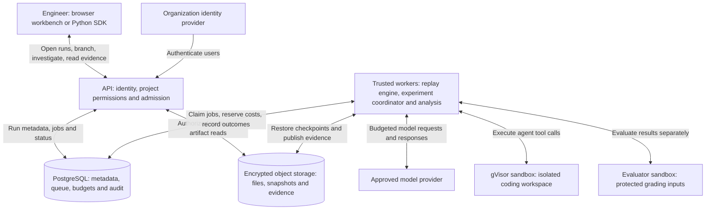
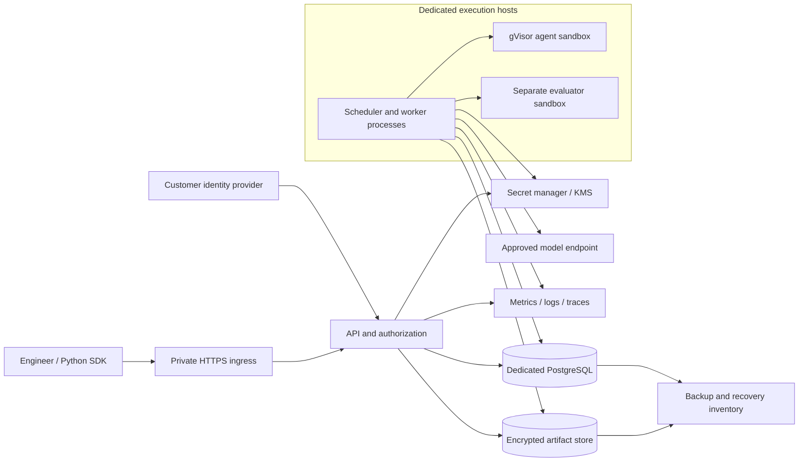
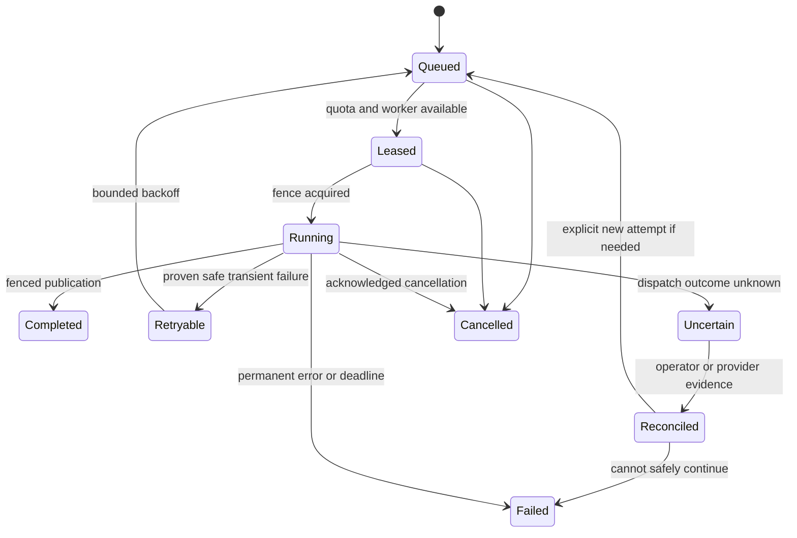
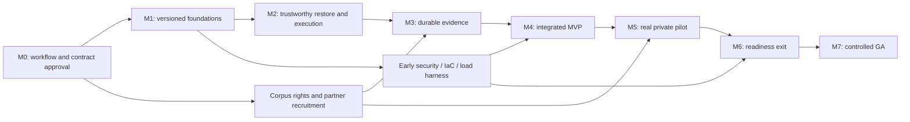

# Agent Rewind — enterprise product and engineering roadmap

**Current delivery checkpoint — 2026-10-22:** HTTP P2 and AR-008 remain Verified at cefd222. Ledger F1 [PR #111](https://github.com/spei04/agent-rewind/pull/111) is **Merged; checkpoint accepted** at 2e0eeeab after exact PR/main checks and candidate verification. Ledger P1 #108, aggregate #107 and parent #10 remain **In progress** with null P1 acceptance. F2 complete persisted reader is **Merged; checkpoint accepted** at e8cba52 after reviewed source ac3b0a31, PR/main attempts 39780954252/39786131008 and verified candidate 12431486551. F3 trusted provisioning/opening/replay/recovery is **In progress** under the explicit 2026-10-22 handoff, beginning with the shared-check kernel; its acceptance remains null. The earlier failed main attempt 39773689705/1 and interrupted candidate verification are retained separately. P2 #109 stays Not started/null acceptance. See [accepted F2 evidence](delivery/LEDGER_EXECUTION_PLAN.md#accepted-f2-reader-and-f3-handoff--2026-10-22) for source, runs, candidate and retained failed history. Totals: **151 tasks / 161 planned PRs / 544 outer edges; 30 Verified / 1 In progress / 120 Not started tasks; 9 Verified / 1 In progress / 5 Not started delivery packages**. Customer, production and spending gates are unchanged.

**Document owner:** spei04 · **Revision:** 2026-10-22 · **State:** Execution backlog approved; staged delivery in progress
**Implementation baseline:** `8f1ae757005c95c50a789e4fa0a10aae9b3c4024` · **Delivery clock:** Day 1 begins after execution-backlog approval (E0) and staffing confirmation; runtime implementation also requires G0.

This is the authoritative product/architecture roadmap and milestone progress document; the requested [execution backlog](EXECUTION_BACKLOG.md) contains assignable task cards and the validated task-level schedule. It fills the product, architecture, delivery, security, operations, and governance brief in one file. Existing technical documents describe the current release; proposed behavior below is not implemented unless explicitly marked verified. No production deployment, enterprise certification, customer adoption, or capacity benchmark is implied by this plan.

## Contents

1. [Context, assumptions, and progress](#1-context-assumptions-and-progress)
2. [Product requirements and user journeys](#2-product-requirements-and-user-journeys)
3. [Architecture and decision records](#3-architecture-and-decision-records)
4. [Data model, APIs, and execution contracts](#4-data-model-apis-and-execution-contracts)
5. [Capacity, performance, and economics](#5-capacity-performance-and-economics)
6. [Security, privacy, and reliability](#6-security-privacy-and-reliability)
7. [Research and evaluation program](#7-research-and-evaluation-program)
8. [Milestones and delivery schedule](#8-milestones-and-delivery-schedule)
9. [Team ownership and parallel work](#9-team-ownership-and-parallel-work)
10. [Prioritized engineering backlog](#10-prioritized-engineering-backlog)
11. [Testing and release quality](#11-testing-and-release-quality)
12. [Delivery and operations](#12-delivery-and-operations)
13. [Traceability, risks, and governance](#13-traceability-risks-and-governance)
14. [Launch gates and progress log](#14-launch-gates-and-progress-log)

## 1. Context, assumptions, and progress

### 1.1 Product context

Agent Rewind helps engineers find interventions that improve a failed coding-agent run. An engineer opens a recorded run, inspects a decision boundary, changes an action or tool observation, and compares fresh continuations against unchanged controls. Automatic investigation proposes promising intervention points; independent confirmation measures whether the selected intervention helps reliably.

The product offers auditable intervention experiments: reliable execution boundaries, useful-location proposals, honest uncertainty, and a path from a finding to an agent regression test. Automatic intervention, repeated replay and confidence intervals already appear in prior work; they are not established research novelty. The research hypothesis is that an experiment-selection policy can find more independently confirmed repairs under the same total budget. No superiority has been demonstrated. Distinguish a successful example, an effect conditional on one failed run, and a result that generalizes across tasks.

| Context | Confirmed fact or planning assumption |
| --- | --- |
| Objective | Build a production product useful to frontier labs and startups operating coding agents. |
| Repository | Public personal repository [spei04/agent-rewind](https://github.com/spei04/agent-rewind); existing MIT license. |
| Existing implementation | Python/FastAPI service, PostgreSQL jobs, encrypted artifacts, Docker/gVisor runner, Python SDK, browser workbench. |
| Working environment | Authoritative source and private validation evidence are in the existing Google Cloud workspace. Development location does not establish a production deployment. |
| Accepted initial deployment | Self-hosted, one organization per deployment, dedicated metadata database and artifact store, dedicated Linux gVisor workers. No connection to an adopter's production application database. |
| Initial execution scope | Controlled sequential Python coding agent; workspace files and serialized policy state; offline tools and independent evaluator. |
| Model integration | Existing model provider adapter and private worker credential. Provider versions and rates are configuration, not hardcoded product assumptions. |
| Spending authorization | Initial model validation cap: $200. Historical reservations: $36.567974, leaving $163.432026 under that cap before any later expenditure. These are conservative reservations, not an invoice. Reconcile before further paid experiments. |
| Team | Unknown. Planning scenario: six core engineers plus shared product/security support; see Section 9. No hires or availability are assumed confirmed. |
| Launch date | Not committed. Earlier week-number windows are superseded by the task-level review; first ten working days are conditional, later scheduling is milestone-based until staffing, throughput and external dependencies are known. |
| Capacity and customers | No verified customer demand or production load. Baseline, forecast, and stress assumptions are defined separately in Section 5. |
| Compliance and data | Assume confidential source code and proprietary traces. Regulated personal/health/payment data and jurisdiction requirements require customer-specific review before ingestion. No compliance claim. |
| Infrastructure budget | Not established. This plan proposes a cost model; it does not authorize recurring cloud spend, staffing, or procurement. |

### 1.2 Current implementation evidence

Source inspected on 2026-10-19 at the baseline above. Historical test results below are from the published validation record, not a fresh execution of those tests during planning.

| Capability | Status | Evidence and material limitation |
| --- | --- | --- |
| Workspace checkpoints, action/result branches, parent immutability | Implemented; historical automated verification | [engine.py](../agent_rewind/engine.py), [workspace.py](../agent_rewind/workspace.py), [engine tests](../tests/test_engine.py). No process-memory or external-system restoration. |
| Bounded execution and hidden evaluator files | Implemented; historical Linux integration verification | [runner.py](../agent_rewind/runner.py), [Docker tests](../tests/test_docker.py). gVisor tested in CI; live model validation used development runc. Adversarial grader integrity remains unproven. |
| Automatic ranking, frozen winner, confirmation and missing outcomes | Implemented; narrow live verification | [experiments.py](../agent_rewind/experiments.py), [statistics.py](../agent_rewind/statistics.py), [VALIDATION.md](VALIDATION.md). A deliberately injected early stop yielded 0/8 control versus 8/8 treatment. No natural-failure benchmark. |
| OIDC/PKCE, roles, scoped API keys, encrypted artifacts | Implemented; fixture verification | [auth.py](../agent_rewind/auth.py), [artifacts.py](../agent_rewind/artifacts.py). No customer IdP exercise, online key rotation, project-level isolation, or production storage validation. |
| PostgreSQL claims, lease fences, budget reservations | Implemented; historical concurrency verification | [database.py](../agent_rewind/database.py), [PostgreSQL tests](../tests/test_postgres.py). Worker loss terminates jobs; studies execute serially; no resumable trial scheduler. |
| Browser debugger, comparison, report export, Python client | Implemented; initial integration verification | [web](../agent_rewind/web/), [sdk.py](../agent_rewind/sdk.py). Limited navigation/search, no full framework integration or fleet administration. |
| CI and packaging | Implemented; historical passing checks | [workflow](../.github/workflows/ci.yml), [validation CI](https://github.com/spei04/agent-rewind/actions/runs/37415445488). 48 core and 3 gVisor tests reported; not a security audit or scale certification. |
| Production operations and enterprise readiness | Not verified | No demonstrated IaC deployment, HA/DR exercise, migration lifecycle, retention/GC, production SLOs, external penetration test, or real customer pilot. |

### 1.3 Progress conventions

Use **Not started**, **In progress**, **Blocked**, **Implemented / verification pending**, and **Verified**. A checked box means its stated acceptance evidence exists. Historical implementation is not retroactively marked enterprise-ready. Milestone completion requires all exit gates, not just merged code. Each implementation change updates its task row, requirement row, and dated evidence log in this file. No fabricated overall percentage.

Current planning work: blueprint and M0/M1 packet published; execution review now covers all 52 packages as 151 bounded tasks with dependencies, contracts, tests and conditional daily scheduling. Section 10 links the execution ledger. E0 and development-scope G0 are satisfied; explicit migration, offline reference configuration and secure CI are verified. Runtime guards and actual synthetic recovery are verified; ownership and safe readiness are verified; RA-01 audit/protocol design is verified for its bounded internal scope; issue #51 core engineering choices are approved and mapped; see [ASSIGNMENTS.md](ASSIGNMENTS.md). Later runtime, production and partner-data gates remain evidence-dependent.

### 1.4 Decisions still requiring confirmation

Planning can proceed with the assumptions above. G0 records three lead-selected contributor slots, reviewed workflows and the migration-first development scope. Production staffing, launch constraints, acceptable regions/data classes and operating budget remain external gate inputs before provisioning/pilot. Before any pilot, confirm who operates the installation, approved model processors, network egress policy, retention contract, and named incident contacts. These are release dependencies, not reasons to stop writing the blueprint.

### 1.5 Staged delivery workflow

The product is delivered through four stages. The broad blueprint remains the roadmap; all milestones now have bounded task specifications, while future contracts are authored/reviewed by explicit producer tasks before their implementation consumers start. Stage 2 outputs for M1 are reviewed. [G0_DECISION.md](delivery/G0_DECISION.md) records the approved development/test first slice under existing execution authority; production-specific funding, region, data and release gates remain separate.

| Stage | Required output and review | Current state / transition |
| --- | --- | --- |
| 1 — Plan and challenge | Inspect source, identify unknowns, compare architecture options, record assumptions/risks and challenge the roadmap. | Planning artifact and execution backlog approved for staged development on 2026-10-19. M0 decision issues retain the unresolved external assumptions. |
| 2 — Engineer the next milestone | Detailed GitHub issues, native dependency links, versioned API/data contracts, failure-oriented acceptance cases and milestone exit gates. | Execution packet prepared: 151 aggregate tasks and 161 planned delivery PRs across M0–M7, 27 gates, 20 contract entries and conditional M1 continuation scheduling; M0/M1 parent issues remain tracked and issues #47/#48 track approved research design. Ownership/readiness child issues #40/#41 are closed. Future contracts and implementation still require their producer/approval gates. |
| 3 — Implement approved slices | One coherent vertical slice at a time with tests, independent review, safe diagnostics, recovery notes and updated progress. | G0 development scope, migration/guard/recovery, ownership/readiness, scoped artifacts/publication, run projection and AR-007-C existing-route authority are Verified for bounded preparatory scope. Remaining M1 work shares three contributor slots; exact producer gates still govern starts and activation. |
| 4 — Verify production readiness | Audit actual requirements against commit-specific test, load, security, deployment and recovery evidence; record pass, fail, not tested, or accepted scoped risk. | Not started. Begin evidence collection with each slice; perform independent readiness review before pilot/GA. A roadmap, contract file, or closed issue is not production proof. |

Do not rerun the entire planning exercise for each change. Maintain this file as the authority for stage/milestone status and link to the relevant issues and contracts. For a slice to advance, the engineer records behavior before/after, acceptance results, reviewer disposition, deployment/recovery impact and any gaps. An unreviewed change cannot be called reviewed; unavailable load/security/deployment evidence cannot be called passing.

## 2. Product requirements and user journeys

### 2.1 Vision, users, and measurable outcomes

The primary customer is an engineering or research team shipping a coding agent with an executable success criterion and access to reproducible task environments. The buyer is the agent platform or engineering lead; daily users are agent engineers, researchers, and evaluation engineers. Security administrators and platform operators control deployment, access, and resource limits.

| Journey | User problem and required outcome | Proposed success measure |
| --- | --- | --- |
| Diagnose a failure | Engineer imports or records a compatible run, sees why a checkpoint can be restored, and investigates a ranked decision. | At least 80% of a predeclared supported-workload pilot sample can be captured and restored without core-code changes. Report incompatible runs separately. |
| Test an intervention | Engineer edits one action/result, sees both actual and observed effects, compares branches without altering the source. | All contract tests preserve parent hashes and reproduce the specified boundary; no hidden side-effect replay. |
| Establish evidence | Researcher freezes a candidate and protocol, runs controlled trials, inspects failures and uncertainty. | Every reported effect links to immutable protocol, attempts, evaluator identity, and missing-outcome accounting. |
| Improve the agent | Engineer exports an investigation as a regression case and tests a policy change on held-out tasks. | Two design partners use the workflow weekly for four weeks; both adopt a resulting regression or policy fix. A third partner is a separately planned expansion. Targets, not current customers. |
| Operate safely | Administrator sets projects, access, quotas, retention, and processor policy; operator restores service after failure. | No authorization or budget invariant violation; restore and on-call gates pass before enterprise launch. |

A pilot should measure time from opening a failed run to a reviewed intervention report against the team's prior workflow. Target a 50% reduction in median engineer investigation time on at least 20 investigations, paired where possible; record selection, uncertainty, and incomplete investigations. This is a product target, not an existing result or a promise that every failure has a useful intervention.

### 2.2 Scope

**Production MVP / private pilot:** one organization per isolated installation; project-scoped authorization; controlled Python environments; two supported policy integrations including the native adapter; immutable state/provenance; manual branching; automatic location ranking; resumable paired experiments; bounded parallel trials; complete cost ledger; readable evidence UI; SSO; retention/deletion; managed secrets; install/upgrade/backup/restore; metrics and on-call ownership. This is the minimum deployable product, beyond the existing initial release.

**Enterprise GA:** demonstrated forecast capacity, four-week operating evidence, tested regional recovery, independent security review, policy administration, audited exports, customer integration/support documentation, reproducible releases, compatibility guarantees, and natural-failure evaluation with held-out tasks. SCIM is required if a launch customer needs automated provisioning; otherwise documented IdP group synchronization and rapid deprovisioning must satisfy the access gate.

**Post-GA, demand-gated:** additional languages/frameworks, customer-operated remote execution plane, shared SaaS tenancy, larger workspaces, brokered network tools, experiment portfolios, and learned location ranking. Each needs its own contract and evidence gate.

**Out of scope for the first enterprise release:** arbitrary memory snapshots; automatic rollback of production databases or external writes; unconstrained internet access; arbitrary uploaded worker plugins; transparent branching of any historical trace; model training; a general observability replacement; global active-active scheduling; and automatic deployment of agent fixes to customer systems.

### 2.3 Requirements and acceptance stories

Priority **P0** blocks a private pilot; **P1** blocks enterprise GA; **P2** is conditional post-GA work. Detailed implementation mapping is in Section 13.

| ID / priority | User story and why it matters | Acceptance criteria |
| --- | --- | --- |
| R01 / P0 | As an engineer, capture a real agent run with enough state to resume it. | Versioned adapter contract; all tool effects classified; policy/image/evaluator identities recorded; unsupported state produces a machine-readable reason rather than a branchable claim. |
| R02 / P0 | Inspect and fork the exact decision that interests me. | Stable decision IDs, before/after files, actual/observed results, immutable parent, action/result fork contracts; keyboard-accessible UI. |
| R03 / P0 | Receive useful intervention suggestions without treating a heuristic as proof. | Ranked locations with reasons and proposal provenance; unchanged negative control; no hidden evaluator source in discovery context. |
| R04 / P0 | Measure the effect of a fixed intervention. | Persisted protocol and winner before confirmation; independent trial set; randomized arm order; complete attempts/missingness; interval and scope displayed. |
| R05 / P0 | Continue long studies after worker loss without silently doubling spend. | Durable trial/attempt state, fenced publication, unique logical call IDs, explicit ambiguous outcomes, safe retry policy, cancellation and budget invariants under crash tests. |
| R06 / P0 | Run untrusted agent code without exposing infrastructure. | Dedicated gVisor workers, no sandbox credentials/network/host mounts, resource caps, tested denial of escape paths, evaluator trust boundary. |
| R07 / P0 | Keep each project's confidential traces accessible only to authorized people. | Resource-scoped checks on every API/export/cache path; project roles and service identities; negative authorization tests; single-organization deployment boundary. |
| R08 / P0 | Retain, rotate keys, export, and delete evidence predictably. | Dependency-aware retention, legal-hold handling, deletion tombstones/receipts, live key rotation, tested restore including deletion replay. |
| R09 / P0 | Control cost before an experiment starts and explain it afterward. | Organization/project/study reservations are atomic; every proposal/continuation/evaluation call has ledger entries; observed usage separate from reservations and invoices. |
| R10 / P0 | Integrate an existing coding agent without rewriting the product. | Native adapter plus one partner-selected Python adapter; conformance suite; working SDK capture/branch/study/export; tracing-only imports visibly nonbranchable. |
| R11 / P0 | Install, upgrade, observe, and recover the product. | Repeatable staging install, versioned schema migration, dashboards/runbooks, backup restore, secret/IdP/storage integration tests, no API Docker privilege. |
| R12 / P1 | Trust throughput and service availability at the purchased capacity. | Forecast and stress load reports, SLO dashboard, saturation/backpressure tests, fair project scheduling, regional recovery exercise. |
| R13 / P1 | Decide whether findings generalize to my agent workloads. | Predeclared natural-failure corpus, task-level held-out evaluation, calibrated uncertainty/null tests, cost-matched baselines and error analysis. |
| R14 / P1 | Share defensible evidence and operate enterprise access. | Permission-checked evidence bundles, audited downloads, admin workflows, lifecycle of users/service accounts, signed release identity, customer support and incident process. |
| R15 / P2 | Use more execution boundaries or deployment models. | Separate capability definitions and security review for each extension; no broadened guarantee inferred from basic support. |

## 3. Architecture and decision records

### Architecture at a glance

In the target system, each installation serves one organization. The boxes below are logical responsibilities; the API and trusted worker processes share a modular Python codebase, rather than requiring a separate service for every box. This is the intended architecture, not a statement that every component has passed production acceptance. The execution backlog tracks implementation and verification.

| Core component | Plain-language responsibility |
| --- | --- |
| Workbench and SDK | Open a failed run, inspect decisions, change an action or tool observation, and compare branches and reports. |
| API and identity | Check who is asking and which project they can access; validate and admit work; return bounded results and cancellation status. |
| PostgreSQL | Own durable run/branch relationships, job leases, experiment phases, budget reservations, artifact references and audit records. The queue lives here initially. This is Agent Rewind's database; customer application databases are outside the system. |
| Experiment coordinator and selection policy | Choose which checkpoint/intervention to investigate next within the permitted protocol and budget; schedule unchanged controls and candidate trials; freeze the selected intervention before independent confirmation. |
| Replay worker and provider adapter | Restore the saved workspace and serialized agent state, apply the permitted intervention, request model decisions, dispatch validated tool calls and record outcomes and costs. Model credentials stay in the trusted execution boundary. |
| gVisor runner | Execute untrusted agent code and tools with bounded CPU, memory and time. Sandboxes have no direct access to the model provider, platform database or secrets, and network access is disabled in the initial scope. |
| Separate evaluator | Score a resulting workspace in a separate execution environment. It also executes candidate code and is treated as untrusted, with the same network and credential restrictions. The agent sandbox does not receive protected grading inputs; grader integrity and evaluator validity remain separate verification gates. |
| Encrypted artifact storage | Keep immutable workspace contents, snapshot manifests, serialized policy state, event bodies and report artifacts. PostgreSQL stores their authorized references and integrity identities. A checkpoint covers supported files and serialized state, not arbitrary process memory or external services. |
| Comparison and evidence analysis | Compare trajectories and outcomes, distinguish discovery from confirmation, and report uncertainty, incomplete trials and full costs. A completed job alone is not evidence of a successful repair. |

**How one investigation moves through the system:**

1. **Capture and inspect.** A supported adapter records the original run's tool calls, actual and observed results, and checkpoints. The worker stores encrypted bodies and publishes their metadata references. The engineer opens the resulting timeline through the API. An imported trace without sufficient restore state can be viewed but cannot be replayed.
2. **Choose and admit.** The engineer selects an intervention, or the experiment coordinator proposes one. The API checks project access and admission rules; durable jobs, protocol identity and budget reservations are recorded in PostgreSQL before execution.
3. **Restore and run.** A worker claims a job, restores the selected checkpoint into an isolated workspace and applies the intervention. It calls the model provider through the trusted adapter and runs the resulting tool actions inside gVisor. Each branch starts from its own restored state.
4. **Evaluate and publish.** The separate evaluator scores the result. Workers upload immutable evidence before publishing its references, outcomes and cost receipts under the current job lease. A lost worker or ambiguous provider response leaves an explicit incomplete or uncertain attempt for reconciliation.
5. **Confirm and compare.** Once discovery selects an intervention, the coordinator freezes it and schedules fresh confirmation trials under the reviewed protocol. Analysis reports repair effects separately from overall task recovery. The API serves the branch comparison, uncertainty and cost report back to the engineer.

**Supporting target services and boundaries:** Secret Manager/KMS supplies trusted services with credentials and encryption keys; untrusted sandboxes receive neither. Redacted metrics, logs and traces observe the API and workers. Backup and recovery procedures cover the database, referenced objects, required key access and deletion records together. Private ingress and project authorization protect access; budgets, leases and cancellation constrain execution. The detailed deployment topology and component ownership follow below.

### 3.1 System boundaries and target topology

Keep a modular Python application and independently scalable trusted workers. Separate the customer/browser trust boundary, privileged execution hosts, hostile sandbox processes, external model provider, and data stores. The platform stores its own metadata; customer application databases are outside this architecture.

No edge from a sandbox to the provider, database, cloud metadata endpoint, or secret manager is allowed. Initially workers are trusted for their entire organization; per-project authorization does not isolate one project from a compromised worker. Customers needing internal hard isolation receive separate installations or worker/storage credentials with a separately tested boundary.

**Recommended reference deployment, pending approval:** Google Cloud because development already uses it; Cloud Run for the stateless API, Cloud SQL PostgreSQL with regional HA, native Cloud Storage artifacts, Secret Manager/KMS, and dedicated Compute Engine worker groups running Docker/runsc. Add a native object-store adapter rather than assuming the current S3 implementation supports Cloud Storage. Keep local and S3 adapters for existing adopters; do not claim tested support on another cloud until its release matrix passes.

Private HTTPS ingress must use an explicitly configured internal load-balancer/serverless integration and supported customer connectivity. Direct VPC egress connects API instances to private resources; it does not itself make ingress private. Verify DNS, IdP redirects, startup probes, and denied public ingress in staging. [Cloud Run network documentation](https://docs.cloud.google.com/run/docs/configuring/vpc-direct-vpc).

Development uses disposable fixtures and the existing checkout. Staging and production have separate cloud projects/accounts, databases, buckets, keys, IdP clients, provider budgets, and identities. Production cannot run on the development VM. A zone failure should preserve API/metadata access; interrupted agent work resumes only through the durable attempt protocol. Regional disaster recovery is an explicit restore/failover procedure, not an active-active promise.

### 3.2 Component ownership

| Component | Responsibility and state | Must not do |
| --- | --- | --- |
| API / identity | Validate requests, authenticate/authorize, admit jobs, serve bounded read models, audit access. Stateless sessions except revocation/access metadata. | Execute submitted code, own Docker access, or hold model credentials. |
| Scheduler / study coordinator | Persist protocol, freeze candidates, create trial pairs, admission/fairness and reconcile attempts. Same deployable initially, separate worker role. | Infer success from job completion or regenerate a selected candidate during resume. |
| Policy worker | Restore state, request model decisions, validate outputs, reserve spend, call runner, publish fenced events. | Trust model instructions as platform authority or silently switch models mid-study. |
| Runner / evaluator | Enforce environment contract, bounded execution, snapshots, cleanup, grade in separate environment. | Restore unsupported external state or permit agent access to grading secrets. |
| Metadata store | Transactions, jobs/attempts, authorization, immutable references, searchable bounded summaries. | Store raw prompts, files, credentials, or full traces in general-purpose logs. |
| Artifact store | Immutable encrypted bodies, manifests, integrity verification, retention graph, export material. | Expose unauthenticated object paths or deduplicate across customer deployments. |
| Research library | Versioned estimators, diagnostics, location strategies, benchmark reporting. | Overstate causality or hide missing trials. |
| Workbench / SDK | Explain compatible states, propose changes, display comparisons/evidence, expose cancellation and quota reasons. | Render untrusted HTML or treat a heuristic score as a measured probability. |

### 3.3 Architecture decision records

These inline ADRs are proposed recommendations unless marked retained. Each includes a reconsideration trigger; moving it to another file is unnecessary for this plan.

| ADR | Decision, rationale, alternatives | Trade-off, cost, limit, and replacement trigger |
| --- | --- | --- |
| ADR-01 — Deployment boundary | Retain one organization per installation through GA. Prefer private customer infrastructure with optional operator-managed dedicated installation. Alternative: shared SaaS from day one. | Duplicated control-plane cost per customer buys simpler isolation/residency. Revisit shared SaaS only after at least three customers require it and a dedicated tenant-isolation milestone passes. |
| ADR-02 — Application structure | Retain FastAPI, SQLAlchemy, Python modules and independent workers. Alternative: microservices or a language rewrite. | Low migration cost; Python remains orchestration, not sandbox trust. Split a service only when measured scaling/availability or ownership needs cannot be met with process roles. |
| ADR-03 — Durable execution | Retain PostgreSQL transactional queue, add normalized trials/attempts, outbox, bounded leases, and an explicit state machine. Alternatives: managed queue, Temporal. | One durable authority avoids cross-system commit ambiguity. DB write/lease load is the ceiling. Revisit an orchestration engine for multi-day external workflows or queue p95 claim latency above 100 ms after indexing/batching at forecast load. A migration must preserve paid-call uncertainty. |
| ADR-04 — Schema lifecycle | Introduce Alembic revisions and expand/backfill/contract migration discipline. Keep typed SQLAlchemy models and JSON only for versioned payloads. | Adds migration maintenance but removes dependence on create_all. Replace generic JSON lookups for hot paths when adding queryable fields; avoid an all-at-once rewrite. |
| ADR-05 — Sandbox | Retain dedicated Linux gVisor/runsc hosts and offline sandboxes. Alternatives: plain runc, managed sandbox service, microVMs. | Host operation and compatibility overhead; API stays unprivileged. gVisor narrows host-kernel exposure but does not eliminate host, side-channel, or application risks. Use separate microVM/managed pool only for a demonstrated compatibility or isolation need and rerun conformance/security tests. [Security model](https://gvisor.dev/docs/architecture_guide/intro/). |
| ADR-06 — State | Retain tool-boundary filesystem plus complete serialized policy state. Alternatives: transparent process/VM snapshot, log-only replay. | Lower complexity and portable evidence; excludes long-lived processes and unmanaged services. A new snapshot type requires a versioned capability contract and evaluator for restoration fidelity. |
| ADR-07 — Storage and keys | Retain encrypted content-addressed objects; add backend-neutral adapter and KMS-wrapped data keys with key IDs. Use organization-local deduplication. | KMS requests, object operations and storage are cost drivers. Manifest caching/batched access precedes a storage rewrite. Separate integrity digest from authorization and object locator; do not make plaintext hash a cross-tenant existence oracle. [Envelope encryption](https://docs.cloud.google.com/kms/docs/envelope-encryption). |
| ADR-08 — Experiment protocol | Retain fixed screening, frozen winner, independent confirmation; add task-level generalization evaluation. Alternatives: single replay, naive adaptive stopping. | More executions and latency buy interpretable evidence. Adaptive experiments require an explicit statistically valid protocol/version; no dashboard-driven early declaration. |
| ADR-09 — Reference cloud | Propose Cloud Run API, Cloud SQL, Cloud Storage, dedicated GCE workers, IaC. Alternative: all-VM install or Kubernetes. | Managed control plane reduces operational work; native storage integration is new work. A customer-required cluster install or measured scheduling need justifies a Kubernetes package; not required for initial throughput. |
| ADR-10 — Frontend | Retain the existing browser surface initially; add typed API contracts, bounded timeline views, accessible components and browser tests. Alternative: immediate React rewrite. | Lowest disruption. Adopt a component framework only when branch graph/state complexity or maintenance evidence justifies it; preserve contracts and workflows through the migration. |
| ADR-11 — Observability | Add structured redacted logs and OpenTelemetry instrumentation exported to the deployment's existing backend. Alternative: proprietary telemetry schema or a new analytics database. | Request volume/retention determine cost. No raw trace payloads in telemetry; cardinality bounded. Add analytical storage only when reporting workloads demonstrably harm transactional SLOs. |
| ADR-12 — Network tools | Keep sandbox network disabled through MVP/GA. Future external tools use a broker with operation allowlists, recorded inputs/results and side-effect classification. | Restricts supported tasks but protects reproducibility and credentials. Never replay external writes automatically. Demand for real network-dependent tasks triggers a separate design/security milestone. |

## 4. Data model, APIs, and execution contracts

### 4.1 Schema and ownership

The current schema contains generic `records`, `events`, `jobs`, `api_keys`, and `audit` tables. Introduce typed read/query fields incrementally without rewriting immutable historical payloads. Preserve original IDs, event digests, and schema-version readers. The database is the authority for publication, authorization and scheduling; the object store is the authority for immutable payload bytes.

| Proposed entity | Required fields and invariants | Owner |
| --- | --- | --- |
| Organization / project / membership | Installation organization ID; project ID; subject/service identity; role and policy version. Exactly one organization enabled per installation through GA. | API / identity |
| Run | Project, task/environment/policy/evaluator digests, parent run and fork boundary, state, capability flags, final event head, timestamps. Composite project references prevent cross-project lineage. | Execution |
| Decision / checkpoint | Run, monotonic step, pre-state and post-workspace refs, proposed/executed action, actual/observed result refs, previous event hash, schema version. Unique `(run_id, step)`; committed bodies never overwritten. | Execution |
| Study / candidate / protocol | Source run, candidate and protocol digests, proposal version, planned sample counts, estimator version, frozen-at time, selected candidate, stopping policy. Confirmation cannot mutate these fields. | Research |
| Trial pair / arm / attempt | Study, phase, pair ID, randomized order, arm, logical execution ID, attempt number, lease epoch, status, run ID, failure class. Unique logical arm; all attempts retained. | Execution / scheduler |
| Job / outbox | Project, kind, payload ref, state, available-at, deadline, owner, monotonic fence, retry policy, priority, terminal reason. Transactional outbox only for later external notifications. | Backend |
| Provider call / budget ledger | Logical call and attempt IDs, purpose including discovery, request digest, dispatch state, provider request ID if available, configured price version, reserved/estimated/reconciled micro-USD, usage, uncertainty. | Execution / finance controls |
| Artifact / reference edge | Organization/project scope, opaque locator, encrypted data-key ref, integrity digest, bytes, backend, lifecycle generation, reference owner, deletion state. Dedup only within authorized boundary. | Storage |
| API key / session / audit | Hashed token or session ID, resource scope, expiry/revocation, actor, action, target, result, correlation ID; no secret bodies. | Identity / security |
| Retention / deletion / release | Policy and hold IDs, dependency closure, tombstone/receipt, backup cutoff; release/build/schema IDs and evidence refs. | Platform / security |

Use foreign keys and unique constraints for relationships and logical operations; require project scope in repository methods and database constraints. Row-level security can provide defense in depth for project separation but is not a substitute for endpoint checks or a shared-SaaS security design. Initial indexes: project/time/ID lists, jobs `(state, available_at, priority, id)`, attempts by study/phase/pair/arm, artifact reference owner, and audit project/time. Paginate by stable `(created_at, id)` cursors. Add time partitioning only after measured retention/query pressure.

### 4.2 Publication, consistency, and lifecycle

1. Validate and authorize input; allocate an idempotent operation identity and reserve admission quota.
2. Write encrypted immutable objects; confirm object write and digest before publishing references in a database transaction. A failed transaction may leave unreferenced objects, never a successful visible reference to an unconfirmed upload.
3. Atomically publish metadata, ledger changes, event head, and outbox entries under the current lease fence. Readers observe committed boundaries only.
4. Resume from the last committed boundary; classify any dispatched-but-uncommitted model or tool operation as uncertain. Offline tool execution may be repeated only from an immutable pre-state under a new attempt; preserve uncertainty about model billing.
5. Cache only immutable decoded manifests or bounded pages. Authorization is checked before cache access; cache keys include organization/project and policy version where relevant. No cache is authoritative for budgets, revocation, or job state. Do not introduce Redis initially.

Object store consistency does not provide a transaction with PostgreSQL; retain this publish-before-reference design even when the backend offers strong consistency. [Cloud Storage consistency guarantees](https://docs.cloud.google.com/storage/docs/consistency).

**Provisional retention defaults:** raw traces and workspace bodies 30 days; study summaries/protocols 90 days; security audit events 365 days; encrypted backups 35 days. These require customer approval and storage sizing. Study evidence pins its referenced raw objects until its retention/hold expires; the UI shows this effective retention, which can exceed 30 days. Never expire parent objects independently of live branch references.

Deletion is an authorized asynchronous operation: calculate descendants and references, reject/resolve legal holds, tombstone access immediately, cancel relevant work, remove or retain explicitly selected dependents, then collect unreferenced objects. Mark-and-sweep uses a stable generation, a grace interval of at least 48 hours, and a second reference check before deletion. Race tests cover new forks and unfinished uploads. Backups age out under the disclosed schedule; restored systems replay an independently retained deletion journal before access reopens. A receipt distinguishes active-store deletion from pending backup expiry. Private support bundles receive a review date and separate access policy.

### 4.3 API and adapter contracts

Current routes remain as documented in [api.py](../agent_rewind/api.py). Introduce `/api/v1` with versioned OpenAPI/schema snapshots, SDK compatibility checks, and an announced legacy transition. The following contracts are proposed; they are not available in the current server.

| Contract | Request / result and guarantees |
| --- | --- |
| `POST /api/v1/projects/{id}/runs` | Task/environment refs, adapter config ID, budget in integer micro-USD, client operation ID. Requires project operator and `Idempotency-Key`; returns `202` with operation/job IDs. |
| `POST /api/v1/runs/{id}/branches` | Boundary ID, intervention kind/payload, expected parent digest, budget. Reject missing state, changed identity, unbranchable source, or unauthorized project before enqueue. |
| `POST /api/v1/runs/{id}/investigations` | Candidate policy/version, screening plan, confirmation plan, concurrency cap and total budget. Persist a draft protocol; freeze winner before confirmation. |
| `GET /api/v1/runs/{id}/events` | Cursor, bounded limit (default 50, max 200), summary/body expansion. Returns events, next cursor, immutable head; never loads every payload to list metadata. |
| `GET /api/v1/studies/{id}` | Separate protocol, planned/completed/missing counts, attempt states, effect interval, limits, and ledger totals; links to paginated trial data. |
| `POST /api/v1/jobs/{id}/cancel` | Idempotent cancellation intent; returns current state and outstanding calls. Does not promise to undo provider billing. |
| `POST /api/v1/studies/{id}/resume` | Explicit reconciliation decision for uncertain attempts, expected protocol digest, budget check. No silent duplicate confirmation sampling. |
| `POST /api/v1/exports` and `DELETE /api/v1/runs/{id}` | Authorized asynchronous jobs; export manifest/access expiry/audit; deletion plan/hold/descendant treatment/receipt. No public share links by default. |

Error envelope: `code`, safe `message`, `request_id`, `retryable`, and optional structured `details` without payloads/secrets. Distinguish `checkpoint_unavailable`, `identity_mismatch`, `budget_exhausted`, `provider_uncertain`, `quota_exceeded`, `lease_lost`, and `retention_hold`. Use 401 for absent/invalid credentials, 403 for forbidden operations where disclosure is safe, 404 for inaccessible object IDs, 409 for state/idempotency conflicts, 413 for size, 422 for invalid schema, and 429 with Retry-After for admission throttles.

Idempotency is scoped to principal/project/operation and canonical request digest. Same key and body returns the same operation; changed body returns 409. Retain records for the operation lifetime plus at least 90 days and publish expiry semantics. Clients must not reuse operation IDs. Idempotent API submission does not make a third-party inference request exactly once.

Adapter contract v2 declares state schema, identity, supported tools, checkpoint capability, deterministic-environment assumptions, evaluator compatibility, and external-effect classification. Add adapter conformance fixtures before framework integration. Imported telemetry without full restore state is viewable but nonbranchable. Trusted, reviewed adapters are deployed by operators; the API never imports arbitrary user-specified Python modules into a worker. Model integration exposes capabilities such as seed support and usage reporting; never infer them solely from a model name.

### 4.4 Durable state machine and retry policy

Lease loss revokes publication rights and permission to reserve new calls. A failed lease monitor must stop execution locally. Already-authorized calls may still be dispatched or billed across a pause/network partition; their reservations remain held and their state becomes uncertain. Fencing does not revoke a credential already held by a compromised worker: quarantine the host and revoke its credentials on suspected compromise. Retry reads and idempotent storage operations with bounded exponential backoff and jitter; cap attempts and job deadline. Malformed inputs, authorization failures, evaluator policy violations and exhausted budgets are terminal. Ambiguous provider calls retain their reservations and enter reconciliation, with no automatic paid retry. A successful remote response followed by a database outage is uncertain until recovered from a durable receipt. No promise of exactly-once external billing.

A dead-letter/reconciliation view exposes safe error codes, attempts, partial evidence and authorized requeue controls. Do not hide failed trials by replacing them in an analysis dataset. Distributed study fanout preserves phase barriers, pair IDs, randomized order, independent confirmation, and a global budget. Separate worker permits for inference and active sandboxes; do not hold a database transaction while awaiting a provider or a tool.

## 5. Capacity, performance, and economics

### 5.1 Workload assumptions

All figures below are planning/test targets per installation, not measurements or customer commitments. A continuation means either an original run or one trial arm; experiments consume many continuations. A fleet of ten isolated customers multiplies installation costs and does not make their data share a database.

| Quantity | Pilot baseline | GA forecast | Stress / saturation test |
| --- | ---: | ---: | ---: |
| Organizations per installation | 1 | 1 | 1 |
| Registered / simultaneously active users | 20 / 5 | 200 / 50 | 1,000 / 250 |
| API requests/s, sustained / five-minute burst | 20 / 100 | 200 / 1,000 | 1,000 / 5,000 |
| Continuations/hour, including study arms | 20 | 200 | 1,000 |
| Mean decisions/continuation | 20 | 20 | 20 |
| Mean continuation duration, including inference | 10 min | 10 min | 10 min |
| Admitted live continuation slots | 8 | 64 | 256 |
| Simultaneously executing sandbox tools, cap | 4 | 32 | 128 |
| Average decision events/s | 0.11 | 1.11 | 5.56 |
| Synthetic metadata write operations/s | 20 | 200 | 1,000 |
| New stored bytes/continuation, assumed | 16 MiB | 16 MiB | 16 MiB |
| Daily new artifact data at continuous utilization | 7.5 GiB | 75 GiB | 375 GiB |
| 90-day artifact upper scenario, before backup | 675 GiB | 6.6 TiB | 33 TiB |

The 90-day estimate assumes studies pin all raw evidence for the full interval; 30-day unpinned retention reduces it. The 16 MiB assumption includes 8 MiB initial unique files, 5 MiB total changed-file content, and 3 MiB event/policy/output bodies. Measure it: whole-file dedup is not block dedup, and repeated policy histories can dominate storage. Use a 2x storage safety reserve until representative data exists. Peak metadata tests include ledger, leases, audit and polling beyond average event throughput.

Current limits remain 32 MiB default workspace, 512 MiB sandbox memory, 100 decisions maximum, and bounded task manifests; they are not evidence of suitability for real repositories. Benchmark 32/128/512 MiB workspaces with varying file counts before choosing supported pilot limits. Large dependency trees belong in pinned images, not every snapshot. Any increase must fit runner/host memory, upload, snapshot and security budgets. Incompatible customer repositories are a product risk, not silently truncated workloads.

Use Little's law for planning: live slots ≈ arrival rate × mean duration. At 200 continuations/hour and 10 minutes, mean concurrency is 33.3; 64 slots leave headroom. If inference time doubles, throttle admissions or add capacity rather than claiming the same throughput. The tool permit cap bounds instantaneous CPU/memory even when many continuations are waiting for inference. At forecast load, 200 continuations/hour × 20 decisions requires about 66.7 model decisions/minute. Provision requests/tokens quotas using measured context/output distributions; concurrency alone is insufficient. A full 32 MiB restore per decision implies approximately 35.6 MiB/s artifact reads before cache, while 16 MiB new data per continuation implies 0.89 MiB/s average artifact writes. Benchmark file-object operation amplification and burst behavior separately from these byte rates.

### 5.2 Latency, availability, and recovery objectives

| SLI | Proposed pilot gate | Proposed GA gate / measurement |
| --- | --- | --- |
| Control-plane availability | 99.9% over pilot window | 99.95% over rolling 30 days; valid eligible requests without 5xx/timeouts. Expected policy denials excluded, unexpected denials investigated separately. No contracted SLA before observation. |
| Metadata read / enqueue latency | p95 < 300 / 500 ms | Same at forecast load; p99 < 1 s / 2 s. Excludes asynchronous completion, not DB/object lookup performed within the endpoint. |
| Workbench responsiveness | Initial usable timeline < 2 s p95 | Same for paginated 100-step run on specified test network/device; no full-history blocking fetch. |
| Queue admission to execution | p95 < 30 s when quota/capacity available | Same at forecast load; quota-blocked time separately visible, never omitted from user-visible total wait. |
| Snapshot restore and capture | p95 < 3 s each for 32 MiB/2,000-file fixture | Measure each supported size; publish maximum latency/size matrix. Images pre-pulled. |
| Platform completion reliability | > 99% of eligible jobs | > 99.5%, excluding user task failure/cancellation but reporting those counts and external provider errors separately. |
| Cancellation | New work stops within 5 s of observed intent | Local commands stopped within 10 s p95; dispatched provider call may run to configured timeout. |
| Zone failure | Documented restart and no stale-owner publish | Control-plane recovery target < 5 min; no loss of committed metadata/object references; prove with fault exercise. |
| Regional disaster | RPO ≤ 24 h, RTO ≤ 8 h before private pilot | RPO ≤ 15 min, RTO ≤ 4 h before GA; includes key availability, reference integrity and deletion journal. |

Observe both request-based and time-based outages; a quiet installation can otherwise hide downtime. Provider outage does not prevent viewing existing evidence, but blocks new model work and is reported in an end-to-end execution SLI. A statistically inconclusive study is a valid product outcome, not an availability failure. Cloud SQL HA does not replace application reconnection/recovery or cross-region disaster recovery. [HA documentation](https://docs.cloud.google.com/sql/docs/postgres/high-availability).

### 5.3 Scaling and degradation

Scale API processes independently within a database connection budget; start with bounded pools, timeouts and query plans. Admission control combines project quotas, study concurrency, sandbox permits, provider requests/tokens limits, and organization spend. Weighted fair scheduling prevents one large study from starving interactive debugging. Users see queue reasons and expected work, not a fake precise completion time.

Scale workers on eligible queue age and permit demand, with a fixed maximum and budget guard. Drain workers before updates; preserve active leases or let recovery reconcile them. Pre-pull images on new nodes before marking ready. Keep online/interactive and bulk study queues independently capped. Under saturation: serve metadata, reject new excessive admissions with 429, delay expensive comparisons/exports, and stop new inference when the ledger cannot be reached.

| Measured trigger | First response | Escalation condition |
| --- | --- | --- |
| DB pool utilization > 70% for 15 min or wait p95 > 50 ms | Lower per-process pools/concurrency; inspect transactions and indexes. | Add pooling or enlarge DB after a benchmark; read replicas only for explicitly stale-tolerant reads. |
| Queue claim p95 > 100 ms at forecast target | Index, reduce lease write frequency safely, batch metadata; measure lock contention. | Evaluate separate orchestration/queue only if SLO still fails; retain transactional ledger/fencing authority. |
| Artifact request rate/latency dominates restore | Cache immutable manifests, bulk/prefetch file bodies, optimize per-file requests. | Add chunk/pack format with compatibility/GC tests if large-file fixtures still miss targets. |
| Worker utilization > 70% and queue-age SLO breached | Add warm slots within approved limits; verify provider capacity first. | Different worker pools by resource class if large tasks cause starvation. |
| Transactional reporting > 20% DB CPU or p95 read target missed | Precompute bounded summaries and pagination. | Add analytical replica/store with explicit freshness; never move budget authority there. |

### 5.4 AI and operating cost model

Separate model, compute, storage, network, telemetry and human operations. There is no confirmed monthly production budget. A provisional **$1,000–$3,000/month base-infrastructure planning envelope per small dedicated installation** excludes inference, burst workers, large evidence storage, staffing and external security work. This is an internal allowance to validate, not a cloud quote; region, HA sizing and private networking may exceed it. M0 must attach a region-specific estimate before provisioning. Use the [cloud calculator](https://cloud.google.com/products/calculator) and current [API hosting](https://cloud.google.com/run/pricing) and [VM pricing](https://cloud.google.com/products/compute/pricing); record date, region, instance sizes and rates.

The reviewed [capacity and funding record](delivery/CAPACITY_AND_FUNDING.md) now supplies dated regional inputs and reproducible scenarios. CAP-01 shows why the original allowance is conditional: repeated unchanged-file uploads incur request charges even when unique byte growth is small. The illustrative 50-file pilot remains around $1,177–$2,115/month including stated allowances/contingency; a 2,000-file sensitivity scenario rises to $8,757–$9,695. These are unmeasured planning ranges, not approved caps or production quotes; inference, staffing and assessment remain separate. Artifact-operation measurement and line-item deployment repricing are required before recurring funding.

Cost worksheet, with rates supplied from that estimate:

- Base/month = API minimum capacity + HA metadata database + minimum worker hosts + ingress/private networking + secrets/KMS + baseline monitoring/support.
- Execution/month = sum(worker vCPU-hours × rate + worker GiB-hours × rate), including idle inference wait if a host remains allocated.
- Evidence/month = stored GiB × storage rate + object operations + backup/replication + retrieval/egress + KMS operations. No dedup savings assumed until measured.
- Inference/study = sum over **discovery, control, treatment, evaluator-model calls if ever enabled** of input, output, reasoning/cache charges at the pinned price configuration. Track model latency p50/p95, concurrent requests, tokens/minute and provider throttle rate separately.
- Customer cost = dedicated fixed cost + attributable usage + support allocation; research efficiency = confirmed useful interventions / dollar and / engineer-hour. No invented gross-margin claim.

Example work count: four screened candidates × eight pairs × two arms = 64 continuations; 30 confirmation pairs × two arms = 60 more. Total 124 continuations plus discovery calls. At 20 decisions per continuation this can approach 2,480 model decisions; it is much larger than one replay. Preflight estimates must account for continuation length at each fork, reserved maximum tokens and provider caps. At forecast arrival rate this study consumes over half an hour of aggregate throughput even before queueing; wall time depends on phase barriers and permits.

Keep the existing $200 experiment ceiling until explicitly revised. Enterprise policy may later support larger administrator-approved ceilings; never remove the guard just because the product targets enterprise. Add per-call, study, project, organization/day and billing-period limits, atomic reservations, alerts at 50/80/100%, and a fail-closed kill switch. Accounting distinguishes held reservation, observed usage estimate, uncertain charge and reconciled invoice. Never refund an ambiguous call without evidence or silently select a cheaper model during confirmation. Forecast experiments run with mocked providers first; paid samples require a current ledger and bounded study plan.

## 6. Security, privacy, and reliability

### 6.1 Threat model

Assets: proprietary source, prompts/traces, provider credentials, evaluator integrity, identity sessions, experiment evidence, billing limits and host/cloud privileges. Adversaries include malicious submitted code, prompt-injected repository content, compromised user/API keys, dependency/image compromise and an attacker exploiting the public edge. Administrators and workers are powerful trusted actors in the initial deployment; hash chains alone cannot prove history against a privileged rewrite.

| Threat / relevant risk family | Required pilot control and test | GA addition / owner |
| --- | --- | --- |
| Object/property/function authorization failures; API BOLA/BFLA | Scope every run/checkpoint/file/study/key/export to project and role; disallow mass-assigned privilege fields. Exercise every route with inaccessible IDs and viewer/operator/admin identities. | Independent authorization review; identity lifecycle/SCIM when required. Backend + security. |
| Authentication/session compromise | OIDC issuer/audience/nonce/PKCE, secure cookies/CSRF, short sessions, API key expiry/revocation, no bootstrap in production. Test replay, bad JWT/JWKS, revoked principal and logout. | Revocation enforcement within 5 minutes, break-glass audit, customer IdP tests. Identity owner. |
| Injection/XSS/unsafe output | Strict model/tool schemas, normalized paths, bounded archives, text-only UI, parameterized DB, restrictive CSP. No model-produced code runs in API/worker interpreter. | Fuzz parsing/archive/display boundaries; browser security regression. Execution + frontend. |
| SSRF/data exfiltration | Offline sandboxes; configured HTTPS model/identity endpoints only; block metadata/private service access from sandbox and validate redirect/DNS policy for configurable outbound destinations. | Network attack tests and egress policy review; broker design before any network tool. Platform. |
| Resource abuse/unrestricted consumption | CPU/RAM/PID/disk/output/time limits, input size and rate quotas, spend reservation before calls, safe cleanup. Test fork/output/archive bombs and concurrent budget exhaustion. | Fairness and abuse-load exercise; organization kill switch. Platform + execution. |
| Supply-chain/integrity compromise | Locked Python dependencies, pinned task images, scanned release artifacts, reviewed trusted adapters, no untrusted PR access to secrets. | Actions/runtime pinned to immutable identities, SBOM, signed provenance, patch SLA and independent review. Platform + security. |
| Cryptographic/storage failure | TLS, DB/storage encryption, application encryption, KMS-backed key IDs, least-privilege roles, redacted telemetry. Test wrong keys, tampering and denied storage access. | Online rotation, backup/key restore, audited key access and cross-project cache checks. Platform. |
| Grader manipulation | Separate read-only evaluator inputs; no grading source in discovery; out-of-process outcome checks where possible. Test malicious candidate code attacking imports, exit codes and filesystem assumptions. | Independent adversarial grading review and corpus of cheating attempts. Research + security. |
| Prompt injection/excessive authority | Repository text and tool output remain untrusted model input; policy cannot change network, permissions, cost limits or evaluator identity. | Attack corpus measures proposed versus blocked unsafe actions; no unsupported claim of prompt-injection elimination. Research + execution. |
| Logging/exception handling gaps | Safe error taxonomy, correlation IDs, audit failures alert; avoid swallowing lease/storage errors; no secrets in generic exceptions. | Incident exercises prove detection and evidence integrity. QE + platform. |

This mapping uses [OWASP Top 10:2025](https://top10.owasp.org/2025/) and [OWASP API Security Top 10:2023](https://api-security.owasp.org/editions/2023/en/0x11-t10/) as review taxonomies, not certifications. Coverage includes access control, configuration, supply chain, cryptography, injection, authentication, integrity, logging, exceptional conditions, resource use, SSRF and unsafe external API consumption. Inventory/version APIs and remove unsupported routes deliberately. Reassess against the applicable editions at release.

### 6.2 Data and identity controls

Production credentials move from development environment files into managed secrets/workload identities. Separate API, worker, migrator, backup and export roles; only workers access provider keys, only migrators alter schema, and sandboxes receive none. Scope object permissions to the installation and operation. KMS wrapping-key rotation must preserve readers of historical key IDs; data-key re-encryption is a separate audited migration. Keys and data must have tested recoverability without publishing either in the repository.

Classify raw workspace/prompt data as confidential by default. Model requests are a documented egress boundary: show exactly which source/context is sent and require an approved provider/region/retention configuration. Literal redaction currently makes checkpoints unbranchable; do not advertise automatic secret discovery. Add upload scanning and configurable deny rules, then clearly distinguish sanitized nonbranchable exports from complete restricted checkpoints. Never send private evidence to public issue trackers or telemetry.

Proposed authorization: organization administrator; project maintainer/operator/viewer; deployment service identities with explicit resource/action scopes. An organization administrator can grant project access; a project operator cannot change provider credentials, role mapping, or environment allowlists. An IdP group is mapped by administrator policy, not trusted merely because a user supplies its name.

Potential procurement requirements include DPA/subprocessor disclosure, data residency, deletion/access requests, vulnerability disclosure, audit evidence, and SOC 2 or ISO 27001 programs. Their legal applicability, audit scope, counsel review and customer requirements are unresolved. No HIPAA/regulated-data acceptance or compliance badge before the relevant agreements, controls and independent evidence exist. Keep compliance evidence private; publish only accurate product capabilities.

### 6.3 Failure scenarios and required behavior

| Failure | Required behavior / release evidence |
| --- | --- |
| Worker killed before/after provider dispatch | Fence old worker; preserve reservation; recover only confirmed boundaries; record uncertain call; no unapproved duplicate dispatch. Crash-point tests before and after each durable transition. |
| Database failover/partition | Stop new spending/publication when authority is unavailable; serve only safe existing reads if possible; reconnect with bounded backoff. Stale owners remain fenced. |
| Object upload/read fails or is corrupted | No complete run references an unverified upload; integrity failure is visible; quarantine; restore from approved backup if available. |
| Model 429/5xx/timeout or identity drift | Enforce limits, distinguish known rejection from uncertain charge, preserve protocol; pause confirmation on incompatible model identity rather than mixing evidence. |
| KMS/secret manager or IdP outage | Fail closed for new access requiring validation/key use; short-lived existing authorized sessions follow policy; no bootstrap bypass. |
| Disk/memory exhaustion or host reboot | Kill bounded workloads; retain committed state; clean orphaned resources without touching active jobs; capacity alert. |
| GC races a branch or restore | Referenced objects survive; deletion journal remains authoritative; interrupted GC is safely resumable. |
| Evaluator flake/tampering | Mark invalid/uncertain outcome, retain evidence, quarantine evaluator version; never silently count as treatment improvement. |
| Deployment/schema incompatibility | Readiness fails; roll back compatible application version or perform forward repair; no destructive automatic downgrade. |

## 7. Research and evaluation program

### 7.1 Claim hierarchy and experimental design

The primary per-run estimand is the change in success probability from replacing one action or observation, conditional on the saved prefix, task, policy, environment and evaluator. It does not identify the unique root cause. A changed observation must preserve the original tool's actual filesystem effects; a changed action restores the pre-action checkpoint. Unchanged controls use that same boundary. Earlier unchanged continuations may avoid a later mistake naturally.

Keep fixed screening and independent confirmation. Record proposal policy/context digest and usage; discovery calls currently lack a separate detailed usage record and must join the new ledger. Freeze candidate, sample size, eligibility, estimator and model identity before confirmation. Pair arms by task/checkpoint and randomized execution order; advisory provider seeds do not establish identical randomness. Record routing/fingerprint changes and stratify or restart the protocol under a new study identity when they invalidate comparability.

The current paired wins-minus-harms estimator and conservative interval remain a baseline. Add simulation tests of null false-positive behavior, confidence coverage, missingness and heterogeneous effects. No optional stopping, hidden trial replacement, reuse of screening observations for confirmation, or aggregate claims from one task. Preregister a multiple-comparison procedure for any portfolio claim across many studies; otherwise label each report exploratory beyond its own fixed confirmation protocol.

### 7.2 Research objective and comparable evaluation

**Research question:** Given a fixed inference and execution budget, can the experiment-selection policy find more independently confirmed repairs for real coding-agent failures than suitable debugging baselines?

The candidate contribution is choosing which checkpoint to inspect, which valid intervention to propose, and whether to spend the next discovery run on another candidate or commit remaining budget to confirmation. Budget awareness alone is not a novelty claim. A literature and implementation review must establish the actual methodological difference before selecting an algorithm or promising a result.

Use two explicitly separated comparisons:

- **Confirmed intervention yield:** on the predeclared eligible natural-failure cohort, count tasks with at least one frozen intervention whose fresh confirmation clears a predeclared practical-effect threshold under the reviewed uncertainty/multiplicity procedure. Multiple successful branches of one task do not increase this count. Exhausted, missing, failed and inconclusive investigations remain in the denominator. Report task/repository clustered uncertainty and confirmed-task counts at predeclared budgets.
- **End-to-end recovery:** compare unchanged continuation and fresh full-task retries with repair workflows under the same total resources. These are necessary practical alternatives, but a fresh retry is a different starting-state strategy, not a same-checkpoint intervention-effect estimate. Report repeated recovery probability, costs and unresolved cases on their own terms; do not assign retries zero value by definition or relabel them as causal repairs.

Baselines include random eligible checkpoints, latest visible error, fixed heuristic/bounded search, and suitable implementations or explicitly documented adaptations of verified prior methods. Include a nonadaptive equal-allocation policy to isolate experiment-selection benefit. Hold proposal generation and permitted information constant for checkpoint/allocation ablations; separately report full-workflow comparisons when methods use different generation policies. Record implementation commit, model versions, prompts, information access, intervention vocabulary, replay semantics and deviations. Unavailable/incompatible methods need documented exclusion or adaptation.

Budget accounting includes diagnosis/proposal inference, screening, confirmation, evaluators, sandbox execution, failed attempts and uncertain provider charges. Freeze monetary prices plus token/call, execution-time and wall-time ceilings; report the resource vector and cost-normalized results. Reserve confirmation capacity before discovery spends it. For methods with offline training/replay data, report training resources and amortization separately alongside online costs. No hidden evaluator answers, held-out outcomes, extra model strength or uncharged human edits may benefit one method.

Adaptive discovery is proposed, not implemented or approved by this amendment. The current fixed-screening/fixed-confirmation workflow remains the baseline. Once confirmation begins, candidate, sample size, analysis and policy identities stay frozen. Confirmation outcomes cannot feed further search or optional stopping under the same claim; repeated selection/confirmation requires a separately reviewed sequential/multiple-testing protocol and new evidence identities. A provider seed does not guarantee shared randomness after contexts diverge.

Secondary metrics are time and cost to the first confirmed repair, recovery-versus-budget curves, replay fidelity/restoration coverage, harmful/no-effect proposals, missingness, and regression on initially successful tasks when a repair is reused. One changed outcome does not establish a unique root cause. Reusable prompt/routing/skill changes require separate transfer/regression evaluation; a one-run action/result patch does not establish that claim.

### 7.2.1 Verified related work and remaining novelty review

Primary sources checked on 2026-10-20. This is an initial overlap assessment, not an exhaustive novelty search or a common-benchmark state-of-the-art ranking. Results from different settings are not directly comparable. The linked paper versions establish the claims below; no additional venue claim is made.

| Source | Verified overlap and comparison consequence |
| --- | --- |
| [DoVer, arXiv v3](https://arxiv.org/html/2512.06749v3) | Hypothesis-driven edits and reruns test recovery; multiple interventions can repair a failure. Compare outcome-oriented diagnosis/repair without requiring one uniquely responsible step. |
| [Causal Agent Replay, v1](https://arxiv.org/html/2606.08275v1) | Executed interventions, stochastic estimates with intervals and budget-bounded interaction attribution already exist. Published validation uses synthetic causal environments; a coding-environment adaptation needs an explicit semantic audit. |
| [REFLECT, v1](https://arxiv.org/html/2606.09071v1) | Targeted replay refines attribution, including software-engineering traces. Its primary regime supplies expected answers to the localizer and diagnostician as well as verification. Proposal-generation oracle access and proxy differences must be disclosed and matched. |
| [DAAF, v1](https://arxiv.org/html/2609.32498v1) | Learns effects of editable system assets and evaluates held-out repair/regression. Offline replay supports online diagnosis; compare training resources as well as online runs and account for the different intervention space. |

The deeper review must inspect released code, licenses, algorithms and evaluation protocols, follow relevant related work, and produce an assumption/feature matrix with pinned identities. Distinguish reproduction, engineering value and a defensible research hypothesis. Updating this framing does not authorize a new estimator, adaptive search algorithm, broad benchmark or prior-method implementation.

### 7.3 Corpus and release gates

1. **M0–M2:** select permitted repositories and deterministic test environments with no hidden evaluator leakage. Obtain at least 10 naturally failing runs across at least three repositories to validate restoration and grading, alongside existing injected-fault cases. Retain the full attempted capture denominator and reasons for incompatibility.
2. **M3–M4:** construct a versioned corpus of at least 100 eligible natural failures across at least 10 repositories and two agent configurations, subject to rights and available budget. Split by repository/task family before ranker tuning: 60 discovery/development and 40 untouched holdout is a provisional allocation. Do not repeatedly inspect holdout to tune proposals.
3. **Before funded confirmation:** estimate discordance/variance from development data; specify minimum useful effect, power target and exact/simulated required trials. Thirty pairs is a default protocol setting, not a power guarantee. If available budget cannot support the design, narrow the claim and mark research gate incomplete.
4. **M5–M6:** evaluate on pilot workloads and holdout under a frozen protocol; report task-level effects with clustering at task/repository where appropriate, uncertainty, heterogeneity, nulls, failures and spend. Compare the predeclared budget-matched workflows and selection ablations in Section 7.2. Evaluate reusable repairs on unseen repositories/task families and initially successful tasks before any transfer claim. A positive effect is not guaranteed and cannot be a prerequisite for honest publication.
5. **GA product gate:** publish a reproducible methodology and scoped results with a useful-location result that exceeds the predeclared practical threshold on the chosen customer workload, or revise the product claim/scope before launch. The precise threshold is set in M0 with design partners; a provisional target is a ≥20% relative increase in confirmed-useful investigations per equal total budget. Freeze the comparator after the prior-method review rather than limiting it to convenient simple baselines. Reapprove this provisional threshold with the estimand, power and baseline set before evaluation. Report uncertainty; a small point estimate alone does not pass. Product usefulness and research superiority are separate decisions: absent advantage requires a narrower claim and owner scope review, not invented success or automatic enterprise certification.

Paid research remains constrained by approved funds. Corpus collection, model drift, grader quality and sample size can move the schedule. The earlier 8-pair injected-stop result is integration evidence only. [AgentReplay's repository](https://github.com/gadda00/agentreplay) is an engineering comparison alongside the research sources above. No result yet establishes superiority or unique novelty for Agent Rewind.

### 7.4 Research amendment RA-01 and delivery impact

The [accepted audit](research/PRIOR_METHOD_AUDIT.md) and immutable [C21 proposal](research/TOTAL_BUDGET_PROTOCOL.md) retain their historical design record. The separate [actual owner decision](research/OWNER_DECISION_2026-10-20.md) activates nine selected scopes; five deferred proposals remain inactive.

The owner approved issue #51's answer-blind/core-control comparison, uniform versus standard successive halving, practical calibration targets and nine engineering scopes. The accepted 4-day RA-01 design remains included. Overlap reconciliation retains all original work and adds 7 base days / 14 upper-range days, yielding 150 tasks / 440 base days at that immutable issuance. The later C04 repair-ownership refinement added AR-006-C (2 base, 2–3.5 range), and existing-route authorization re-estimation adds four base days, yielding 151 tasks / 446 base days at that checkpoint. The admission execution reconciliation adds six base days, reaching 151 tasks / 452 base days; the separate observability producer reconciliation added two PL days, yielding 151 tasks / 454 base days at that checkpoint. The separate listing/cursor reconciliation adds two TL days, yielding 151 tasks / 456 base days at that checkpoint. The operation HTTP reconciliation adds one BE day for the existing status/cancellation adapter obligations, yielding 151 tasks / 457 base days at that checkpoint. The worker-failure ownership reconciliation adds two BE days for existing C04 persistence/provenance and both completion/expiry producers, yielding 151 tasks / 459 base days at that checkpoint. The operation ownership reforecast adds two BE days for factory-born SQLite provenance, explicit post-close verdicts and the full shared-engine caller adaptation, yielding 151 tasks / 461 base days at that checkpoint. The owner-approved ledger schema/provisioning and reservation split adds three BE days, yielding the current 151 tasks / 464 base days. These refinements retain existing requirements rather than expanding product scope. No study, paid evaluation, held-out execution, optional adapter, reuse claim or production approval follows.

C20/C21 are internally available; RESEARCHSCOPE0 alone is now satisfied by the explicit owner decision. C08/C09 producers retain their original runtime prerequisites. Fixed independent confirmation, G2/G3, current C02 execution restrictions, DATA0, STUDYFUNDS0 and independent statistical review remain.

Ownership/readiness, scoped repositories, artifact metadata/storage, preparatory publication/projection, existing routes, admission, run-list/detail and operation HTTP are Verified for their recorded internal scope. AR-008-B/P2 #95 and aggregate #93 are Verified after reviewed source 065df8c89da384d6e502cf0c15bf174e380c53c7, protected merge cefd222230c800eb2e90c49a3b3c411b394d0393, matching PR/main runs 39683408934/39686498691 (attempt 1) and verified candidate 12387716715. P1 #94 retains accepted merge 03a8e074b51dca7c03d69295e0c18ca0f22dc1da and candidate 12355648523. Parent #8 is Verified/closed. See [accepted HTTP evidence](delivery/OPERATION_HTTP_EXECUTION_PLAN.md#accepted-p2-delivery--2026-10-21) and the dated delivery records for earlier source, package and failure evidence. AR-010-A/P1 #108, aggregate #107 and parent #10 remain In progress with null P1 acceptance. P1 entry policy 51af77dc and the HTTP prerequisite are accepted. F1 dormant foundation is Merged; checkpoint accepted after reviewed source c6f32cdd, protected merge 2e0eeeab, matching PR/main attempts 39729061054/39733331352 and verified candidate 12407151544. F2 complete persisted reader remains In progress/null acceptance: source 432bcbc passed PR #113 checks and merged at 08234c, but protected-main attempt 39773689705/1 failed one Python 3.11 timed listing-continuation test; Python 3.12 passed and candidate delivery was skipped. Independent QE owns the isolated test-clock correction; planning/verification updates progress and reviews the correction and delivery evidence; the lead owns integration and fresh protected delivery. Platform/security completed the separate writer feasibility component and prepares reviewed F3 components only. F3 provisioning/opening/replay/recovery remains Not started. P2 #109 remains Not started/null acceptance behind accepted full P1 and its own reservation/fence entry review. F1/F2/F3 retain the unchanged P1 effort and acceptance scope. Full reader, provisioning, recovery and P1 delivery remain unaccepted. Default adapters, customer admission, worker integration, full M1/G1 acceptance and external funding/data/production gates remain unavailable or open. Earlier dated failures and component evidence remain historical, not current status.

M3 is 81 base days after approved scope reconciliation. M5 stays 50 pending measured calibration, permitted corpus, independent statistics and funded execution. The 176.5-day effort-only path is a lower bound without staffing or external waits. Deferred adaptations and study execution require their own decisions; approved core engineering choices need no repeat approval.

## 8. Milestones and delivery schedule

### 8.1 High-level roadmap

Execution has started with the E0-ready workflow, inventory and fixture tasks. The remaining task states are recorded in the execution ledger and assignment log. The [execution backlog](EXECUTION_BACKLOG.md) replaces the earlier coarse estimates and calendar windows. Effort is engineering work, not elapsed time. Every milestone below has explicit task-level start prerequisites and a gate that joins all its required tasks; early infrastructure from M4 may precede M2 acceptance without waiting for all M4 work.

| Milestone | Objective and deliverable | Base effort | Dependency-ready scheduling | Exit gate |
| --- | --- | ---: | --- | --- |
| M0 | Approved workflow, architecture, contracts and development decisions | 8.5 days | Internal development freeze verified; external production funding remains separately gated | [G0](EXECUTION_BACKLOG.md#g0) |
| M1 | Versioned migrations, identity, API, artifacts and budgets | 65.5 days | Continue dependency-ready tasks after accepted G0; allocate against research review demand | [G1](EXECUTION_BACKLOG.md#g1) |
| M2 | Verified isolated execution, restore, real cloud storage and keys | 69 days | After exact M1 inputs and early staging; closes after G1 | [G2](EXECUTION_BACKLOG.md#g2) |
| M3 | Durable distributed studies, reviewed research design and evidence accounting | 81 days | RA-01 before C08/C09 producers; runtime follows existing prerequisites and G2 | [G3](EXECUTION_BACKLOG.md#g3) |
| M4 | Integrated workbench, SDK, adapter, retention, identity and installation | 82 days | Early staging after G0/ENV0; consumer tasks after their APIs; closes after G3 | [G4](EXECUTION_BACKLOG.md#g4) |
| M5 | Two-partner private pilot and natural-failure evaluation | 50 days | After G4, agreements and recovery gate; at least 28 calendar days of measurement | [G5](EXECUTION_BACKLOG.md#g5) |
| M6 | Enterprise capacity, recovery, security, release and support evidence | 78 days | Hardening overlaps stable M3–M5; closes only after G5 and all readiness evidence | [G6](EXECUTION_BACKLOG.md#g6) |
| M7 | Controlled rollout and 30-day review | 30 days | After G6 and actual launch authorization; at least 30 calendar days after rollout | [G7](EXECUTION_BACKLOG.md#g7) |

The current base estimate is **464 engineering days**; an alternate 25% integration/rework allowance yields **580 days**. Summed task upper planning ranges total **784.6 days**; do not add these uncertainty views together. Task confidence includes medium-low where integration uncertainty warrants it, with explicit ranges. Unknown security remediation, customer-required controls, staffing, assessor lead time/fees, ongoing operations and paid research are excluded and must be estimated when known. No launch date is committed.

The effort-only task path is **176.5 days**, approximately **50.4 workweeks** at 70% delivery availability before role contention and external waits; it is a lower bound, not a forecast. Primary-role effort is TL 75, BE 97.5, PL 90, FE 23, RS 66 and QE 112.5 days. Six logical role totals are demand estimates, not six staffed people; the three contributor slots have no measured conversion to that calendar scenario. Reforecast at Day 10 and every milestone gate using actual throughput and staffing; preserve acceptance criteria when moving dates. The original 430-day/133-day-path and 42–50-week figures are superseded.

### 8.2 Milestone execution cards

**M0 — Discovery and approval.** Owner: technical lead with product/security. Entry: inspected baseline and this draft. Tasks AR-001–004: confirm workflow/personas, obtain permissible natural-failure inputs, freeze architecture/contracts, quote capacity and define success thresholds. Deliverables: completed assumptions/decision log, permitted corpus manifest specification, versioned interface fixtures and approved roadmap. Tests: reproducibility feasibility on sample metadata and review of current evidence; no claim of new live trials. Risk: no compatible customer workload or funded team. Done/G0: named owners, confirmed scope and minimum useful effect, region/data policy, budget plan, launch assumptions and explicit plan approval. If users cannot supply a restorable workload, narrow integrations before building infrastructure.

**M1 — Contracts and data foundation.** Owner: backend lead; QE/security review. Entry: G0. Tasks AR-005–012 and AR-051: secure CI/candidate delivery, migrations, queryable metadata, project authorization, idempotency, object format, budget ledger, safe errors/telemetry and contract CI. Deliverables: migration from the existing database, `/api/v1` schemas, compatibility reader, immutable object/ref lifecycle and ledger primitives. Tests: historical fixture upgrade, cross-project denial, concurrent idempotency/reservation, schema compatibility. Risks: changed event digests, ambiguous legacy ownership, backward-incompatible API. Done/G1: existing evidence still verifies; new contracts pass automated tests; duplicate submissions/insufficient budgets cannot enqueue extra paid work. Required CI and an installable main candidate must pass. No new UI or worker relies on an unversioned field.

**M2 — Execution reliability.** Owner: execution engineer plus platform. Entry: stable M1 schema/identity/ledger interfaces; G1 required before exit; early AR-033-A/B staging precedes cloud verification. Tasks AR-013–019: Linux worker image, runner conformance, bounded object IO, keys/secrets, fail-closed leases, adversarial evaluators, crash matrix. Deliverables: real gVisor execution in staging, complete checkpoints, resource lifecycle, runtime identity inventory. Tests: kill worker/container at each boundary, verify hashes/restores, timeout/fork/output bombs, credential/network denial, evaluator evasion attempts. Risks: gVisor compatibility, large snapshots, lost-heartbeat races, compromised grader. Done/G2: admitted workloads satisfy replay contract, all mandatory isolation tests pass, stale owner cannot acquire new call permits or publish, every created runtime resource is accounted for. A paid model smoke test is separately budgeted and records runtime/model identity.

**M3 — Durable experiments.** Owner: backend execution and research. Entry: M1 contracts plus M2 checkpoint/runner interfaces; G2 before exit. Tasks AR-020–026: trial/attempt schema, resumable coordinator, fair bounded fanout, provider reconciliation, statistical simulation, proposal provenance and frozen evaluation. Deliverables: phase barriers, deterministic plan identities, immutable candidate, complete call ledger, missingness and invalidation states. Tests: crash/resume during discovery, freeze, arm dispatch and confirmation publication; concurrent cancellation/budget depletion; null/coverage simulations. Risks: duplicate paid calls, selection bias, provider drift. Done/G3: a multi-worker study survives failures with no silently duplicated logical outcomes, no unauthorized spend and no changed confirmation protocol; the report can be independently recomputed from evidence.

**M4 — Integrated production MVP.** Owner: technical lead coordinating frontend, SDK, platform and research. Entry: stable `/api/v1`, runner and study contracts; G1–G3 before final acceptance. Tasks AR-027–034: useful workbench, SDK/adapter integration, retention/GC, reference IaC, real IdP/admin workflows. AR-033-A/B provide early staging; AR-033-C/D assemble and independently reinstall the completed product. Deliverables: native plus partner adapter, accessible full workflow, install/upgrade guide, deletion/export controls and staging deployment. Tests: SDK/browser end-to-end on PostgreSQL + real object store + IdP + gVisor, client compatibility, GC races, permission matrix. Risks: adapter state gaps, overly large UI scope, real repository incompatibility. Done/G4: an engineer outside the implementing workstream installs and performs capture → investigate → confirm → compare → export/delete using documented interfaces, including cancellation and insufficient-evidence cases. No production customer secrets required for this gate.

**M5 — Private pilot.** Owner: product/technical lead and platform; named customer operator. Entry: G4, baseline backup/restore/security/load gates, approved data/processor terms and pilot spend. Tasks AR-035–039: isolated customer install, two partner onboarding paths, natural-failure evaluation and four-week measurement. Deliverables: workload compatibility report, investigation outcomes, cost/SLO dashboard, incidents and usability findings, customer feedback. Tests: customer IdP/deprovisioning, production-shaped restore, supported real workload journeys; monitor all attempted investigations. Risks: no partners, weak useful-location results, unrepresentative tasks, budget shortfall. Done/G5: actual pilot evidence supports or narrows the product claim; blocker defects fixed; agreed usefulness/operability thresholds met. Lack of positive research evidence is recorded honestly and triggers scope/strategy review.

**M6 — Enterprise readiness.** Owner: platform lead with QE/security; research signs off claims. Entry: early hardening starts after G1 with stable deployment contracts; completion depends on G5. Tasks AR-040–047: forecast load, HA/region recovery, supply-chain release, independent security review, customer evidence pack, on-call drills, upgrade compatibility. Unknown security/customer fixes receive new estimated PR tasks and must clear SECFIX0/PROCURE0; they are not assumed to fit a ten-day package. Deliverables: benchmark/cost report, restore evidence, security findings/remediation, signed release package, runbooks and support responsibility matrix. Tests: 24-hour forecast soak, five-minute burst and saturation, backup/key loss, failover, red-team scenarios, N/N-1 rolling upgrades. Risks: capacity differs from assumptions, late security findings, unfunded operations. Done/G6: all GA launch blockers pass, no unresolved critical/high exploitable issue, no untested recovery dependency, named support owners and approved capacity/cost envelope. A third-party review is not a certification.

**M7 — Launch and post-launch review.** Owner: product/technical lead; platform release owner. Entry: G6 and customer launch agreement. Tasks AR-048–050: release/docs/support package, staged rollout, 30-day operating review. Deliverables: versioned supported matrix and limitations, release notes, customer rollback plan, documented adoption and reliability results, prioritized next-quarter backlog. Tests: canary journeys and rollback, alert routing, regression studies under approved spend. Risks: hidden workload mix, operator fatigue, model/version changes. Done/G7: rollout stable, remaining risks explicitly accepted within policy, 30-day review complete, success metrics measured, next expansion justified by demand and evidence.

### 8.3 Critical path and integration gates

Arrows describe **exit dependencies**, not a requirement to keep everyone idle until the prior milestone closes. UI can use frozen mocks while workers are built; research can develop on fixed fixtures; platform can build staging after contracts stabilize. Full acceptance cannot bypass the predecessor gate. The critical path is approved workload/state contract → migrations/identity → trustworthy execution → durable trials → integrated workflow → four-week pilot → enterprise evidence → rollout. Corpus access, budget, IdP setup and independent audit booking are external critical dependencies.

### 8.4 First two weeks

The [live day-by-day plan](EXECUTION_BACKLOG.md#first-two-weeks--day-by-day) is the conditional RA-01 review schedule: audit half-day allocations on Days 1–4, accepted audit checkpoint on Day 5, protocol half-day allocations on Days 6–9, and owner/reviewer reforecast on Day 10. Three contributor slots cover authorship, independent review and integration. These planning allocations do not assert six human hires or an elapsed launch date.

If audit acceptance, review capacity or a prerequisite is unavailable, shift the dependent work; time is not approval. The upper 4–7-day design range adds bounded work before handoff. The original first-ten-day foundation scenario remains historical in the backlog. Existing M1 work is an unscheduled approved queue and must be reforecast alongside research review demand, not silently cancelled.

### 8.5 Subsequent milestone scheduling

After Day 10, use Section 8.1 milestone scheduling and the exact [task dependencies](EXECUTION_BACKLOG.md#assignable-task-cards). Do not retain the previous first-eight-week or quarterly date commitments. Re-estimate after the first two weeks, G1 and each later gate; use actual staffed role capacity, completed work, measured trial costs and external customer/assessor dates. Independent tracks overlap only when their reviewed interfaces exist and different people are available. Four-week pilot and 30-day review are explicit elapsed gates, separate from engineering effort.

## 9. Team ownership and parallel work

### 9.1 Staffing scenario and code ownership

| Role / allocation | Ownership and deliverables | Interfaces, dependencies, testing and required review |
| --- | --- | --- |
| Technical lead / backend engineer, 1 FTE | Architecture, API/data model, migration decisions; accountable delivery owner. | Own API/OpenAPI/DB contract. Review from consumers and security on auth/data changes; integration/upgrade tests. |
| Execution/backend engineer, 1 FTE | Engine, runners, queue/attempt state, budgets and cancellation. | Own policy/runner/lease/ledger contracts. QE crash tests; platform review for host privilege; research review for trial semantics. |
| Platform/SRE engineer, 1 FTE | IaC, worker images, deployment, storage/keys, telemetry and DR. | Own deployment/storage interfaces. Security approval for trust boundary changes; restore/load/failover tests. |
| Frontend/product engineer, 1 FTE | Debugger, branch comparison, evidence/admin workflows and accessibility. | Consumes versioned API fixtures; owns browser tests. Research reviews claim presentation; backend reviews permissions. |
| Research/ML engineer, 1 FTE | Protocols, ranking, evaluator design, corpus, partner adapter and evidence reports. | Own evaluator/proposal/statistics contracts. Independent statistical and adversarial grading review; golden/simulation/held-out tests. |
| Quality/automation engineer, 1 FTE | Cross-system contract/E2E/failure/load harness and release evidence. | Own quality gates; does not replace developer-owned tests. Reviews migration, failure matrix and supported configuration coverage. |
| Product/founder, shared ~0.3 FTE | Customer research, scope, adoption, launch criteria and budget decisions. | Accepts user journeys and scope changes; provides partner/data permissions. |
| Security specialist, shared ~0.3 FTE plus external assessment | Threat model, authorization/isolation review, incident/privacy controls. | Signs off security gates; independently reviews changes crossing trust boundaries. Not assumed to provide round-the-clock on-call. |

These are role allocations, not named hires. If one person covers several roles, reduce parallel commitments. Infrastructure owners cannot simultaneously implement the entire worker platform, run an audit and provide continuous support without capacity adjustment. Establish primary/secondary on-call coverage and contract hours before offering enterprise support.

### 9.2 Parallel development rules

Freeze shared schemas and representative success/error/uncertain fixtures at G0/G1 before parallel consumers implement them. Backend and research agree trial identities and failure taxonomy; platform and execution agree artifact/key/runtime boundaries; frontend and SDK consume the same generated schema. Mocks must represent errors and missing data, not only successful runs.

Use short-lived branches and pull requests in the personal repository. Independent writers use separate owned checkouts; reuse free worktrees and preserve private evidence outside them. Each contract change includes migration/compatibility notes and consumer review. Daily integration on shared staging with synthetic fixtures; twice-weekly cross-workstream integration review during M1–M4; weekly product/research/operations gate review. No long-lived frontend/backend branches or private, undocumented schema changes.

## 10. Prioritized engineering backlog

The 52 stable work-package IDs contain **151 aggregate tasks and 161 planned delivery PRs** in [EXECUTION_BACKLOG.md](EXECUTION_BACKLOG.md). Each task and explicit package records objective, scope, exclusions, prerequisites, interfaces, acceptance, tests, security/reliability, effort/confidence, owner/review and definition of done. Nested packages inherit all aggregate prerequisites and require accepted merged predecessor evidence; they add neither aggregate tasks nor duplicate effort. AR-008-A retains three packages; AR-007-C, AR-006-B and AR-008-B retain two each, all Verified for their accepted scopes. Operation adapters/HTTP total 6 [6–10] BE days; [accepted P1/P2 records](delivery/OPERATION_HTTP_EXECUTION_PLAN.md) preserve exact evidence. AR-010-A retains two sequential 3 [3–5] BE packages, total 6 [6–10], medium-low: schema/provisioning/opening backfill, then reservations/minimum generation/rollover. AR-010-A/P1 #108, aggregate #107 and parent #10 remain In progress with null P1 acceptance. P1 entry policy 51af77dc and the HTTP prerequisite are accepted. F1 dormant foundation is Merged; checkpoint accepted after reviewed source c6f32cdd, protected merge 2e0eeeab, matching PR/main attempts 39729061054/39733331352 and verified candidate 12407151544. F2 complete persisted reader remains In progress/null acceptance: source 432bcbc passed PR #113 checks and merged at 08234c, but protected-main attempt 39773689705/1 failed one Python 3.11 timed listing-continuation test; Python 3.12 passed and candidate delivery was skipped. Independent QE owns the isolated test-clock correction; planning/verification updates progress and reviews the correction and delivery evidence; the lead owns integration and fresh protected delivery. Platform/security completed the separate writer feasibility component and prepares reviewed F3 components only. F3 provisioning/opening/replay/recovery remains Not started. P2 #109 remains Not started/null acceptance behind accepted full P1 and its own reservation/fence entry review. F1/F2/F3 retain the unchanged P1 effort and acceptance scope. Full reader, provisioning, recovery and P1 delivery remain unaccepted. AR-010-B retains two sequential 2 [2–3] BE packages, total 4 [4–6], for failure/provenance followed by live permits and both completion/expiry producers. Both inherit AR-010-A and AR-005-C; P2 requires accepted P1. AR-011-C retains two sequential PL packages totaling 4 [4–6] days gated on AR-010-B; AR-011-C/AR-012-B require the whole worker aggregate. AR-006-C repair also remains gated. Other tasks retain one delivery PR each; no reverse worker edge or ready-profile claim is added.

Initial E0-ready tasks are **Verified**; AR-004-B/C contract reconciliation and development decision are **Verified**. Other tasks retain their ledger status. Parent rows below are rollups, not assignable implementation PRs. Their entry dependencies point to exact child/gate prerequisites; they do not imply waiting for an entire parent package. This matters for early staging in AR-033 and independently testable contract producers. Full milestone gates still join all required tasks. No issue or specification is completion evidence. Unknown assessment findings or customer gaps receive new IDs with reviewable scope before their blocking gate can close.

Role abbreviations: TL technical lead/backend, BE execution/backend, PL platform, FE frontend, RS research, QE quality, SEC security, PM product. Named staffing is pending. Priority describes delivery order, not authority to bypass gates. Use the existing personal-repository issues as M0/M1 parent trackers; materialize child issues when their milestone is authorized, preserving these IDs and native dependency links.

| Package | Milestone / priority | Assignable task cards / objective | Entry prerequisites from outside package | Primary roles / base effort | Status |
| --- | --- | --- | --- | --- | --- |
| AR-001 | M0 / P0 | [AR-001](EXECUTION_BACKLOG.md#ar-001): 2 PRs. Make supported investigations and their business value explicit. | [E0](EXECUTION_BACKLOG.md#e0) | FE/TL / 2 days | Verified |
| AR-002 | M0 / P0 | [AR-002](EXECUTION_BACKLOG.md#ar-002): 2 PRs. Protect corpus rights and establish a credible natural-failure evaluation protocol. | [AR-001-A](EXECUTION_BACKLOG.md#ar-001-a), [AR-001-B](EXECUTION_BACKLOG.md#ar-001-b) | RS / 2 days | Verified |
| AR-003 | M0 / P0 | [AR-003](EXECUTION_BACKLOG.md#ar-003): 2 PRs. Bound deployment trust, operating responsibility and financial exposure. | [AR-001-A](EXECUTION_BACKLOG.md#ar-001-a) | PL / 2 days | Verified |
| AR-004 | M0 / P0 | [AR-004](EXECUTION_BACKLOG.md#ar-004): 3 PRs. Resolve architecture and interface decisions before runtime changes. | [AR-002-B](EXECUTION_BACKLOG.md#ar-002-b), [AR-003-B](EXECUTION_BACKLOG.md#ar-003-b), [AR-005-A](EXECUTION_BACKLOG.md#ar-005-a), [AR-011-A](EXECUTION_BACKLOG.md#ar-011-a), [AR-012-A](EXECUTION_BACKLOG.md#ar-012-a), [ARCH0](EXECUTION_BACKLOG.md#arch0), [E0](EXECUTION_BACKLOG.md#e0) | BE/TL / 2.5 days | Verified |
| AR-005 | M1 / P0 | [AR-005](EXECUTION_BACKLOG.md#ar-005): 3 PRs. Upgrade stored history safely without changing evidence identity. | [E0](EXECUTION_BACKLOG.md#e0), [G0](EXECUTION_BACKLOG.md#g0) | BE/QE / 6 days | Verified |
| AR-006 | M1 / P0 | [AR-006](EXECUTION_BACKLOG.md#ar-006): 4 PRs. Make large run histories queryable through bounded authorized requests. | [AR-005-C](EXECUTION_BACKLOG.md#ar-005-c), [AR-007-A](EXECUTION_BACKLOG.md#ar-007-a), [AR-007-C](EXECUTION_BACKLOG.md#ar-007-c), [AR-009-B](EXECUTION_BACKLOG.md#ar-009-b), [AR-010-B](EXECUTION_BACKLOG.md#ar-010-b), [AR-011-B](EXECUTION_BACKLOG.md#ar-011-b) | BE/TL / 9 days | In progress |
| AR-007 | M1 / P0 | [AR-007](EXECUTION_BACKLOG.md#ar-007): 4 PRs. Prevent cross-project access through both legacy and new paths. | [AR-005-C](EXECUTION_BACKLOG.md#ar-005-c), [AR-009-B](EXECUTION_BACKLOG.md#ar-009-b), [AR-011-B](EXECUTION_BACKLOG.md#ar-011-b) | TL/BE / 9.5 days | Verified |
| AR-008 | M1 / P0 | [AR-008](EXECUTION_BACKLOG.md#ar-008): 5 PRs. Make retries safe and admission/cancellation behavior predictable. | [AR-007-C](EXECUTION_BACKLOG.md#ar-007-c), [AR-009-B](EXECUTION_BACKLOG.md#ar-009-b), [AR-011-B](EXECUTION_BACKLOG.md#ar-011-b) | BE / 13 days | Verified |
| AR-009 | M1 / P0 | [AR-009](EXECUTION_BACKLOG.md#ar-009): 2 PRs. Keep published evidence immutable, scoped and complete. | [AR-005-C](EXECUTION_BACKLOG.md#ar-005-c), [AR-007-A](EXECUTION_BACKLOG.md#ar-007-a), [AR-007-B](EXECUTION_BACKLOG.md#ar-007-b), [AR-011-B](EXECUTION_BACKLOG.md#ar-011-b) | PL / 4 days | Verified |
| AR-010 | M1 / P0 | [AR-010](EXECUTION_BACKLOG.md#ar-010): 6 PRs. Enforce budget limits before every potentially paid action. | [AR-005-C](EXECUTION_BACKLOG.md#ar-005-c), [AR-008-B](EXECUTION_BACKLOG.md#ar-008-b) | BE / 10 days | In progress |
| AR-011 | M1 / P0 | [AR-011](EXECUTION_BACKLOG.md#ar-011): 4 PRs. Diagnose failures without exposing secrets or losing request context. | [AR-004-A](EXECUTION_BACKLOG.md#ar-004-a), [AR-005-C](EXECUTION_BACKLOG.md#ar-005-c), [AR-010-B](EXECUTION_BACKLOG.md#ar-010-b), [G0](EXECUTION_BACKLOG.md#g0) | PL / 7 days | In progress |
| AR-012 | M1 / P0 | [AR-012](EXECUTION_BACKLOG.md#ar-012): 2 PRs. Detect incompatible or unsafe foundation changes before integration. | [AR-004-A](EXECUTION_BACKLOG.md#ar-004-a), [AR-005-A](EXECUTION_BACKLOG.md#ar-005-a), [AR-006-B](EXECUTION_BACKLOG.md#ar-006-b), [AR-006-C](EXECUTION_BACKLOG.md#ar-006-c), [AR-008-B](EXECUTION_BACKLOG.md#ar-008-b), [AR-009-B](EXECUTION_BACKLOG.md#ar-009-b), [AR-010-B](EXECUTION_BACKLOG.md#ar-010-b), [AR-011-C](EXECUTION_BACKLOG.md#ar-011-c) | QE / 5 days | In progress |
| AR-013 | M2 / P0 | [AR-013](EXECUTION_BACKLOG.md#ar-013): 3 PRs. Execute untrusted code within an accountable Linux sandbox boundary. | [AR-009-B](EXECUTION_BACKLOG.md#ar-009-b), [AR-011-C](EXECUTION_BACKLOG.md#ar-011-c), [AR-033-A](EXECUTION_BACKLOG.md#ar-033-a), [AR-033-B](EXECUTION_BACKLOG.md#ar-033-b) | PL/QE / 10 days | NS |
| AR-014 | M2 / P0 | [AR-014](EXECUTION_BACKLOG.md#ar-014): 3 PRs. Restore only supported state and explain why a checkpoint cannot branch. | [AR-006-B](EXECUTION_BACKLOG.md#ar-006-b), [AR-009-B](EXECUTION_BACKLOG.md#ar-009-b), [AR-012-B](EXECUTION_BACKLOG.md#ar-012-b), [AR-013-C](EXECUTION_BACKLOG.md#ar-013-c) | BE/QE / 10 days | NS |
| AR-015 | M2 / P0 | [AR-015](EXECUTION_BACKLOG.md#ar-015): 3 PRs. Keep artifact memory, disk and restore latency within admitted bounds. | [AR-009-B](EXECUTION_BACKLOG.md#ar-009-b), [AR-013-A](EXECUTION_BACKLOG.md#ar-013-a), [AR-014-A](EXECUTION_BACKLOG.md#ar-014-a), [AR-014-C](EXECUTION_BACKLOG.md#ar-014-c), [AR-033-B](EXECUTION_BACKLOG.md#ar-033-b) | PL/QE / 10 days | NS |
| AR-016 | M2 / P0 | [AR-016](EXECUTION_BACKLOG.md#ar-016): 4 PRs. Protect cloud evidence and credentials throughout key and storage lifecycles. | [AR-003-B](EXECUTION_BACKLOG.md#ar-003-b), [AR-009-B](EXECUTION_BACKLOG.md#ar-009-b), [AR-015-A](EXECUTION_BACKLOG.md#ar-015-a), [AR-015-B](EXECUTION_BACKLOG.md#ar-015-b), [AR-033-B](EXECUTION_BACKLOG.md#ar-033-b) | PL/QE / 11 days | In progress |
| AR-017 | M2 / P0 | [AR-017](EXECUTION_BACKLOG.md#ar-017): 3 PRs. Prevent stale workers from dispatching new work or publishing invalid evidence. | [AR-010-B](EXECUTION_BACKLOG.md#ar-010-b), [AR-013-B](EXECUTION_BACKLOG.md#ar-013-b), [AR-013-C](EXECUTION_BACKLOG.md#ar-013-c), [AR-014-B](EXECUTION_BACKLOG.md#ar-014-b), [AR-014-C](EXECUTION_BACKLOG.md#ar-014-c) | BE/QE / 10 days | NS |
| AR-018 | M2 / P0 | [AR-018](EXECUTION_BACKLOG.md#ar-018): 3 PRs. Keep candidate behavior from corrupting the independent success criterion. | [AR-002-B](EXECUTION_BACKLOG.md#ar-002-b), [AR-013-A](EXECUTION_BACKLOG.md#ar-013-a), [AR-013-C](EXECUTION_BACKLOG.md#ar-013-c), [AR-014-A](EXECUTION_BACKLOG.md#ar-014-a), [AR-014-B](EXECUTION_BACKLOG.md#ar-014-b) | QE/RS / 10 days | NS |
| AR-019 | M2 / P0 | [AR-019](EXECUTION_BACKLOG.md#ar-019): 3 PRs. Verify integrated execution and recovery with reproducible fault evidence. | [AR-015-C](EXECUTION_BACKLOG.md#ar-015-c), [AR-016-D](EXECUTION_BACKLOG.md#ar-016-d), [AR-017-C](EXECUTION_BACKLOG.md#ar-017-c), [AR-018-C](EXECUTION_BACKLOG.md#ar-018-c), [PAID0](EXECUTION_BACKLOG.md#paid0) | QE/RS / 8 days | NS |
| AR-020 | M3 / P0 | [AR-020](EXECUTION_BACKLOG.md#ar-020): 3 PRs. Give every study, logical trial and attempt a durable scoped identity. | [AR-002-B](EXECUTION_BACKLOG.md#ar-002-b), [AR-005-C](EXECUTION_BACKLOG.md#ar-005-c), [AR-007-C](EXECUTION_BACKLOG.md#ar-007-c), [AR-010-B](EXECUTION_BACKLOG.md#ar-010-b), [AR-012-B](EXECUTION_BACKLOG.md#ar-012-b), [RA-01-B](EXECUTION_BACKLOG.md#ra-01-b), [RESEARCHSCOPE0](EXECUTION_BACKLOG.md#researchscope0) | BE / 11 days | NS |
| AR-021 | M3 / P0 | [AR-021](EXECUTION_BACKLOG.md#ar-021): 3 PRs. Resume studies without silently repeating paid work or changing the protocol. | [AR-014-C](EXECUTION_BACKLOG.md#ar-014-c), [AR-020-C](EXECUTION_BACKLOG.md#ar-020-c), [AR-023-B](EXECUTION_BACKLOG.md#ar-023-b), [AR-023-C](EXECUTION_BACKLOG.md#ar-023-c) | BE/QE / 10 days | NS |
| AR-022 | M3 / P0 | [AR-022](EXECUTION_BACKLOG.md#ar-022): 3 PRs. Run trials concurrently without starvation, budget bypass or phase leakage. | [AR-017-C](EXECUTION_BACKLOG.md#ar-017-c), [AR-020-C](EXECUTION_BACKLOG.md#ar-020-c), [AR-021-A](EXECUTION_BACKLOG.md#ar-021-a), [AR-021-C](EXECUTION_BACKLOG.md#ar-021-c), [AR-023-C](EXECUTION_BACKLOG.md#ar-023-c) | BE/QE / 10 days | NS |
| AR-023 | M3 / P0 | [AR-023](EXECUTION_BACKLOG.md#ar-023): 3 PRs. Account for every provider call and preserve uncertainty until reconciled. | [AR-010-B](EXECUTION_BACKLOG.md#ar-010-b), [AR-017-A](EXECUTION_BACKLOG.md#ar-017-a), [AR-020-A](EXECUTION_BACKLOG.md#ar-020-a), [AR-020-B](EXECUTION_BACKLOG.md#ar-020-b), [AR-020-C](EXECUTION_BACKLOG.md#ar-020-c) | BE / 10 days | NS |
| AR-024 | M3 / P0 | [AR-024](EXECUTION_BACKLOG.md#ar-024): 4 PRs. Report intervention effects with correct denominators and uncertainty. | [AR-002-B](EXECUTION_BACKLOG.md#ar-002-b), [AR-020-A](EXECUTION_BACKLOG.md#ar-020-a), [AR-025-D](EXECUTION_BACKLOG.md#ar-025-d), [RA-01-B](EXECUTION_BACKLOG.md#ra-01-b), [RESEARCHSCOPE0](EXECUTION_BACKLOG.md#researchscope0) | RS / 12 days | NS |
| AR-025 | M3 / P0 | [AR-025](EXECUTION_BACKLOG.md#ar-025): 4 PRs. Compare useful intervention locations against fair inexpensive baselines. | [AR-018-C](EXECUTION_BACKLOG.md#ar-018-c), [AR-021-A](EXECUTION_BACKLOG.md#ar-021-a), [AR-023-C](EXECUTION_BACKLOG.md#ar-023-c), [AR-024-A](EXECUTION_BACKLOG.md#ar-024-a), [AR-024-C](EXECUTION_BACKLOG.md#ar-024-c), [RESEARCHSCOPE0](EXECUTION_BACKLOG.md#researchscope0) | RS/QE / 14 days | NS |
| AR-026 | M3 / P0 | [AR-026](EXECUTION_BACKLOG.md#ar-026): 3 PRs. Establish experiment correctness before relying on research conclusions. | [AR-002-B](EXECUTION_BACKLOG.md#ar-002-b), [AR-022-C](EXECUTION_BACKLOG.md#ar-022-c), [AR-023-C](EXECUTION_BACKLOG.md#ar-023-c), [AR-024-C](EXECUTION_BACKLOG.md#ar-024-c), [AR-024-D](EXECUTION_BACKLOG.md#ar-024-d), [AR-025-B](EXECUTION_BACKLOG.md#ar-025-b), [AR-025-C](EXECUTION_BACKLOG.md#ar-025-c), [G2](EXECUTION_BACKLOG.md#g2) | RS/QE / 10 days | NS |
| AR-027 | M4 / P0 | [AR-027](EXECUTION_BACKLOG.md#ar-027): 3 PRs. Let engineers inspect and branch large recorded runs through stable contracts. | [AR-006-B](EXECUTION_BACKLOG.md#ar-006-b), [AR-008-B](EXECUTION_BACKLOG.md#ar-008-b), [AR-012-B](EXECUTION_BACKLOG.md#ar-012-b), [AR-014-A](EXECUTION_BACKLOG.md#ar-014-a), [AR-014-C](EXECUTION_BACKLOG.md#ar-014-c) | BE/FE/TL / 10 days | NS |
| AR-028 | M4 / P0 | [AR-028](EXECUTION_BACKLOG.md#ar-028): 3 PRs. Make intervention differences and unsuccessful outcomes understandable. | [AR-014-C](EXECUTION_BACKLOG.md#ar-014-c), [AR-027-B](EXECUTION_BACKLOG.md#ar-027-b), [AR-027-C](EXECUTION_BACKLOG.md#ar-027-c) | FE/QE / 10 days | NS |
| AR-029 | M4 / P0 | [AR-029](EXECUTION_BACKLOG.md#ar-029): 3 PRs. Expose study progress, uncertainty and costs without overstating evidence. | [AR-008-B](EXECUTION_BACKLOG.md#ar-008-b), [AR-020-C](EXECUTION_BACKLOG.md#ar-020-c), [AR-022-C](EXECUTION_BACKLOG.md#ar-022-c), [AR-023-C](EXECUTION_BACKLOG.md#ar-023-c), [AR-024-B](EXECUTION_BACKLOG.md#ar-024-b), [AR-026-C](EXECUTION_BACKLOG.md#ar-026-c), [AR-027-C](EXECUTION_BACKLOG.md#ar-027-c) | BE/FE/TL / 10 days | NS |
| AR-030 | M4 / P0 | [AR-030](EXECUTION_BACKLOG.md#ar-030): 3 PRs. Let customers integrate through a versioned supported Python client. | [AR-008-B](EXECUTION_BACKLOG.md#ar-008-b), [AR-012-B](EXECUTION_BACKLOG.md#ar-012-b), [AR-014-C](EXECUTION_BACKLOG.md#ar-014-c), [AR-027-B](EXECUTION_BACKLOG.md#ar-027-b), [AR-029-B](EXECUTION_BACKLOG.md#ar-029-b), [AR-032-B](EXECUTION_BACKLOG.md#ar-032-b) | QE/TL / 10 days | NS |
| AR-031 | M4 / P0 | [AR-031](EXECUTION_BACKLOG.md#ar-031): 3 PRs. Prove that one real external agent framework meets the restoration contract. | [AR-002-B](EXECUTION_BACKLOG.md#ar-002-b), [AR-014-A](EXECUTION_BACKLOG.md#ar-014-a), [AR-030-B](EXECUTION_BACKLOG.md#ar-030-b), [DATA0](EXECUTION_BACKLOG.md#data0), [PARTNER0](EXECUTION_BACKLOG.md#partner0) | QE/RS / 10 days | NS |
| AR-032 | M4 / P0 | [AR-032](EXECUTION_BACKLOG.md#ar-032): 3 PRs. Honor retention, export and deletion without breaking live evidence. | [AR-007-C](EXECUTION_BACKLOG.md#ar-007-c), [AR-009-B](EXECUTION_BACKLOG.md#ar-009-b), [AR-016-A](EXECUTION_BACKLOG.md#ar-016-a), [AR-016-D](EXECUTION_BACKLOG.md#ar-016-d), [AR-020-C](EXECUTION_BACKLOG.md#ar-020-c), [AR-029-B](EXECUTION_BACKLOG.md#ar-029-b) | PL/TL / 10 days | NS |
| AR-033 | M4 / P0 | [AR-033](EXECUTION_BACKLOG.md#ar-033): 4 PRs. Make the reference installation reproducible and its trust boundaries testable. | [AR-003-B](EXECUTION_BACKLOG.md#ar-003-b), [AR-011-C](EXECUTION_BACKLOG.md#ar-011-c), [AR-013-C](EXECUTION_BACKLOG.md#ar-013-c), [AR-016-D](EXECUTION_BACKLOG.md#ar-016-d), [AR-029-B](EXECUTION_BACKLOG.md#ar-029-b), [AR-032-C](EXECUTION_BACKLOG.md#ar-032-c), [ENV0](EXECUTION_BACKLOG.md#env0), [G0](EXECUTION_BACKLOG.md#g0) | PL/QE / 10 days | In progress |
| AR-034 | M4 / P0 | [AR-034](EXECUTION_BACKLOG.md#ar-034): 4 PRs. Support real enterprise identity workflows and independent product acceptance. | [AR-003-B](EXECUTION_BACKLOG.md#ar-003-b), [AR-007-C](EXECUTION_BACKLOG.md#ar-007-c), [AR-028-C](EXECUTION_BACKLOG.md#ar-028-c), [AR-029-C](EXECUTION_BACKLOG.md#ar-029-c), [AR-030-C](EXECUTION_BACKLOG.md#ar-030-c), [AR-031-C](EXECUTION_BACKLOG.md#ar-031-c), [AR-032-C](EXECUTION_BACKLOG.md#ar-032-c), [AR-033-C](EXECUTION_BACKLOG.md#ar-033-c), [AR-033-D](EXECUTION_BACKLOG.md#ar-033-d), [G3](EXECUTION_BACKLOG.md#g3), [IDP0](EXECUTION_BACKLOG.md#idp0) | FE/QE / 12 days | In progress |
| AR-035 | M5 / P0 | [AR-035](EXECUTION_BACKLOG.md#ar-035): 3 PRs. Admit pilot data only after deployment, permission and recovery prerequisites. | [AR-003-B](EXECUTION_BACKLOG.md#ar-003-b), [AR-026-A](EXECUTION_BACKLOG.md#ar-026-a), [AR-032-A](EXECUTION_BACKLOG.md#ar-032-a), [G4](EXECUTION_BACKLOG.md#g4), [PARTNER0](EXECUTION_BACKLOG.md#partner0), [PILOT0](EXECUTION_BACKLOG.md#pilot0) | PL/QE/TL / 10 days | NS |
| AR-036 | M5 / P0 | [AR-036](EXECUTION_BACKLOG.md#ar-036): 3 PRs. Validate onboarding and daily operation for the first design partner. | [AR-030-C](EXECUTION_BACKLOG.md#ar-030-c), [AR-031-C](EXECUTION_BACKLOG.md#ar-031-c), [AR-035-C](EXECUTION_BACKLOG.md#ar-035-c) | QE/RS/TL / 10 days | NS |
| AR-037 | M5 / P0 | [AR-037](EXECUTION_BACKLOG.md#ar-037): 3 PRs. Validate repeatable onboarding for a second distinct design-partner workflow. | [AR-030-C](EXECUTION_BACKLOG.md#ar-030-c), [AR-031-C](EXECUTION_BACKLOG.md#ar-031-c), [AR-035-C](EXECUTION_BACKLOG.md#ar-035-c) | QE/RS/TL / 10 days | NS |
| AR-038 | M5 / P0 | [AR-038](EXECUTION_BACKLOG.md#ar-038): 3 PRs. Measure natural-failure intervention usefulness under a frozen affordable protocol. | [AR-026-A](EXECUTION_BACKLOG.md#ar-026-a), [AR-026-C](EXECUTION_BACKLOG.md#ar-026-c), [AR-036-C](EXECUTION_BACKLOG.md#ar-036-c), [AR-037-C](EXECUTION_BACKLOG.md#ar-037-c), [DATA0](EXECUTION_BACKLOG.md#data0), [STUDYFUNDS0](EXECUTION_BACKLOG.md#studyfunds0) | RS / 10 days | NS |
| AR-039 | M5 / P0 | [AR-039](EXECUTION_BACKLOG.md#ar-039): 3 PRs. Decide pilot readiness from complete customer and operating evidence. | [AR-036-C](EXECUTION_BACKLOG.md#ar-036-c), [AR-037-C](EXECUTION_BACKLOG.md#ar-037-c), [AR-038-C](EXECUTION_BACKLOG.md#ar-038-c), [P28](EXECUTION_BACKLOG.md#p28), [PILOTFIX0](EXECUTION_BACKLOG.md#pilotfix0) | QE/TL / 10 days | NS |
| AR-040 | M6 / P1 | [AR-040](EXECUTION_BACKLOG.md#ar-040): 3 PRs. Establish measured forecast capacity and honest installation limits. | [AR-022-C](EXECUTION_BACKLOG.md#ar-022-c), [AR-033-C](EXECUTION_BACKLOG.md#ar-033-c), [AR-033-D](EXECUTION_BACKLOG.md#ar-033-d), [SCALEFUNDS0](EXECUTION_BACKLOG.md#scalefunds0) | PL/QE / 10 days | NS |
| AR-041 | M6 / P1 | [AR-041](EXECUTION_BACKLOG.md#ar-041): 3 PRs. Recover from zonal and dependency failures without duplicating logical work. | [AR-019-C](EXECUTION_BACKLOG.md#ar-019-c), [AR-021-C](EXECUTION_BACKLOG.md#ar-021-c), [AR-033-C](EXECUTION_BACKLOG.md#ar-033-c), [AR-033-D](EXECUTION_BACKLOG.md#ar-033-d), [SCALEFUNDS0](EXECUTION_BACKLOG.md#scalefunds0) | PL/QE / 10 days | NS |
| AR-042 | M6 / P1 | [AR-042](EXECUTION_BACKLOG.md#ar-042): 3 PRs. Recover coherent evidence, identities, keys and deletion state after regional loss. | [AR-016-D](EXECUTION_BACKLOG.md#ar-016-d), [AR-032-C](EXECUTION_BACKLOG.md#ar-032-c), [AR-035-C](EXECUTION_BACKLOG.md#ar-035-c), [SCALEFUNDS0](EXECUTION_BACKLOG.md#scalefunds0) | PL/QE / 10 days | NS |
| AR-043 | M6 / P1 | [AR-043](EXECUTION_BACKLOG.md#ar-043): 3 PRs. Publish only traceable verified releases and recover from compromised inputs. | [AR-012-B](EXECUTION_BACKLOG.md#ar-012-b), [AR-013-C](EXECUTION_BACKLOG.md#ar-013-c), [AR-033-C](EXECUTION_BACKLOG.md#ar-033-c), [AR-033-D](EXECUTION_BACKLOG.md#ar-033-d) | PL/QE / 10 days | NS |
| AR-044 | M6 / P1 | [AR-044](EXECUTION_BACKLOG.md#ar-044): 3 PRs. Resolve independently identified security risks before enterprise release. | [AR-003-A](EXECUTION_BACKLOG.md#ar-003-a), [AR-034-A](EXECUTION_BACKLOG.md#ar-034-a), [AR-034-C](EXECUTION_BACKLOG.md#ar-034-c), [AR-043-A](EXECUTION_BACKLOG.md#ar-043-a), [AR-043-C](EXECUTION_BACKLOG.md#ar-043-c), [AUDIT0](EXECUTION_BACKLOG.md#audit0), [SECFIX0](EXECUTION_BACKLOG.md#secfix0) | BE/QE/TL / 8 days | NS |
| AR-045 | M6 / P1 | [AR-045](EXECUTION_BACKLOG.md#ar-045): 3 PRs. Make customer procurement claims match implemented and verified controls. | [AR-032-C](EXECUTION_BACKLOG.md#ar-032-c), [AR-034-C](EXECUTION_BACKLOG.md#ar-034-c), [AR-035-C](EXECUTION_BACKLOG.md#ar-035-c), [AR-036-C](EXECUTION_BACKLOG.md#ar-036-c), [AR-037-C](EXECUTION_BACKLOG.md#ar-037-c), [AR-044-C](EXECUTION_BACKLOG.md#ar-044-c), [PROCURE0](EXECUTION_BACKLOG.md#procure0) | QE/TL / 10 days | NS |
| AR-046 | M6 / P1 | [AR-046](EXECUTION_BACKLOG.md#ar-046): 3 PRs. Provide funded, practiced incident response with primary and secondary coverage. | [AR-011-C](EXECUTION_BACKLOG.md#ar-011-c), [AR-033-C](EXECUTION_BACKLOG.md#ar-033-c), [AR-040-A](EXECUTION_BACKLOG.md#ar-040-a), [AR-041-C](EXECUTION_BACKLOG.md#ar-041-c), [AR-042-C](EXECUTION_BACKLOG.md#ar-042-c), [SUPPORT0](EXECUTION_BACKLOG.md#support0) | PL/QE / 10 days | NS |
| AR-047 | M6 / P1 | [AR-047](EXECUTION_BACKLOG.md#ar-047): 3 PRs. Prove supported upgrades and audit actual enterprise readiness evidence. | [AR-005-C](EXECUTION_BACKLOG.md#ar-005-c), [AR-032-C](EXECUTION_BACKLOG.md#ar-032-c), [AR-033-D](EXECUTION_BACKLOG.md#ar-033-d), [AR-040-C](EXECUTION_BACKLOG.md#ar-040-c), [AR-041-C](EXECUTION_BACKLOG.md#ar-041-c), [AR-042-C](EXECUTION_BACKLOG.md#ar-042-c), [AR-043-B](EXECUTION_BACKLOG.md#ar-043-b), [AR-043-C](EXECUTION_BACKLOG.md#ar-043-c), [AR-044-C](EXECUTION_BACKLOG.md#ar-044-c), [AR-045-C](EXECUTION_BACKLOG.md#ar-045-c), [AR-046-C](EXECUTION_BACKLOG.md#ar-046-c), [G5](EXECUTION_BACKLOG.md#g5) | QE/TL / 10 days | NS |
| AR-048 | M7 / P1 | [AR-048](EXECUTION_BACKLOG.md#ar-048): 3 PRs. Prepare a supported release that an independent operator can use. | [AR-043-C](EXECUTION_BACKLOG.md#ar-043-c), [AR-045-C](EXECUTION_BACKLOG.md#ar-045-c), [AR-046-C](EXECUTION_BACKLOG.md#ar-046-c), [AR-047-C](EXECUTION_BACKLOG.md#ar-047-c), [G6](EXECUTION_BACKLOG.md#g6) | QE/TL / 10 days | NS |
| AR-049 | M7 / P1 | [AR-049](EXECUTION_BACKLOG.md#ar-049): 3 PRs. Launch in bounded cohorts with observable rollback criteria. | [AR-048-C](EXECUTION_BACKLOG.md#ar-048-c), [LAUNCH0](EXECUTION_BACKLOG.md#launch0) | PL/QE / 10 days | NS |
| AR-050 | M7 / P1 | [AR-050](EXECUTION_BACKLOG.md#ar-050): 3 PRs. Use the first month of production evidence to decide what comes next. | [AR-049-C](EXECUTION_BACKLOG.md#ar-049-c), [D30](EXECUTION_BACKLOG.md#d30) | TL / 10 days | NS |
| AR-051 | M1 / P0 | [AR-051](EXECUTION_BACKLOG.md#ar-051): 1 PR. Secure CI and verify installable candidates. | [E0](EXECUTION_BACKLOG.md#e0), [AR-004-A](EXECUTION_BACKLOG.md#ar-004-a), [AR-003-A](EXECUTION_BACKLOG.md#ar-003-a) | PL / 2 days | Verified |
| RA-01 | M3 / P0 | [RA-01](EXECUTION_BACKLOG.md#ra-01): 2 design PRs. Audit prior methods and specify fair total-budget evaluation. | [AR-002-B](EXECUTION_BACKLOG.md#ar-002-b), [AR-004-C](EXECUTION_BACKLOG.md#ar-004-c) | RS / 4 days | Verified |

Post-GA candidates remain **uncommitted P2**: remote customer workers, additional frameworks/languages, read-only brokered network tools, learned ranking, shared SaaS, Kubernetes packaging and analytics storage. Each requires demonstrated demand and a separately approved design, budget, estimate and security/recovery gate. Nothing in this execution packet schedules them automatically.

### 10.1 Stage 2 packet — M0/M1

**Review state:** Execution backlog approved; three contributor slots active. G0 development/testing, migration/recovery, ownership, safe readiness, reference configuration and secure CI/candidates have scoped verification. RA-01 objective and bounded audit/protocol design are internally verified; owner decision #51 is approved for the recorded nine engineering scopes. Customer admission remains disabled. No new cloud resources or paid inference were authorized by this execution packet; human staffing and external funding/data decisions remain open.

| Deliverable | Reviewable artifact | What it establishes |
| --- | --- | --- |
| M0 decision work | [Discovery and approval milestone](https://github.com/spei04/agent-rewind/milestone/1) | Workload, data rights, trust/budget assumptions and explicit contract/slice approval. |
| M1 foundation work | [Versioned foundations milestone](https://github.com/spei04/agent-rewind/milestone/2) | Issue entry/exit criteria and integrated G1 acceptance. |
| API contract | [m1.openapi.json](../contracts/proposals/m1.openapi.json) | Five proposed operations across four paths; scoped run admission/list/read and operation read/cancel; request/response/error, idempotency and authentication rules. This is a bounded subset, not the full enterprise API. |
| Logical schema | [m1.data-model.json](../contracts/proposals/m1.data-model.json) | Twelve proposed entities, keys/invariants, legacy adoption/backfill and atomic publication/reservation contracts. This is a logical design, not executable DDL. |
| Test and gate plan | [m1.acceptance.json](../contracts/proposals/m1.acceptance.json) | Twenty-four planned cases mapped to AR-005–012 plus G0/G1 gates. They are not implemented tests or passing results. |

| Package | GitHub issue | Preparation state |
| --- | --- | --- |
| AR-001 | [Confirm customer workflows](https://github.com/spei04/agent-rewind/issues/1) | Internal workflows/metrics verified; real partner evidence remains gated |
| AR-002 | [Specify permitted corpus and evaluator protocol](https://github.com/spei04/agent-rewind/issues/2) | Internal contract scope verified; external data/funding decisions remain gated |
| AR-003 | [Review trust, deployment and budget](https://github.com/spei04/agent-rewind/issues/3) | Internal contract scope verified; external data/funding decisions remain gated |
| AR-004 | [Approve contracts and first slice](https://github.com/spei04/agent-rewind/issues/4) | Reviewed development G0; production-specific external gates remain pending |
| AR-005 | [Versioned schema upgrades](https://github.com/spei04/agent-rewind/issues/5) | Verified; PR #39 completes runtime guard and synthetic recovery acceptance. Customer activation remains gated. |
| AR-006 | [Run projections and pagination](https://github.com/spei04/agent-rewind/issues/6) | Projection foundation AR-006-A Verified in [PR #72](https://github.com/spei04/agent-rewind/pull/72); [evidence and limits](delivery/RUN_PROJECTION.md). AR-006-B/P2 [#88](https://github.com/spei04/agent-rewind/issues/88) and aggregate #86 are Verified/closed after [PR #91](https://github.com/spei04/agent-rewind/pull/91) and [accepted PR/main/candidate evidence](delivery/RUN_LISTING_EXECUTION_PLAN.md#accepted-p2-delivery--2026-10-21); AR-006-C repair and parent #6 remain open |
| AR-007 | [Project authorization](https://github.com/spei04/agent-rewind/issues/7) | Verified for preparatory ownership/repositories/existing-route authority; parent #7, aggregate #75 and P2 #77 closed after accepted [PR #79](https://github.com/spei04/agent-rewind/pull/79), merge e117aaa, main run 39536476328 and verified candidate 12318112434. P1 #76 remains closed in PR #78. [accepted P2 evidence](delivery/EXISTING_ROUTE_AUTHORITY_PLAN.md#accepted-p2-delivery--2026-10-21); customer admission remains disabled. |
| AR-008 | [Idempotent admission/cancellation](https://github.com/spei04/agent-rewind/issues/8) | Verified/closed. Admission #80 and operation #93, including P1 #94 and P2 #95, retain their own accepted source and candidate records; [HTTP P2 evidence](delivery/OPERATION_HTTP_EXECUTION_PLAN.md#accepted-p2-delivery--2026-10-21). |
| AR-009 | [Artifact publication and references](https://github.com/spei04/agent-rewind/issues/9) | Metadata/storage Verified in [#53](https://github.com/spei04/agent-rewind/issues/53); preparatory publication Verified in [PR #70](https://github.com/spei04/agent-rewind/pull/70) after C implementation and A/B review; live integration gates remain open |
| AR-010 | [Hierarchical budget reservations](https://github.com/spei04/agent-rewind/issues/10) | In progress: ledger aggregate #107 and P1 #108 assigned to platform/security after accepted HTTP and P1 entry 51af77dc. P2 #109 remains Not started behind accepted P1 and its own exact entry; all ledger acceptance fields remain null. |
| AR-011 | [Safe errors and readiness](https://github.com/spei04/agent-rewind/issues/11) | Safe errors/readiness verified in closed [#41](https://github.com/spei04/agent-rewind/issues/41); trace/counter work remains pending. |
| AR-012 | [Contract and failure verification](https://github.com/spei04/agent-rewind/issues/12) | Fixture harness verified; runtime acceptance remains pending |

Issue bodies contain scope, dependencies, acceptance, tests, owner/review and contract links. The **544 exact task/gate edges** are authoritative; the 19 removed coarse parent relationships remain historical preparation. Parent #8 and implementation #93/#95 are now closed after lead read-back on 2026-10-21; #94 retains its separate earlier acceptance. Parents #1–5/#7/#9 and their recorded internal deliveries remain closed; #6/#10/#11/#12 remain open. The lead also read back ledger #107/#108 and parent #10 open/In progress for the explicit P1 handoff; #109 remains open/Not started. Current issue state and package acceptance are mirrored in the machine-readable ledger. Actual partner usage and production readiness remain unproven.

The first bounded vertical slice is now accepted: explicit CLI metadata installation/adoption, API/worker revision refusal and verified historical preservation/recovery. AR-005-A supplies the frozen fixtures, AR-005-B the migration implementation and AR-005-C the runtime guard/recovery evidence. This package is Verified for its internal scope; full readiness, customer activation and enterprise acceptance remain later gates. Subsequent slices add scoped reads, admission and ledger behavior against reviewed contracts. Proposed endpoints remain unavailable until their implementation issues pass.

**Contract review findings incorporated:** scoped run/artifact projections explicitly depend on the project ownership foundation; preserve default-materialized request identity without changing source text; store new retry keys as aliases of the same operation; authorize before replaying cached admission results; keep budget reservations tied to their original accounting period; preserve legacy ciphertext/history; keep project exposure disabled until old routes are scoped. Structural validation of the OpenAPI document and internal references is a preparation check, not behavioral verification.

## 11. Testing and release quality

### 11.1 Layered strategy

| Layer | Product-specific protections | Execution and release consequence |
| --- | --- | --- |
| Unit/property | Path/archive validation, state transitions, hashes, permission predicates, estimator arithmetic, budget integer bounds. Include malformed/oversized inputs. | Local and every PR. Failure blocks merge; use behavioral properties rather than implementation-mirroring assertions. |
| Integration | Real PostgreSQL claim/reservation races, object store/key envelope, gVisor execution, IdP token/session flows. | Every PR for deterministic DB/runtime paths; dedicated staging for actual cloud/IdP integrations. Mandatory platform matrix before release. |
| Contract | Versioned OpenAPI, SDK, policy/runner capability, event/checkpoint readers, error envelopes and old-fixture compatibility. | Every PR and published SDK build. Consumer-breaking change requires version/migration review. |
| End-to-end | Browser and SDK capture → branch → investigate → confirm → export/delete; viewer denials; cancel/budget/missing-state paths. | PR smoke with test-only policy; full staging matrix before pilot/release. Distinguish fixtures from live-agent evidence. |
| Regression | Known action/result fork bugs, premature finish discovery, resource cleanup, init preserving credentials, existing historical evidence. | Every relevant change; never rewrite a failed fixture merely to obtain a passing check. |
| Load/stress | Sections 5 targets; realistic pagination, artifact sizes, concurrent studies, fair queues, token throttles and GC. | Reproducible baseline on scaling changes; full 24-hour forecast soak and saturation before GA. Mock provider latency/rate profiles for volume; bounded live sample separately. |
| Security | Project/role/object matrix, JWT/session/CSRF, archive fuzzing, SSRF/metadata denial, sandbox escape attempts, evaluator attacks, XSS and secret leakage. | PR tests plus pre-release independent assessment. Critical/high exploitable findings block release. |
| Failure injection | Kill before/after reservation, dispatch, upload, commit and freeze; network partition; expired lease; provider ambiguity; KMS outage; cleanup failure. | Nightly/staging and every state-machine change. Validate invariants and visible uncertainty, not a fixed number of automatic retries. |
| Migration/rollback | Existing v0.1 data, interrupted backfill, mixed N/N-1 readers, app rollback against expanded schema, recovery of failed migration. | Required on schema/storage/version changes and before release. No data-destroying downgrade in rollout automation. |
| Data correctness | Independent hash/lineage verifier, report recomputation, GC reference closure, spend/usage reconciliation, audit completeness and deletion replay. | PR fixtures, staging integration, periodic production integrity samples without exporting customer bodies. |
| AI evaluation | Real natural failures, cost-matched ranking baselines, grader attacks/flakiness, drift, null/coverage simulations and held-out generalization. | Deterministic checks in CI; funded, versioned real-model studies at research gates. No secret provider key on untrusted CI. |

### 11.2 Definition of done and evidence standard

A task is verified only when its acceptance criteria pass at an identified commit/environment; relevant docs and compatibility notes are updated; security/data effects are reviewed; required CI is green; rollback/recovery behavior is known; and this document links a public-safe report or a private evidence identifier. Record command or pipeline, date, configuration, result, limitations and owner. Keep raw traces/customer evidence private with an indexed source commit and retention date. A screenshot, unit suite, or successful replay alone cannot close a scale, security or research gate.

No arbitrary line-coverage percentage. Require coverage of every authorization boundary, paid-call state transition, branch semantic, checkpoint compatibility failure and recovery invariant. Quarantined/flaky tests have an owner, reason and repair deadline; a release-blocking invariant cannot be quarantined to pass CI. Read-only availability may degrade under fault, but no accepted risk may permit cross-project disclosure, unbounded spend, unauthorized code execution or corrupted evidence presented as valid.

## 12. Delivery and operations

### 12.1 CI/CD implementation plan

1. Preserve existing ruff, format, mypy, pytest, JS syntax, packaging and gVisor CI. Add schema compatibility/migration checks, SDK/browser smoke, fixture replay and secret scanning in M1. Run from locked dependencies in owned Linux environments.
2. In M2–M4, add container/dependency vulnerability scans, IaC validation, real staging storage/IdP/runtime matrix and failure harness. CI identities use scoped workload federation where available; untrusted pull requests never receive deployment or model credentials.
3. In M6, pin GitHub Actions/runtime/image versions to reviewed immutable identities, generate SBOM and signed build provenance, publish a versioned release manifest with schema/adapter/runtime matrix. Scan findings are triaged by exploitability and affected path; define patch owner and deadline.
4. Use protected main and short-lived PRs. Required reviewers: component owner plus security for trust boundaries, research for protocol/statistics, platform for migrations/operations. Retain existing commit identity conventions; no generated authorship trailers. Automated tests and public logs contain no secrets/private workloads.
5. Build once and promote the same artifact to staging/canary/production. Migrations run as a restricted one-off role with preflight backup/schema check. Expand schema, backfill with bounded batches, verify, switch readers, and only later contract after the support window. Avoid coupling destructive schema change to application deploy.
6. Roll out API to a small canary, validate synthetic journeys/latency/error budget, then broaden. Drain worker groups and verify capability/identity before admitting new work. Snapshot/protocol semantics remain pinned for existing studies. Feature flags may gate UI/new algorithms but cannot disable authorization, encryption, fencing or spend limits.
7. Roll back compatible application revisions on regression. If data format has changed irreversibly, stop admissions and perform forward repair/restore; never claim a binary rollback repairs data automatically. Record all releases and decisions in the evidence ledger.

Plan assessor procurement and lead time at the AR-044-A scope handoff; book the authorized independent assessment against candidate readiness and AUDIT0 dependencies. Engagement lead time and remediation may move launch; no week-number commitment is established. A region-specific infrastructure estimate and production approval are required before provisioning. Initial plan drafting creates no cloud resources or paid model calls.

### 12.2 Observability and alerting

Use structured logs with safe error code, request/job/run/study/attempt ID, component and release version. Do not log prompts, source, provider tokens, task contents or raw exception bodies. High-cardinality run IDs belong in logs/traces, not unconstrained metric labels. Use bounded sampling and policy-controlled retention.

Dashboards cover API eligible request/error/latency, auth denial anomalies, queue age by reason, admitted/active permits, lease expiry, attempt uncertainty, provider latency/rate/usage, budget reservation/reconciliation gap, sandbox CPU/memory/cleanup, snapshot bytes/latency, DB pool/locks, object/KMS errors, GC lag, backup age/restore integrity and study outcomes/missingness. Keep model/task failure distinct from infrastructure failure. An improving completion rate caused by missing failed trials must be detectable.

Alerts have owners and runbooks: rapid/slow SLO error-budget burn, oldest eligible queued job above target, orphan count above zero beyond grace, any cross-scope authorization anomaly, spend admission inconsistency, backup age beyond RPO policy, repeated key failures and repeated provider uncertainty. Warning thresholds are tuned against staging baselines; security/data/budget invariant breaches page immediately. Readiness verifies database and necessary storage/key dependencies without leaking configuration; liveness only establishes process health. Synthetic probes use dedicated non-customer fixtures and scoped credentials.

### 12.3 Incident response and support

| Severity | Example | Proposed response expectation |
| --- | --- | --- |
| SEV0 | Suspected data exfiltration, uncontrolled paid dispatch, sandbox host compromise | Immediate page and containment; acknowledge within 15 min during contracted coverage; pause new execution/revoke affected access, preserve private evidence, notify designated customer contacts under agreed process. |
| SEV1 | Sustained control-plane outage or corrupted evidence references | Page primary/secondary; acknowledge within 30 min during contracted coverage; fail over or restore, communicate impact and data uncertainty. |
| SEV2 | Partial degradation, isolated failing adapter, delayed study | Ticket/alert to owner; same business-day triage; disclose affected scope and workaround. |
| SEV3 | Nonblocking UI/documentation issue | Prioritized backlog with normal support response. |

These are proposed operating commitments, not an existing 24/7 service. Customer-operated deployments require a responsibility matrix: customer owns cloud/IdP/network/on-call access; product team owns software support, security releases and agreed escalation. Operator-managed deployments need staffed primary/secondary coverage and access before accepting workloads. Do not sell a stronger SLA than the staffed service can deliver.

Runbooks: provider outage/ambiguous charge; stuck/expired job; sandbox cleanup or compromise; database failover and exhausted connections; artifact corruption; key/IdP outage; budget stop; retention/deletion failure; bad release/migration; and regional restore. Each identifies detection, safe containment, evidence location, customer impact, recovery, validation, escalation and rollback limits. Hold a blameless review for SEV0/1 within five business days with root conditions, corrective tasks, owners and verification; do not substitute a model-generated root-cause claim for an investigation.

### 12.4 Backup and disaster recovery

Back up database, immutable artifact versions/manifests, encryption-key recoverability, configuration, deployment inventory and deletion journal as a coherent set. For GA, maintain a separately recoverable region within permitted residency and a reference-consistent recovery watermark no older than 15 minutes. Asynchronous replication alone does not establish that watermark. If data and keys cannot be restored together within the objective, the gate fails.

Restore procedure: stop admissions; choose a complete recovery watermark; restore database and object inventory; validate keys and critical digests; replay deletion/hold policies; reconcile leases/uncertain provider calls without automatic redispatch; rotate exposed credentials if relevant; run representative read/branch/evaluator checks; reopen access gradually. Record actual RPO/RTO from fault start to usable validated service, not just database startup. Exercise isolated restore monthly during pilot and full regional recovery quarterly after GA, with a drill after material storage/key changes. A stored archive is not a tested off-region recovery plan.

## 13. Traceability, risks, and governance

### 13.1 Requirements traceability

Status **Partial** means some initial-release code exists but the stated enterprise acceptance requirement is not yet verified. **Planned** means the new requirement lacks end-to-end evidence. No enterprise requirement below is marked complete.

| Requirement | Design component / ADR | Implementation packages | Verification | Accountable role | Status |
| --- | --- | --- | --- | --- | --- |
| R01 Capture/restoration | Adapter, engine, ADR-06 | AR-006,014,031 | Historical fixture + adapter conformance + natural workload restore | BE | Partial |
| R02 Debug/branch | Engine, workbench, ADR-10 | AR-027,028 | Parent hashes, before/after semantics, browser E2E | FE | Partial |
| R03 Suggest locations | Discovery, ADR-08 | AR-023,025 | Proposal ledger, negative controls, cost-matched baselines | RS | Partial |
| R04 Confirm effects | Protocol/statistics, ADR-08 | AR-020,024,026 | Freeze/resume invariants, independent recomputation, calibration | RS | Partial |
| R05 Recover work | Scheduler/attempts, ADR-03 | AR-017,019,021,022,023 | Dispatch/crash/fencing/cancel matrix | BE | Planned |
| R06 Isolate execution | Runner/host, ADR-05,12 | AR-013,018,019,044 | Linux isolation/egress/grader attack tests | PL | Partial |
| R07 Access control | API/identity, ADR-01 | AR-007,034,044 | Full object/role/project matrix and real IdP lifecycle | TL | Partial |
| R08 Data lifecycle | Artifacts/KMS, ADR-07 | AR-009,016,032,042 | Rotation, reference/GC races, deletion-aware restore | PL | Planned |
| R09 Cost control | Admission/ledger, ADR-03 | AR-008,010,023 | Atomic hierarchical caps, call completeness/reconciliation | BE | Partial |
| R10 Integrate agents | SDK/adapters, ADR-06 | AR-030,031,036,037 | Version compatibility and partner-run conformance | TL | Partial |
| R11 Operate product | Deployment/data, ADR-04,09,11 | AR-005,011,033,035,046,047 | Install/migrate/observe/restore and operator handoff | PL | Planned |
| R12 Scale/reliability | Capacity/HA | AR-040,041,042 | Forecast soak, burst, zone/region fault evidence | PL | Planned |
| R13 Generalize results | Research corpus/protocol | AR-002,024,026,038,039 | Preregistered held-out study and error analysis | RS | Planned |
| R14 Enterprise evidence | Audit/export/release | AR-032,034,043,045,048 | Authorized evidence bundle, lifecycle and customer acceptance | TL | Planned |
| R15 Extensions | New capability contracts | P2 backlog | Separate conformance/security/effect gates | TL | Planned |

### 13.2 Risk register

Severity is impact if realized; likelihood is a planning judgment, not measured probability. Review date for all initial risks: **2026-10-26 or the first approval review, whichever occurs first**. Later reviews replace this date and retain outcome in the progress log; no automatic monitoring task is implied.

| ID | Risk | Severity / likelihood | Mitigation and trigger | Owner |
| --- | --- | --- | --- | --- |
| K01 | No compatible, high-value customer workload | High / medium | M0 partner workflow and restore feasibility; stop scope expansion if compatibility < 80% on agreed supported sample. | PM+TL |
| K02 | Prior methods overlap the proposal or experiment selection adds no practical value | High / high | RA-01 novelty/semantic audit; equal-total-budget natural-failure comparison and untouched repository holdout; narrow claims on null or underpowered results. | RS |
| K03 | Hidden process/network state invalidates branches | High / high | Capability/preflight contract; reject unsupported checkpoints; require adapter conformance. | BE |
| K04 | Worker escape, hostile plugin or evaluator cheating | Critical / medium | Dedicated hosts, gVisor, no network/secrets, trusted adapters, adversarial evaluator tests and external review. | SEC+PL |
| K05 | Crash creates duplicate spend or biased missing trials | High / high | Durable logical call/attempt ledger, no automatic ambiguous retry, phase barriers, missingness analysis. | BE |
| K06 | Key loss, bad GC or inconsistent backup destroys evidence | Critical / medium | Reference graph, rotation and deletion-aware regional restore drills; no independent lifecycle expiry of live blobs. | PL |
| K07 | Cross-project disclosure through API/cache/export | Critical / medium | Complete resource authorization matrix, scoped keys/objects, no shared SaaS claims, security review. | TL+SEC |
| K08 | Proposed staffing or schedule unavailable | High / high until confirmed | Capacity-based forecast; M0 named commitments; reduce scope/parallelism instead of compressing gates. | PM |
| K09 | Provider changes/rate caps invalidate confirmation or throughput | High / medium | Record identities, explicit protocol invalidation, quota simulations, provider-aware admission; no silent fallback. | RS+PL |
| K10 | Research/production cost exceeds approved funds | High / high until funded | Reconcile initial cap; preflight costs and samples, separate production estimate; no paid benchmark without budget. | PM+BE |
| K11 | Large repositories overwhelm snapshots/metadata | High / medium | Representative size/file-count benchmarks; bounded IO and images with dependencies; reject incompatible sizes visibly. | PL |
| K12 | Compliance/procurement or region constraints arrive late | High / medium | M0 customer/data/processor review, private evidence pack, legal/security scope before pilot. | PM+SEC |
| K13 | Six-person team cannot sustain promised enterprise support | High / medium | Coverage/responsibility matrix, limited pilot support hours, gate 24/7 promises on staffing. | PL+PM |
| K14 | Audit/remediation or customer access extends critical path | Medium / high | Book early, reserve 25% contingency, explicit release gate independent of calendar date. | TL |

### 13.3 Skeptical design review and revisions

The blueprint was reviewed against the current source and its limits, rather than assuming a green test suite means enterprise readiness. The resulting decisions are:

- **Overengineering:** defer shared tenancy, Kubernetes, a separate message broker, analytical database and learned ranker. Keep explicit triggers in ADRs; use the existing modular application and transactional database first.
- **Missing workload evidence:** make restoration compatibility, natural failures, independent graders and cost-matched ranking baselines pilot gates. The injected-stop test cannot satisfy them.
- **Recovery overclaim:** do not promise exactly-once third-party calls or cancellation of a billed request. Fence new reservations/publication; treat already-authorized dispatches as potentially billed when ownership is lost.
- **Security gap:** organization-dedicated workers remain powerful trusted components. Project roles protect application access, not a hostile shared host. Keep hostile multi-tenant SaaS out of GA scope.
- **Single points of failure:** the current development VM, single data key and initial schema creator are not a production deployment. Add managed HA, versioned migrations, rotation and coherent region recovery; gate them with failures, not diagrams.
- **Potential bottleneck:** per-file downloads, full-history API reads and sequential studies can dominate. Benchmark/paginate first, then add bounded fanout and cache immutable manifests; do not assume aggregate API RPS measures execution scale.
- **Schedule realism:** 151 bounded tasks, 464 base days and a 176.5-day effort-only path preserve 28/30-day elapsed gates. Three contributor slots do not establish six human FTEs or a launch calendar. Reforecast from observed throughput and external dependencies.
- **Cost realism:** one confirmatory study can require 124 continuations under default counts. The existing $200 authorization is not a production or broad benchmark budget; require a funded research design before making evidence promises.
- **Operational omissions:** add customer responsibility matrix, on-call coverage, independent assessment, deletion-aware restore and upgrade compatibility before GA. Avoid compliance claims without scoped evidence.

### 13.4 Governance and progress maintenance

Weekly engineering review: inspect milestone exits, active work/blocked dependencies, evidence freshness, budget/capacity, research validity and risks. Technical lead owns schedule/dependencies; product owns scope; security/research/platform own their release gates. Architecture reviews occur at G0, before schema/execution contract changes, and before any P2 trust-boundary expansion. Release readiness review requires sign-off from technical lead, QE, platform, security, research and the launch customer/operator where applicable.

Scope changes record need, alternatives, effect on requirements/contracts, security/cost, effort and displaced work. Do not quietly add a new platform or broaden replay guarantees. Technical debt gets an issue, operational impact, owner and removal trigger; no permanent undocumented workaround. Update this file in the same change as implementation whenever feasible. A task marked Blocked names its dependency and next action; a task marked Verified links evidence and notes its applicable runtime/configuration.

Progress update format: `date | task/milestone | old → new status | commit/environment | checks/evidence | remaining limitation | next action/owner`. Keep planning completion separate from implementation completion. New progress entries preserve earlier results and explain superseded evidence. Public log entries contain only aggregates and safe identifiers; private evidence is retained in the existing separate evidence location with source commit, owner, purpose and retention review date.

### 13.5 Required artifact mapping — roadmap and execution companion

The original brief is filled in this single roadmap. The later request explicitly asks for consistent roadmap and backlog documents; detailed assignable task cards now live in EXECUTION_BACKLOG.md to keep this roadmap readable. This file retains program/architecture/status authority; the companion and JSON ledger carry the same task-level execution facts. Other requested artifact substance remains here rather than in empty duplicate files.

| Requested artifact | Location in this file / disposition |
| --- | --- |
| `docs/product/PRD.md` | Sections 1–2: context, scope, requirements and measurable outcomes |
| `docs/product/USER_STORIES.md` | Section 2.3: user stories and acceptance criteria |
| `docs/architecture/SYSTEM_OVERVIEW.md` | Section 3: boundaries, components and topology |
| `docs/architecture/SCALABILITY.md` | Section 5: workload, budgets, bottlenecks and evolution |
| `docs/architecture/DATA_MODEL.md` | Sections 4.1–4.2: entities, ownership and lifecycle |
| `docs/architecture/API_CONTRACTS.md` | Sections 4.3–4.4: APIs, adapters and job transitions |
| `docs/architecture/adr/` | Section 3.3: ADR-01–12 with costs, alternatives and triggers |
| `docs/security/THREAT_MODEL.md` | Section 6.1: assets, trust, threats and tests |
| `docs/security/SECURITY_REQUIREMENTS.md` | Sections 6.1–6.3: controls, privacy and failure behavior |
| `docs/quality/TEST_STRATEGY.md` | Section 11: layered local/CI/staging/release verification |
| `docs/operations/OBSERVABILITY.md` | Section 12.2 and Section 5.2 SLIs/SLOs |
| `docs/operations/INCIDENT_RESPONSE.md` | Section 12.3: ownership, severity and runbooks |
| `docs/operations/DISASTER_RECOVERY.md` | Section 12.4: coherent backups and measured recovery |
| `docs/roadmap/ROADMAP.md` | Section 8.1–8.2: milestones and gates |
| `docs/roadmap/DELIVERY_SCHEDULE.md` | Sections 8.4–8.5 plus execution backlog: conditional first ten working days, then milestone-level scheduling |
| `docs/roadmap/DEPENDENCY_GRAPH.md` | Section 8.3 and execution backlog: 146-task DAG with explicit external/integration/elapsed gates |
| `docs/team/OWNERSHIP.md` | Section 9: roles, boundaries, reviews and parallel work |
| `docs/REQUIREMENTS_TRACEABILITY.md` | Section 13.1: requirement → design → task → evidence |
| `docs/RISKS_AND_ASSUMPTIONS.md` | Sections 1.1/1.4 and 13.2 |
| `docs/DEFINITION_OF_DONE.md` | Sections 11.2 and 14, plus milestone-specific gates |
| Backlog, GitHub issues, labels and milestones | Section 10 rollups; EXECUTION_BACKLOG.md complete task cards/schedule; execution-backlog.json auditable dependency/effort ledger; Section 10.1 M0/M1 tracking issues/contracts |
| CI/CD plan, launch checklist and progress report | Sections 12.1 and 14 |

## 14. Launch gates and progress log

### 14.1 Enterprise launch checklist

- [x] G0 development scope: reviewed contracts and migration-first build/testing accepted; production region, data, funding and operator decisions remain at their external gates.
- [ ] G1: versioned contracts/migrations/project authorization/idempotency/budget tests pass against historical and new data.
- [ ] G2: production-shaped Linux sandbox, checkpoint, credential/network isolation, grader and failure matrix verified.
- [ ] G3: distributed studies preserve frozen protocol, logical outcomes, missingness and complete provider-call accounting under faults.
- [ ] G4: independently executed browser/SDK customer workflow passes on staging with real IdP, storage and supported adapter.
- [ ] G5: four-week private pilot, compatible-workload denominator, usefulness and natural-failure evidence accepted; limitations public-safe and explicit.
- [ ] G6 capacity: forecast/soak/burst/overload results meet Section 5 objectives with measured per-installation cost.
- [ ] G6 security: independent review/remediation complete; no unresolved critical/high exploitable issue, unauthorized access/spend path or corrupted-evidence claim.
- [ ] G6 operations: region/key/data recovery, deletion replay, upgrade/rollback and incident drills meet objectives; named support coverage in place.
- [ ] G6 procurement: customer data/processor/retention/residency/support agreements and required identity controls reviewed; no unearned compliance claim.
- [ ] G7: signed release and supported configuration matrix published, rollout/rollback accepted, 30-day review complete.

### 14.2 Planning and historical evidence checklist

- [x] Supplied planning brief read and mapped into one document.
- [x] Cloud repository, current source, tests, dependency manifests, deployment files and existing documentation inspected at `8f1ae75`.
- [x] Existing capabilities separated from unverified enterprise controls and proposed architecture.
- [x] PRD, ADRs, contracts, capacity/cost model, threat model, evaluation program, roadmap, ownership, backlog, operations and traceability drafted.
- [x] Principal-engineering challenge review recorded and incorporated in Section 13.3.
- [x] Cross-references, task dependencies, effort totals and document integrity validated.
- [x] Roadmap committed and published to the personal repository.
- [x] Staged delivery workflow and first M0/M1 engineering packet prepared; draft contracts structurally checked.
- [x] Execution backlog prepared: 146 independently reviewable tasks, contract producers, milestones, risks and conditional first-ten-day schedule; dependency/capacity audit passed.
- [x] E0: project owner approved execution backlog and three delegated contributor slots; assignment/review log is [ASSIGNMENTS.md](ASSIGNMENTS.md).
- [x] G0 development decision recorded with independent review and explicit owner scope confirmation.
- [ ] G1–G7 implementation and release gates accepted with actual evidence.

### 14.3 Dated progress ledger

| Date | Item / state change | Evidence / scope | Next action |
| --- | --- | --- | --- |
| 2026-10-06 | Historical initial release and live integration recorded | [VALIDATION.md](VALIDATION.md): published 48 core + 3 gVisor tests; live model injected-stop confirmation 0/8 versus 8/8. Historical evidence only; no natural-failure/general scale claim. | Preserve evidence and use as regression baseline. |
| 2026-10-19 | Planning: Not started → In progress | Supplied brief and baseline inspected; original short plan expanded into this single authoritative roadmap. No runtime implementation or infrastructure changes in this planning pass. | Validate plan consistency and publish. |
| 2026-10-19 | Design challenge: draft → reviewed | Section 13.3 records revisions to isolation, recovery, staffing, costs, scope and research claims. This is an internal design review, not independent security/statistical certification. | Product owner reviews proposed decisions and provisional assumptions. |
| 2026-10-19 | Document consistency: pending → verified | Local repository links/anchors, 50 unique work packages, acyclic dependency graph, 430-day effort reconciliation, 133-day serialized package path and clean diff checks at that revision; these estimates/calendar windows are superseded by the later execution-backlog review. No application tests or paid inference rerun for this documentation-only change. | Commit and publish the single roadmap. |
| 2026-10-19 | Roadmap: In progress → Verified (planning deliverable only) | [Published roadmap commit](https://github.com/spei04/agent-rewind/commit/a72380d28a4de9c50def2180bf43d1db1f9f4a03) in the public personal repository. Document checks passed; no broad implementation, paid inference or infrastructure provisioning performed. | Product-owner approval, then M0; maintain task/evidence status in this file. |
| 2026-10-19 | Staged delivery / Stage 2: M0/M1 packet prepared | Four-stage workflow added; 12 detailed issues and two milestones created. Three draft contract artifacts define five API operations, twelve logical entities and 24 planned acceptance cases. OpenAPI structure/references validated and 19 native dependencies read back against the roadmap; runtime cases remain unexecuted. | Product owner reviews assumptions/contracts before Stage 3. |
| 2026-10-19 | Execution backlog: draft → prepared and checked | 14 planning findings resolved; 145 bounded PR tasks, 26 gates, 18 contract entries, 427-day rollup, 511-edge acyclic dependency graph and conditional ten-day capacity/prerequisite checks. Draft scope FKs tightened. All execution tasks remain Not started; no runtime changes or paid work. | Product owner reviews E0 scope, staffing/funding/data decisions; runtime work waits for G0. |

Earlier 2026-10-19 execution checkpoint: AR-001-A/B, AR-003-A, AR-004-A and AR-005-A verified through PRs #13–17. AR-002-A verified through PR #18; AR-011-A verified through PR #19; AR-003-B verified through PR #20; AR-002-B verified in PR #21; AR-012-A is verified in PR #22 and AR-004-B is in progress. AR-002-A timestamp follow-up is verified in PR #23. [Assignment log and management checkpoint](ASSIGNMENTS.md) contain exact evidence, storage constraint and unchanged budget.

### 14.4 Immediate next action

Execute the approved backlog with three independent contributor slots and lead review. [ASSIGNMENTS.md](ASSIGNMENTS.md) records who owns each task and the integration/reassignment decisions. E0 approval was explicitly given on 2026-10-19; do not request it again. Preserve real contract, external funding, data, customer, security and release gates. Integrate tested work, update task/evidence status, and assign each available contributor the next task whose prerequisites are satisfied.

2026-10-19 integration: main 8c3a7b9 passes 402 core tests (one environment-dependent skip), contract/fixture checker, Ruff and formatting; all 11 delivery PRs #13–23 passed core and gVisor CI. The revised 514-edge DAG adds observability/harness before freeze and revision guard before readiness. Conditional runtime start follows the first fortnight; total effort remains 427 days and the longest effort path is now 146 days. No paid calls or production resources were created.

C04 consumer review at 22c4376 accepted by A (FE/RS), C (PL/QE/SEC) and lead after fixes; PR #24 awaits CI. Scoped object reads add the readiness bounded-read producer dependency. Current DAG: 515 edges and 146.5-day effort path; first-ten-day schedule and 427-day rollup rechecked.

G0 accepted for development/testing, 2026-10-19: AR-004-B/C verified and C04 reviewed at source 22c4376. Independent record review and 435 core tests (one environment skip), checker, lint/format pass. First runtime slice AR-005-B/C is authorized by the existing approved backlog; production funding, region, real data, operators and release acceptance remain external.

2026-10-20 earlier execution checkpoint: thirteen delivery PRs #13–25 and security update PR #27 merged. G0 is accepted only for build/testing. AR-005-B is active with C (issue #28); AR-051-A with B and independent A review (issue #26). The task ledger now contains 146 tasks, 51 parents and 519 edges; revalidated totals are 429 base days and 146.5 days on the effort-only critical path. Secure CI joins G1; later signed-release and production gates remain open. The approved architecture and $200 validation ceiling are unchanged; no paid provider calls or new resources in this batch.

2026-10-20 verified CI delivery: [PR #29](https://github.com/spei04/agent-rewind/pull/29), protected-main [run 39346262029](https://github.com/spei04/agent-rewind/actions/runs/39346262029) and artifact 12230273836 prove the candidate workflow; [full evidence](delivery/CI_EVIDENCE_2026-10-20.md). AR-051-A is Verified. A now owns AR-033-A reference configuration, B reviews migration, C implements AR-005-B. The retired legacy writer-role inventory corrects an actual compose-superuser assumption before adoption acceptance; runtime migration remains unaccepted until PostgreSQL and recovery evidence pass.

2026-10-20 reference configuration verified: [PR #36](https://github.com/spei04/agent-rewind/pull/36), merge 4abc352, independent exact-head review and hosted locked core/gVisor/security/package checks. [C14 configuration](delivery/REFERENCE_CONFIGURATION.md) specifies private topology, distinct identities, full pool/process capacity and bounded cost inputs; it cannot authorize deployment. A/B now review C’s migration slice. ENV0, production spending and partner-data gates remain open.

2026-10-20 explicit migration verified: [PR #35](https://github.com/spei04/agent-rewind/pull/35), merge 385e5ecf, passed independent source review and 656 hosted tests per Python version, including real PostgreSQL roles/locks/process-death tests, plus gVisor/security/package checks. [Migration evidence](delivery/MIGRATION_EVIDENCE_2026-10-20.md) records scope and limits. AR-005-C now assigns C runtime revision guards, A synthetic PostgreSQL backup/restore and B independent integration review. Prepared metadata is not customer-ready; ownership, full M1 acceptance and production gates remain open.

2026-10-20 guard/recovery verified: [PR #39](https://github.com/spei04/agent-rewind/pull/39), merge 0737c7b, exact 94dd9cb independent review and [run 39350413566](https://github.com/spei04/agent-rewind/actions/runs/39350413566) passed 758 tests per supported Python version, 58 real PostgreSQL cases and 3 gVisor tests, plus security/package/CI gate. [Recovery evidence](delivery/GUARD_RECOVERY_EVIDENCE_2026-10-20.md) records actual archive restoration, preserved history/holds and strict compatibility. AR-005 is Verified for its internal scope; customer admission and full M1 acceptance stay gated. C begins ownership/backfill AR-007-A (#40), A safe errors/readiness AR-011-B (#41), B reviews both. Prerequisites were integrated before assignments. No production resources, model calls or partner data in this batch.

2026-10-20 research correction: verified primary-source overlap with DoVer, Causal Agent Replay, REFLECT and DAAF. Section 7 treats fixed-budget experiment selection as an unproven hypothesis, separates retry recovery from conditional intervention effects, and includes offline costs and independent confirmation. RA-01 design/review expansion remains proposed; approved reliability slices continue with no new paid study or adaptive implementation.

2026-10-20 current activation checkpoint: ownership AR-007-A and readiness AR-011-B are Verified after PRs #43/#46 and their exact-head hosted review; [evidence](delivery/OWNERSHIP_READINESS_EVIDENCE_2026-10-20.md) includes actual ownership restore and protected-main candidate checks. Customer admission remains disabled. Owner-approved RA-01 design is active with A, C reviews research and B reconciles the execution ledger; RA-01-B remains queued after accepted audit. The active plan has 148 tasks, 52 parents, 524 edges and 433 base engineering days; unknown runtime expansion and all external funding/data/statistical gates remain separate.

2026-10-20 audit acceptance: PR #49 merged at 10e2729 after independent review of a0bd48e and run 39357250799 (1,036 passing tests per Python version, isolation/security/package/CI gate). The audit establishes comparison requirements and gaps, not algorithmic novelty or reproduced results. C20 is available; RA-01-B starts only after this integration. No budget/data/runtime scope expansion.

2026-10-20 decision dependency: unsatisfied RESEARCHSCOPE0 now gates both C08/C09 producers after RA-01-B; baseline/information, threshold calibration, selected follow-up and nested-protocol choices require a recorded owner decision. This adds three edges and one zero-effort gate (527 / 27) without changing active task effort. Internal design approval does not authorize studies or supersede C02.

2026-10-20 owner-scope activation: issue #51 explicitly approved nine core engineering scopes. [Decision overlay](research/OWNER_DECISION_2026-10-20.md) binds immutable C21; eight overlapping scopes retain original work, AR-024-D separates harness review, and AR-025-D adds the standard comparator. Totals: 150 tasks, 538 edges, 440 base days, 744.6 upper and 152.5 effort-path days. Only RESEARCHSCOPE0 changes to Satisfied. No runtime implementation or paid/data execution occurred in this reconciliation.

2026-10-20 execution issue linkage: approved research scopes map to blocked implementation issues #57–67, linked in the [actual decision](research/OWNER_DECISION_2026-10-20.md#linked-implementation-issues) and task cards. Internal activation review accepted 1f2eaba; matching hosted/final-composition checks remain pending. Research runtime work has not started.

2026-10-20 scoped repositories accepted: AR-007-B Verified in PR #54, main 9b33ddd, after A/B review through 2a3c52d and hosted run 39364339490 (1,281 tests per Python version, actual PostgreSQL cases, three gVisor cases and security/package/CI gate). Review corrected SQL revocation/finite metadata boundaries and post-storage authorization. AR-009-A remains under integration; C reuses its checkout to combine its accepted fixture drain fix with A storage. No new provider calls or resources. Full route isolation and customer admission remain gated.

2026-10-20 artifact primitives accepted: AR-009-A Verified in [PR #55](https://github.com/spei04/agent-rewind/pull/55), merged at b42b5aba60ffb58635f71d3f4a616b4ade36334d. B independently accepted A's storage corrections through 24096f7 and C's exact integration 260e1d14f8b6b67264db3a8f0f889237ef34a3b4; the latter preserved parent module/profile bytes and the exact package allowlist union. [Hosted run 39364861264](https://github.com/spei04/agent-rewind/actions/runs/39364861264) passed 1324 tests per Python version, actual PostgreSQL constraints/concurrency/restore, three gVisor cases, isolated package smoke, security and CI gate. Issue #53 is closed. ar_0004_artifacts remains migration-only; publication coordination, full route isolation, customer admission, cloud storage and real power-loss evidence remain outside this acceptance. Eleven approved research implementation issues #57–67 remain blocked by their unchanged runtime prerequisites. No new provider calls, paid resources, data access or scope approval.

2026-10-20 context and selection planning: the [bounded method amendment](research/CONTEXT_SELECTION_AMENDMENT_2026-10-19.md) records actual model/prompt facts, six proposed context/role/model/allocation tasks and recent primary-source comparison limits. RC-01–06 remain outside the active 150-task/440-day ledger; 15–26 incremental days are provisional and overlap must be reconciled before activation. Existing approved foundation work continues. No provider calls, paid execution, held-out permission or new runtime scope is added.

2026-10-20 final approval reconciliation: [PR #56](https://github.com/spei04/agent-rewind/pull/56) merged at d408e5d1b10191dacbfe43a78f43df6de08b5950 after independent source/composition review and [run39365454903](https://github.com/spei04/agent-rewind/actions/runs/39365454903), with1350 passing tests per Python version, actual PostgreSQL, installed distributions, three gVisor tests and all required gates. Issue #51 is closed; its eleven mapped runtime issues remain blocked on their prerequisites. The separate [context planning amendment](research/CONTEXT_SELECTION_AMENDMENT_2026-10-19.md) is internally reviewed; RC-01–06 remain proposed and excluded from active totals. No new paid evaluation, held-out access or production scope.

2026-10-20 next replay-path assignment: AR-009-B is In progress in [issue #69](https://github.com/spei04/agent-rewind/issues/69), after accepted AR-009-A/007-B on main 4e509a2. C owns complete graph verification and atomic scoped publication; A reviews failure/security behavior and B reviews contracts/transactions. The observable gate is all verified run/checkpoint children and the root becoming visible together, or no completed root on upload, corruption, scope, fence or SQL failure. The generation-aware live adapter and run projection remain later integration work, with no owner-only fallback. Existing C checkout is reused; primary retains the reviewed architecture explanation. No new paid calls, infrastructure or partner data; reconcile historical reservations against actual spend before paid validation.

2026-10-20 publication acceptance: AR-009-B preparatory publication is Verified in [PR #70](https://github.com/spei04/agent-rewind/pull/70): reviewed integration 5923bbe passed hosted run [39461271604](https://github.com/spei04/agent-rewind/actions/runs/39461271604) with 1431 tests on each supported Python version, all eleven actual PostgreSQL publication cases, three gVisor cases, security, isolated package smoke and the required CI gate. A accepted graph/fidelity and diagnostic behavior; B accepted transaction/ownership and full source-writer contracts. Live worker publication stays unavailable until AR-006-A and AR-010-A/B are integrated and AR-012-B verifies the complete path. Customer admission, historical adoption and production gates remain open. The earlier Python 3.11 migration-drain refusal remains an unproven-cause observation; its strict guard is unchanged and bounded synthetic-test diagnostics were added. No paid calls or new resources.

2026-10-20 projection assignment and retained repair ownership: from accepted main 7c0571ba1cbff1dfe9902bd92f63cea574d8f1fa, AR-006-A starts only after Verified AR-005-C/007-A/009-B and development G0. Issue #71 records C capture/backfill/publication and B schema/revision/compatibility after this planning checkpoint; A/lead and reciprocal scoped reviews remain required. B exclusively reconciles primary planning files on work/run-projection-integration, while C uses work/run-projection in its existing checkout. No branch switch or new checkout/environment is needed. AR-006-C makes the existing C04 repair/audit requirement assignable: BE 2 base days, range 2–3.5, medium confidence; depends on AR-006-A/010-B and is required before AR-012-B. AR-006-B owns conservative read suppression only. Live worker publication, customer admission and external gates stay closed. The split reflects implementation boundaries, not a dependency cycle. No paid call, data access or cap change.

Recomputed live planning totals: 151 tasks, 52 parents, 27 gates, 20 contracts and 542 acyclic edges; 442 base / 748.1 upper / 552.5 alternate 25% allowance days, with a 154.5-day effort-only path. M1 is 43.5 days and BE 79.5; other role/milestone totals are unchanged. Historical C21/owner issuance records and prior schedules remain unchanged; these estimates do not establish a calendar or new staffing.

2026-10-20 projection integration checkpoint: AR-006-A remains In progress while actual PostgreSQL recovery/concurrency and final matching hosted checks are pending. Independent reviews accepted the bounded capture/progress, SQLite transaction-mode, UTC-storage and project-before-job corrections. The current C04 interface requires affected project exclusion before owning job/run locks; AR-006-C/010-A/010-B/012-B now carry the same hierarchy and the remaining account-lock integration tests. The 151-task/542-edge schedule, estimates and historical decisions are unchanged. The production fence, customer admission, new spending and partner-data gates remain closed.

2026-10-20 projection acceptance: AR-006-A preparatory run projection is Verified in PR #72 at reviewed source 46639c49502995870eb19faaea218b84a02a95ec. Hosted run 39497717028 passed 1596 tests on Python 3.11 and 1600 on Python 3.12, including all 21 new actual PostgreSQL backfill/publication cases. Three core Docker skips are covered by three passing gVisor cases; four sqlite3 transaction-mode cases are Python-3.12-only. Lint, formatting, strict types, contract/planning validation, dependency security audit, isolated package smoke and CI gate passed. A/B accepted the scoped runtime, transaction, catalog, test and diagnostic corrections. Frozen history, interrupted process recovery, backup/restore/resume, project serialization and publication rollback/retry have synthetic execution evidence. Live generation-aware publication, API listing, mutable repair/audit, customer admission and production acceptance remain gated. No model calls, new paid resources or partner data were used. Parent AR-006 and M1 remain In progress.

2026-10-20 existing-route planning reconciliation: [AR-007-C plan](delivery/EXISTING_ROUTE_AUTHORITY_PLAN.md) retains original C04/C05 obligations in one preparatory PR with four reviewable commits. Estimate replaces 2 [2–3] with 6 [6–10] BE days, medium-low; direct verified AR-009-B is added as a consumed graph-reader producer. B owns planning, C design/implementation after acceptance, A security/auth/read and B transaction review; runtime remains Not started. Current totals: 151 tasks, 543 acyclic edges, 446 base / 755.1 upper / 557.5 alternate allowance and 160.5 effort-path days; M1 47.5 and BE 83.5. Historical owner/C21 records and daily schedules remain unchanged; no full future-route, customer, paid or production gate is promoted.

2026-10-20 smaller-PR correction supersedes the preceding one-PR/four-commit proposal: the user requested separately reviewable deliveries. AR-007-C/P1 is the 2 [2–3] day foundation with unwired strict v2 helpers, fresh authority, shared journal-free verified reader and preserved RunPublisher.read delegation; AR-007-C/P2 is the 4 [4–7] day complete integration after accepted merged P1. Both retain migration-only limits; aggregate AR-007-C stays Not started until implementation begins and cannot be Verified before accepted P2/full route matrix. Issue #75 is the aggregate tracker. Refusal by the unavailable admission adapter precedes readiness probes, storage and enqueue. A/C/lead accepted the split in principle; exact delta review remains required.

The aggregate graph and effort stay 151 tasks, 543 edges, 446 base / 755.1 upper / 557.5 alternate allowance and 160.5 effort-path days. Delivery accounting is now explicitly 152 planned PRs; parent AR-007 has four PRs across three aggregate tasks. Nested package checks require inherited prerequisites/contracts, sum base/ranges without double counting, accepted merged P1 before P2, and complete package evidence before aggregate verification. Historical decisions and prior daily schedules remain unchanged.

2026-10-20 foundation start: A and lead accepted exact planning correction 839f3a7 after 41 independent backlog tests, the execution validator and additional sequencing/refusal probes. C owns AR-007-C/P1 in issue #76 from the accepted card; A reviews identity/security/read behavior, B reviews authority/transactions and lead integrates. P1 must preserve existing HTTP behavior while RunPublisher.read uses the shared verified reader; zero/ambiguous roots, foreign references and revoked authority must refuse. P2 in issue #77 remains Not started until accepted merged P1. Aggregate #75 stays In progress and cannot close before full integration. No production, data-access or spending gate changed.

2026-10-20 P1 implementation checkpoint: C delivered identity/authority helpers at 6e1b4f, integrated as 31b0a1b in [draft PR #78](https://github.com/spei04/agent-rewind/pull/78). A independently accepted that scope with 58 targeted tests passed; B found no authority/transaction defect. B then delivered 23 PostgreSQL authority cases at dda70ba in the primary checkout and released writing/consumers. They collect but explicitly skip without local PostgreSQL; actual hosted execution and independent test review are pending. C continues the shared verified reader, publisher delegation and exact package allowlist/smoke integration in its separate checkout. The first draft run found an omitted new-module allowlist entry, assigned to C. P1 and aggregate #75 remain In progress; P2 #77 cannot start before accepted merged P1. No existing HTTP authentication/route or production guard is activated.

2026-10-20 P1 review checkpoint: corrected runtime source 1cf77178514589b202654de42fd202a276049714 is independently accepted by A for identity/read behavior and B for authority/SQL/transaction behavior. A reproduced and rechecked explicit-root preflight (16 earlier storage calls reduced to zero) and oversized SQLite metadata (bounded before Python object validation). The shared reader, actual publisher delegation, bounded SQL and exact package smoke are implemented. The two PostgreSQL suites have 46 independently reviewed cases; actual hosted execution remains pending. Lead integration passed 261 focused tests with 53 explicit local PostgreSQL skips, full lint/format/security rules, strict runtime types and all three planning/contract validators. Earlier draft run 39524188636 passed core/security/isolation but failed its then-missing package entry; that correction is included. P1 is Implemented; verification pending in #76 / draft PR #78. P2 #77 remains Not started; aggregate #75 stays In progress. No production or customer activation follows.

2026-10-20 P1 hosted correction: final run [39526088575](https://github.com/spei04/agent-rewind/actions/runs/39526088575) at e7442b5 failed one PostgreSQL fixture before the maximum-reference reader query: repeated project parameters inferred conflicting text/varchar types. Python 3.11 passed 1778 with seven skips; Python 3.12 passed 1782 with three skips; each had one failure and one existing warning. The other 45 new PostgreSQL cases, package/security and three gVisor tests passed. B delivered fixture-only dbfbae0, preserving all 16,000 rows and assertions; A accepted the exact fixture correction and the lead owns matching hosted verification. P1 remains Implemented; verification pending, P2 Not started and aggregate #75 In progress. B/C completed read-only P2 interface and test preparation; the accepted 4 [4–7] engineering-day estimate and prerequisite gate remain. No new checkout, model call, paid resource or partner data was used.

2026-10-20 P1 query correction: C delivered 8222644, integrated as 8be6316, after a bounded SQLite probe found repeated JSON rowset scans. A/B accepted materialized, exact-object-ID matching with the original single-statement snapshot, complete descriptor/ownership checks and input/result bounds retained. A independently verified 16,000 matching refs within about 4.21 million VM instructions under a 20-million ceiling, plus foreign/substituted/missing refusals; 61 reader/publication tests passed. Unsupported SQLite versions refuse before storage. Lead integration passed 314 focused tests with 53 explicit local PostgreSQL skips, lint/format/security rules, strict types and all planning/contract validators. PostgreSQL fixture correction dbfbae0 remains included. These results do not establish PostgreSQL performance: final matching hosted execution, package checks and accepted merge remain required. P1 is Implemented; verification pending; P2 remains Not started and aggregate #75 In progress. No new checkout, dependency installation, paid call or partner data was used.

2026-10-20 P1 accepted delivery: PR #78 source 923647d85ac8acc68f5334c2edcad40c6638d59a accepted by A for identity/read security and B for authority/SQL semantics; merge 51a2b1fefc40fc871426a47e3f3865fcbeef5bec has the identical reviewed tree. PR run 39528447469 and protected-main run 39529350057 passed 1789 tests on Python 3.11 and 1793 on Python 3.12, including all 46 new PostgreSQL cases; package/security and three gVisor tests passed. Candidate 12314568373 archive, exact four-file set, source/pinned manifests and package/SHA256SUMS hashes independently verified. Private release record is indexed outside disposable checkouts. P1 is Verified; P2 #77 is In progress after this prerequisite, with the full current-route/transaction matrix still required before aggregate #75 can close. Customer, production, research-execution and spending gates are unchanged.

2026-10-21 P2 implementation complete: A independently accepted final UI source 6565555 with 38 shipped-JS passes, including credential-switch and same-credential access-loss races, own CSRF/logout and later recovery. B accepted route transaction consumption; C independently accepted boundary-test correction 3420314 and distinct GET/HEAD OpenAPI IDs 291efaf. Lead integrated UI as e2621c7/26f55b5; 159 combined route/UI/guard tests passed, one opt-in PostgreSQL case skipped, one existing TestClient warning (29.68 seconds). Earlier full local ee528e1 passed 1,770 with 219 opt-in skips and four warnings. Initial hosted run 39533947726 at 72c0606 failed both core jobs on the obsolete artifact-test hook; 1,975/1,981 passed, one failed each, nine/three skipped, while package/security and three actual gVisor tests passed. That failure is retained as historical evidence. P2 is Implemented; verification pending in PR #79. Final matching hosted checks, accepted merge, protected-main checks and candidate verification remain required; aggregate #75 remains In progress. No new checkout, dependency installation, paid call, partner data or production activation.

2026-10-21 admission execution reconciliation: [AR-008-A/B plan](delivery/ADMISSION_EXECUTION_PLAN.md) retains the approved scope and aggregate dependencies. A becomes three sequential accepted-merge-gated PRs, 7 [7–11] BE days; B owns three HTTP operations and is provisionally 3 [3–5], with list/detail/cursors retained by AR-006-B. Current totals are 151 tasks, 154 delivery PRs, 543 edges, 452 base / 765.1 upper / 565 alternate allowance and 166.5 effort-path days; M1 53.5 and BE 89.5. This is engineering re-estimation, not a calendar or expanded spending approval. P2/AR-007-C remains unverified; no admission runtime starts. Historical schedules, C21/owner decisions and frozen contracts remain unchanged.

2026-10-21 observability producer reconciliation: [AR-011-C plan](delivery/OBSERVABILITY_EXECUTION_PLAN.md) retains the approved correlation/five-metric scope as two sequential PRs, 4 [4–6] PL days. Both packages inherit AR-010-B alongside AR-011-B/AR-005-C; P2 also waits for accepted merged P1. No early foundation assignment or reverse AR-012-B edge is allowed. A/C independently accepted the preceding admission plan at 1d284ba; the separate observability source awaits their review. Current computed totals: 151 tasks, 155 delivery PRs, 544 acyclic edges, 454 base / 768.1 upper / 567.5 alternate allowance and 168.5 effort-path days; M1 55.5, PL 90. Historical schedules/decisions/contracts remain unchanged. P2/AR-007-C stays verification pending; this is planning only, with no runtime, funding or activation claim.

2026-10-21 P2 acceptance and admission foundation assignment: [PR #79 acceptance evidence](delivery/EXISTING_ROUTE_AUTHORITY_PLAN.md#accepted-p2-delivery--2026-10-21) records reviewed db5f992, identical merge e117aaa, matching PR/main checks and verified candidate 12318112434. AR-007-C/P2/aggregate/parent are Verified; #7/#75/#77 are closed. C starts AR-008-A/P1 (#80/#81); P2/P3 (#82/#83) remain Not started behind accepted-merge gates. A completed the read-only AR-006-B audit; its separate plan amendment/review is pending, with no runtime or estimate change here. B owns acceptance reconciliation then independent review; lead integrates. A/C accepted plans 1d284ba/9a70fdc, A accepted f08b1ca with 54 independent backlog passes and three validators. Historical schedules/evidence, immutable contracts/decisions, effort and external gates remain unchanged.

2026-10-21 admission foundation handoff: AR-008-A/P1 is Implemented; verification pending. C authored parser 4c6a558, configuration 0e6cb05, envelope 1dde230 and packaging/guide e699394; lead integrated unchanged file contents as 7ea387f/3f74d69/d0448d4/02424e0 onto reviewed c390726. B independently accepted each runtime component for source and test design. Author validation passed 230 focused admission/package-helper/workflow/contract/model/legacy/artifact-metadata tests in 10.37 seconds, strict types, lint/security lint, formatting and whitespace. Final independent composed execution, actual installed wheel/sdist smoke, hosted checks, accepted merge and protected-main candidate remain required. No SQL/HTTP/storage/worker activation or provider call occurred; P2/P3 remain Not started. [Implementation boundary](delivery/ADMISSION_FOUNDATION.md). Aggregate AR-008-A remains In progress and G1 is not accepted.

2026-10-21 admission foundation acceptance and storage assignment: AR-008-A/P1 is Verified after accepted PR #85 merge 81905a5 and matching PR/main checks plus candidate verification. C owns AR-008-A/P2 (#82) additive schema and bounded repositories in the retained checkout; P3 (#83) remains Not started until accepted merged P2. Aggregate #80 and parent #8 remain open. A authored AR-006-B/P1 in draft PR #89 under accepted plan 9b97a09; its plan and accepted admission progress are composed here, with independent review and hosted proof pending. B reviews admission contracts/security; A reviews preservation/boundary evidence as available; lead owns integration and delivery. Accepted source bc2a784, merge 81905a5, PR/main runs 39539994853/39541051449 and candidate 12320076132 are recorded in [accepted P1 delivery](delivery/ADMISSION_EXECUTION_PLAN.md#accepted-p1-delivery--2026-10-21). C's short listing PostgreSQL test handoff d9fa9a8 received A source/test-design acceptance with explicit local skips; no actual local PostgreSQL proof or listing completion is claimed. Historical evidence, schedules, profiles, contracts and all unrelated task statuses remain unchanged. No coordinator, HTTP/worker wiring, ledger/generation schema, provider call or customer-ready activation follows. CT-M1-008/010/011/012 service acceptance remains with P3 and later integration.

2026-10-21 progress reconciliation: C records admission P2 #82 as Implemented; verification pending after A/B source/catalog/crash-test acceptance and A's independent 461 passes/78 explicit PostgreSQL skips/one warning at composed 01b3b65. Lead static/lock/three-validator checks passed; matching hosted P2 checks, accepted merge and main candidate remain required. Listing P1 #87 is Verified at merge ed0d6c4 after successful PR/main runs 39547572853/39548734170 (2419/2427 core plus three gVisor tests) and verified candidate 12323231309; #87 is closed and A starts P2 #88 in reused primary work/scoped-run-routes. Lead owns admission P2 delivery, A owns listing P2 in primary, B reviews independently and C releases its checkout after this progress-only validation. Aggregate #80/#86 remain In progress, admission P3 Not started. Metrics remain 151 tasks/156 PRs/544 edges/456 base/771.1 upper/570 alternative/168.5 effort path; no runtime, historical evidence/contracts/profiles, estimates or gates changed.

2026-10-21 delivery progress reconciliation: Admission P2 #82 remains Implemented; verification pending after PR #90 merged reviewed 4135c6f as 41759bb and PR run 39550589433 passed 2571/2579 core tests (11/3 expected skips), actual PostgreSQL, three gVisor cases and package/security/gate checks. Protected-main run 39552010828 and candidate acceptance remain pending; accepted-merge/review-evidence fields stay null and P3 #83 Not started. Listing P2 #88 is Implemented; verification pending in draft PR #91: B accepted 1954f3e, C independently passed 181 tests/no skips/one warning (70.92 seconds). At composed 47abde4, B accepted the source union and A passed 217 tests/no skips/one warning (71.51 seconds) plus the combined source smoke sequence; this is no installed-wheel or PostgreSQL claim. Lead owns both delivery gates; A/B reviewers are available and C releases primary after this progress-only validation. Aggregates #80/#86 and parents remain open. Metrics remain 151 tasks/156 PRs/544 edges/456 base/771.1 upper/570 alternative/168.5 effort-path days. Dated history, runtime/tests/lock, frozen contracts/profiles, scope/effort and gates are unchanged.

2026-10-21 admission P2 acceptance and P3 assignment: AR-008-A/P2 #82 is Verified and closed after reviewed 4135c6f merged as 41759bb, successful PR/main runs 39550589433/39552010828 (2571/2579 core passes, 11/3 expected skips, actual PostgreSQL, three gVisor cases and installed-package/security/gate checks), and lead-verified candidate 12324805344 (544761 bytes, exact four files and source/manifests/package/archive hashes). See [accepted P2 evidence](delivery/ADMISSION_EXECUTION_PLAN.md#accepted-p2-delivery--2026-10-21). C starts P3 #83 in the retained checkout from accepted 41759bb; B reviews security/source, A independently owns PostgreSQL tests after the stable interface handoff, and lead integrates. The first checkpoint is frozen-envelope restoration plus SQL-only creator recovery/alias and fresh disclosure; new-work adapters remain unavailable and the full P3 matrix is still required. Aggregate #80/parent #8 stay open. Listing P2 #88 remains Implemented; verification pending in PR #91, with no accepted merge or candidate claim; its delivery is separate from admission acceptance. All historical evidence, scope, estimates, dependencies, gates, contracts/profiles and runtime/lock bytes remain unchanged.

2026-10-21 admission P3 implementation handoff: P3 #83 is Implemented; verification pending in draft PR #92, with accepted-merge/review-evidence fields null and aggregate #80/parent #8 In progress/open. B accepted runtime 302571f/4440ee3, e5a75ec's ten residual cases and A's corrected 32-case PostgreSQL suite 458c1114. A independently passed 157 original runtime cases without skips (52.93 seconds); lead's composed edf85ae selection passed 530 with 94 explicit PostgreSQL skips, no warnings (117.85 seconds), plus full static/lock/three-validator checks. Early published 1878cfb run 39558425762 passed 2748/2758 core, 13/3 expected skips, 26 actual PostgreSQL recovery cases and package/security/three gVisor/gate checks; it does not prove the later publication path. All 32 new publication/crash cases require hosted execution, followed by final-source package/CI, accepted merge and protected-main/candidate proof. Lead owns delivery, A/B reviewers are available and C releases its reused checkout after this progress-only validation. AR-008-B remains Not started; accepted listing records, dated history, 151 tasks/156 PRs/544 edges/456 base/771.1 upper/570 alternative/168.5 effort-path metrics, scope, gates, runtime/tests/lock and frozen contracts/profiles are unchanged.

2026-10-21 dependency-ready design assignments: AR-016-A (#99, engineer A) and AR-034-A (#100, engineer C) begin only their offline contracts and synthetic fixture work. Their listed prerequisites are Verified; reviewed entry audits found no new outer dependency. C07/C15 are not available yet. Existing C04/C14 bytes, downstream implementation and all external gates remain unchanged. AR-034-A now explicitly lists SEC alongside TL/QE, matching its existing acceptance requirement. Estimates, dependency graph and conditional calendar are unchanged.

2026-10-21 admission service acceptance: AR-008-A/P3 and aggregate AR-008-A are Verified; issues #83/#80 closed after read-back. PR #92 reviewed a09e26d and protected merge 4c86c52 have identical trees; matching PR/main runs and candidate 12335133060 are accepted in the [P3 delivery record](delivery/ADMISSION_EXECUTION_PLAN.md#accepted-p3-delivery--2026-10-21). Parent #8 and HTTP/worker/customer gates stay open. The 151 tasks, 158 planned PRs, 544 edges, 459 base / 775.1 upper days and 171.5-day effort path are unchanged. C07/C15 design corrections remain independently reviewed work in progress, with no runtime or contract-availability promotion.

2026-10-21 operation adapter assignment: C starts AR-008-B/P1 #94 in the reused secondary checkout after Verified AR-008-A/AR-011-B and independent concrete-entry review. B reviews cumulative work accounting and raw receipt checkpoint before dependent read/cancel services; A reviews boundaries as available. Aggregate #93 is In progress, P2 #95 remains Not started and both accepted-merge/review fields remain null. Scope, estimates, dependencies and external gates are unchanged.

2026-10-21 ownership entry accepted and helper assigned: B/lead accepted exact 5bedede after 54 independent backlog passes and three validators; C independently confirmed 33 acquisition sites across 14 modules. P1 remains 4 [4–7] BE days and aggregate B 6 [6–10], medium-low; current totals remain 461 base / 779.1 upper / 576.25 alternative / 173.5 effort-path days. A is assigned only the dormant helper and focused tests, with no Database activation or consumer edits. C retains P1 ownership; caller integration and activation receive separate reviews. The e490a27 component suite passed 40 actual PostgreSQL cases with restored baseline and stopped instance. Separate correction 97ef62c passed B source review and 18 lead regression cases in 0.88 seconds after six pre-fix failures; full author suite passed 250 cases. These component results do not verify P1 or enable HTTP, workers, customer data or spending. Dated pending checkpoints remain historical.

2026-10-21 encryption contract acceptance: AR-016-A offline C07 is Verified after reviewed source db9a1855620674a2ad615dba340f471384fad8f3 merged in PR #102 as 2bb75695b69ae62f4f69acd4c3df5876652b3095 with an identical tree. PR run 39584005704 and protected-main run 39586072558 passed 2970/2980 tests on Python 3.11/3.12 with 13/3 expected skips and one existing warning each; all 33 publication and 26 recovery PostgreSQL cases ran on both versions. Package/security/CI gate, three gVisor cases and main delivery passed. A authored the contract, C independently accepted the corrected schema and B accepted composition and both CI runs. Lead verified candidate 12341062437 (585234 bytes), exact four files, source/parent/tree, pinned manifests and package/archive hashes; indexed private release record reviewed-delivery-20261021-pr102-2bb7569.json is retained outside checkouts. C07 is available for development contract consumption; format-2 runtime, live KMS/IAM, migration/rotation/deployment and external gates remain open.

2026-10-21 dormant ownership helper accepted and caller integration assigned: A authored d1b7ce20; B accepted API/provenance and C accepted lifecycle/test design. Lead independently passed all 67 helper cases in 0.50 seconds and reproduced the original237114 pool-substitution flaw in memory: old code entered the caller and created a foreign connection before exit refusal; corrected code refused with zero caller/body/connection creation and no pool-slot leak. Six author negative cases failed against the original while two normal-dispose controls passed; final author combined suite passed 169 cases with no skips and one existing warning. Public QueuePool.recreate registers only successors of owned predecessors; full checkout attestation precedes yield and observed same-generation disposal does not clear failure. This is component source acceptance, not full P1, hosted delivery, installed-package or activation proof. C is assigned complete caller integration against the accepted 33-site/14-module map with Database factory activation disabled. A/B review; lead owns integration/delivery. C15 PR #103 merged reviewed881096a as9ee75e7 after 3040/3050 PR passes; protected-main39589239743 and candidate acceptance remain pending.

2026-10-21 accepted C15 delivery: AR-034-A offline C15 is Verified after reviewed source 881096a73224f2ca307d31ebfe26d66c86f8229a merged in PR #103 as 9ee75e785224fc2856e4666e32ef62631ef93454 with an identical tree. PR run 39586855528 and protected-main run 39589239743 passed 3040/3050 tests on Python 3.11/3.12 with 13/3 expected skips and one existing warning each; all 33 publication and 26 recovery PostgreSQL cases ran on both versions. Package/security/CI gate, three gVisor cases and main delivery passed. C authored the contract, A independently accepted the corrected contract and schema, and B accepted composition and both CI runs. Lead verified candidate 12342151758 (585143 bytes), exact four files, source/parent/tree, pinned manifests and package/archive hashes; indexed private release record reviewed-delivery-20261021-pr103-9ee75e7.json is retained outside checkouts. C15 is available for development contract consumption. Administrative services/UI, durable mapping/recovery storage, real IdP and production acceptance remain gated; AR-034-B still waits for AR-033-C and its concrete storage/effort entry decision.

2026-10-21 owned caller progress: The corrected dormant caller 55b3950 is independently accepted as a component after A/B review, 124 lead regression passes and exact-source isolated package proof. C owns factory activation and dedicated smoke tests; A owns existing Database-backed fixture adaptation in the reused primary. Activation and dependent services require separate review; P1 remains In progress and P2 Not started. The accepted component is not merged P1 delivery; hosted activation/service evidence remains required. Assignment and source-bound evidence are recorded in ASSIGNMENTS.md.

2026-10-21 factory component accepted: The composed owned-factory and fixture checkpoint 97d39edf is accepted as a component after independent source/package review and 1,273 local passes with 250 explicit PostgreSQL skips. C now implements bounded cohort/final-receipt/association primitives; A reviews their test design and B reviews source/hosted evidence. Full service and P1 delivery acceptance remain pending; P1 remains In progress and P2 Not started. Draft PR #105 is the existing planned P1 and adds no package or effort. The accepted primitive entry is in OPERATION_ADAPTER_ENTRY.md; assignments and source-bound evidence are in ASSIGNMENTS.md.

2026-10-21 foundation CI and fixture correction: Draft PR #105 run 39596377455 at 97d39edf failed the same four optimized doctor-command fixture cases on both Python versions. Python 3.11 passed 3,326 with 14 skips in 978.18 seconds; Python 3.12 passed 3,337 with three skips in 1,050.02 seconds; each had one existing warning. All 40 operation-component, 33 publication and 26 recovery PostgreSQL cases executed on both versions. Package/security and three gVisor cases passed, but the CI gate failed and the main-only candidate delivery job correctly skipped. B's exact skip identities are source-derived (11 Python-3.12-only SQLite cases plus three Docker cases), consistent with the logged aggregate counts.

A corrected only test_cli_doctor.py at a92db83 after reproducing all four failures. Engine/Connection doubles now follow direct connect and close semantics while the real owned_connect remains exercised; all original artifact, runner and optimization assertions remain. The doctor/CLI/sentinel selection passed 37 cases with no skips, and static checks passed. B and the lead accepted the narrow source; no production guard changed. Full failed-run and correction evidence are privately indexed outside checkouts with owner-only permissions and a 2026-11-20 review date. C continues the separate primitive implementation and actual PostgreSQL proof; A next reviews that frozen checkpoint. Corrected matching hosted checks, complete service composition and accepted P1 delivery remain pending. P1 stays In progress, P2 Not started; estimates, dependencies and activation gates are unchanged.

2026-10-21 bounded primitive component accepted: C froze 691ad661 with bounded complete-cohort discovery, a single typed final receipt query, the pure full-job decoder and immutable cancellation association. B independently accepted its SQL/security/native-type and cardinality boundaries. A verified the exact 366-path composition at 1985202 and passed 174 SQLite/component cases in 45.41 seconds, then all 15 original actual PostgreSQL cases in 41.63 seconds. A's test-only cbed928 adds three PostgreSQL controls that passed in 9.80 seconds: same-project reassignment invalidates the snapshot, foreign-project reassignment stays excluded, and actual write denial is followed by clean reads. The original tests and production source remain unchanged. The initial new-test NullPool cleanup-oracle diagnostic is preserved; it was not a production defect. PostgreSQL baseline was restored and the existing instance stopped.

Measured examples reached 255 roots/259 identities and 4,000 scoped/foreign distractors within unchanged limits (101,000/177,000 SQLite VM instructions; 22 final-query binds and 26 PostgreSQL attempts observed before cleanup, including setup/probe; the normal post-cleanup total of 28 is derived from source). These examples do not establish throughput for arbitrary unindexed tables. C built exact-source wheel/sdist; the lead independently matched all 111 runtime members in each archive, hashes, pinned manifests and actual isolated smoke/CLI evidence. Disposable build runtime cleanup recovered 126,238,720 filesystem bytes; both active cloud checkouts remain. Private source-bound evidence is indexed with owner-only permissions and a 2026-11-20 review date.

This accepts the strict GET receipt and association primitives, not OperationService or multi-phase cancellation. The next cancellation entry must share cumulative request work while releasing phase-local mutable evidence; worker progress between phases must not be compared with an earlier GET snapshot. A reviews that entry, B prepares the concrete phase API, C prepares GET composition, and the lead owns integrated CI/delivery. The first failed hosted run remains historical; the doctor correction is included in the composed source. P1 stays In progress and P2 Not started, with unchanged scope, effort, dependencies and external gates.

2026-10-21 GET source and package evidence accepted: B and the lead reviewed 28d47cc9. C passed 312 combined cases with 19 explicit PostgreSQL skips, then all 19 actual GET PostgreSQL cases with zero skips in 58.36 seconds. Completed OIDC/API-key requests measured 40/48 SQLite and 50/62 PostgreSQL attempts; these are bounded synthetic examples, not arbitrary-scale throughput. The lead verified the source-bound logs and restored/stopped database baseline. Exact wheel, sdist and installed-tree proof matched all 112 runtime members; isolated installed GET/result/refusal scenarios and a separate real migration-only guard passed. The disposable runtime was removed, recovering 126,410,752 filesystem bytes.

The earlier primitive source 5e1766d passed draft PR #105 CI 39601721324: 3,406/3,417 tests, expected 14/3 skips, all 117 targeted PostgreSQL cases on both Python versions, package/security, three gVisor cases and the CI gate. This is component CI; no protected-main or complete service acceptance follows.

Cancellation helper d8975224 remains blocked on one independently reproduced failure-latch defect. Its original 43 SQLite cases passed in the lead's run, but an additional schema-legal oversized-job-metadata test caught a read failure, repaired the metadata and successfully retried the same phase. A owns the narrow correction and its SQLite/PostgreSQL regressions; B reviews it and C checks unchanged GET behavior. The lead owns composition and the written cancellation-service handoff. P1 remains In progress, P2 Not started; task counts, estimates, dependencies, funding and activation gates are unchanged.

### 2026-10-21 — corrected phase ownership and service assignment

The caught-active-read blocker is closed at 9f73448d. B accepted exact source and indexed evidence, C accepted unchanged ordinary GET behavior, and the lead independently passed 55 SQLite cases in 36.06s including the unchanged original failing probe. The author’s final 134 SQLite and 40 actual PostgreSQL coverage is assembled from full runs plus 9/4 affected test-only reruns; the original 11/4 regressions and intermediate diagnostic failures remain preserved.

The lead composed exact GET 28d47cc9, corrected helper 9f73448d and accepted cancellation entry b65d38f7 at 950a4160. B verified 372 unchanged union paths, the exact guide append union and 113-member distribution allowlist. Independent lead GET execution passed 85 SQLite cases in 57.59s; C passed 19 actual PostgreSQL cases without skips in 61.07s. Completed GET traces remain 40/48 SQLite and 50/62 PostgreSQL attempts for OIDC/API-key callers. The exact synthetic database baseline was restored with zero other clients and the server stopped. Installed proof at 28d47cc9 remains distinct from this composition; a final 113-member service package and hosted delivery are still required.

A is assigned cancellation runtime/effect extraction and SQLite tests in the reused primary checkout. C is assigned independent actual PostgreSQL service tests in the reused secondary checkout and coordinates the sole existing database lifecycle. B independently reviews both deliveries; the lead owns composition, evidence and delivery. The [cancellation service entry](delivery/OPERATION_CANCEL_ENTRY.md) freezes three phases, original associations, the stable 85-root pre-effect refusal, malformed-ID authority ordering and phase-specific uncertainty mapping. No helper or GET support-table expansion is authorized. P1 remains In progress; P2 Not started. No task status, dependency, estimate, spending or production/data gate changes.

## Service composition and final delivery checkpoint — 2026-10-21

The same-Connection cancellation implementation at 1ce9469f has independent source review and 68 independently executed SQLite passes at 0f031962 (43.63 seconds). Its author selection passed 274 new/existing cases; six strengthened test observations were rerun separately. Completed cancellation traces are 88/106 SQLite and 119/146 PostgreSQL attempts for OIDC/API-key callers, within the unchanged 512-attempt/10-second SQL-active limits.

C's PostgreSQL evidence covers 65 distinct cases across runs: 62 initial passes, one corrected organization contention case and two physical QueuePool recovery cases. The first run's nonexistent-column fixture and a later tuple-initialization typo are preserved as test failures; neither required a runtime change. The two pool cases prove closed old physical connections, zero occupied slots, an idle replacement and a successful subsequent cancellation after confirmed rollback or acknowledged commit. The exact original database/role inventory was restored, with zero other clients and the socket-only server stopped.

Composition f9172462 preserves the exact 377-file union of reviewed runtime, independent PostgreSQL tests and installed smoke. The 71d33737 package proof passes isolated service GET/cancellation, a separate untouched real migration-only guard, CLI and all 113 Git/wheel/sdist/installed runtime member comparisons. The service marker follows the service scenarios and real-guard checks; separate package and CLI evidence records the remaining checks. Final source binding and matching hosted checks remain required; older component CI does not cover this composition.

The core CI job receives a bounded 30-minute scheduling window because the preceding Python 3.12 suite already took 1,106.67 seconds and this composition adds execution coverage. Product, native SQL, test wait and other job deadlines remain unchanged. A owns final installed proof, B reviews final source/CI inventory, C reviews integration evidence, and the lead owns delivery. P1 remains In progress; P2 Not started. No task status, dependency, estimate, spending or production/data gate changes.

## HTTP validation checkpoint — 2026-10-21

P1 remains Verified and P2 remains In progress. The three HTTP routes have reviewed runtime, 80 passing SQLite/ASGI/helper cases, five independent frozen-contract cases, 34 actual PostgreSQL passes and independently accepted 114-member installed-package proof. The lead separately passed 91 existing API/identity/contract/backlog cases. C independently accepted the PostgreSQL source/evidence and the lead composed its exact test bytes at 907946c. Final source review, matching hosted checks, merge and protected-main candidate verification remain required. Current ownership and exact component evidence are in the [assignment log](ASSIGNMENTS.md#p2-test-and-package-checkpoint--2026-10-21); these separate results are not one combined full-suite run. No research superiority, enterprise capacity, production activation or customer-data readiness is established.

2026-10-21 owner-approved ledger amendment: [LEDGER_EXECUTION_PLAN.md](delivery/LEDGER_EXECUTION_PLAN.md) records approval of proposal 882fa139: one finite nonrenewable authorized job window from trusted provisioning and two sequential 3 [3–5] BE packages, total 6 [6–10], medium-low. Current totals are 151 tasks, 159 planned PRs, 544 edges, 464 base / 784.6 upper / 580 alternate allowance and 176.5 effort-path days; M1 65.5, BE 97.5 and parent AR-010 10 days/four PRs. All statuses, outer dependencies, historical schedules, other estimates and external gates remain unchanged. AR-010-A/P1/P2 are Not started; exact entry review and accepted HTTP protected-main delivery remain necessary before code. This is planning, not a staffing, spending or calendar commitment.

## Accepted HTTP P2 delivery — 2026-10-21

AR-008-B/P2 #95 and aggregate #93 are Verified after reviewed source 065df8c89da384d6e502cf0c15bf174e380c53c7, protected merge cefd222230c800eb2e90c49a3b3c411b394d0393, matching PR/main runs 39683408934/39686498691 (attempt 1) and verified candidate 12387716715. P1 #94 retains accepted merge 03a8e074b51dca7c03d69295e0c18ca0f22dc1da and candidate 12355648523. Parent #8 is Verified/closed. [Full delivery evidence](delivery/OPERATION_HTTP_EXECUTION_PLAN.md#accepted-p2-delivery--2026-10-21) records exact PR/main attempts, core/PostgreSQL/gVisor/build checks and candidate verification. The ledger P1 entry is accepted, but this first ordered checkpoint records no ledger runtime assignment. All approved estimates, 544 dependencies, 159 planned PRs and external gates remain unchanged.

## Ledger P1 implementation handoff — 2026-10-21

AR-010-A/P1 #108, aggregate #107 and parent #10 are In progress after the explicit lead handoff to platform/security in the existing secondary checkout, work/ledger-schema, from 9f6ea6e. P1 entry policy 51af77dc and the HTTP prerequisite are accepted. P1 product proof and acceptance remain pending; P2 #109 is Not started/null acceptance behind accepted P1 and its own exact reservation/fence entry review. Planning/verification authors independent owned tests only after the progress patch is accepted and runtime interfaces are stable; the lead integrates and the delivery reviewer independently reviews. First checkpoint: immutable bounded manifest/progress parsing and explicit ar7 DDL with literal SQLite/PostgreSQL catalog evidence. This checkpoint cannot establish provisioning or ready-profile completion. The accepted [entry policy](delivery/LEDGER_SCHEMA_ENTRY.md) and [execution plan](delivery/LEDGER_EXECUTION_PLAN.md) retain all actual constraint, privilege, maximum-state and outcome/recovery exit requirements. Counts are 30 Verified / 1 In progress / 120 Not started tasks and 9 Verified / 1 In progress / 5 Not started packages; effort, dependencies, contracts and external gates are unchanged.

## Ledger first schema checkpoint — 2026-10-21

The first schema checkpoint is independently accepted at b2e19be after 65
native PostgreSQL passes (107 combined schema passes and 18 deliberate dialect
skips). Four scope-reversal defects found during review are repaired; the
original failed evidence is retained. The 209 previous migration regressions
pass. [Checkpoint evidence and remaining work](delivery/LEDGER_EXECUTION_PLAN.md#first-schema-checkpoint--2026-10-21)
separate this result from the unfinished operator, recovery and full P1 delivery.

Platform/security revises startup and cleanup accounting before operator
implementation; planning prepares independent fault controls and delivery
reviews the design and hosted planning evidence. P1 remains In progress and P2
Not started. Task/package totals, acceptance fields, 544 dependency edges,
159 planned delivery PRs, estimates and external gates are unchanged.

## Ledger operator verification checkpoint — 2026-10-22

Corrected source at 3716811 passes all 79 independent SQLite and nonconnecting
factory checks: 14 transaction, 37 work-boundary and 28 factory cases in 2.47
seconds. Four initial transaction failures, three native setter-expiry failures
and reservation-delay failures were retained before the respective fixes.
Separate authored checks pass 41 cases; these are not one combined full-suite run.
[Exact scope and remaining gates](delivery/LEDGER_EXECUTION_PLAN.md#operator-sqlite-verification-checkpoint--2026-10-22)
distinguish this checkpoint from accepted operator or P1 delivery.

Platform/security owns native PostgreSQL and both-interpreter validation in the
existing secondary checkout. Independent QE prepares further PostgreSQL coverage
and waits for the verified database handoff; delivery reviews source and evidence.
The lead maintains the public checkpoint and assignment log. P1 stays In progress
with null delivery acceptance; P2 stays Not started. Task/package counts, 544
dependency edges, 159 planned PRs, estimates and external gates are unchanged.

## Ledger operator native and lifecycle checkpoint — 2026-10-22

The bounded operator at 80023cbc is independently accepted for its factory,
work accounting, transaction outcomes and cleanup. All 100 independent
SQLite/factory/lifecycle cases pass on both supported interpreters. Separate
PostgreSQL evidence passes 131 cases together on Python 3.11; Python 3.12 has
47 earlier cases followed by 18 expanded cases. These overlapping selections
are not summed into a full-suite result.

[Exact scope and remaining work](delivery/LEDGER_EXECUTION_PLAN.md#operator-native-and-lifecycle-checkpoint--2026-10-22)
include inspection/provenance, the actual 245000 opening, replay, concurrency,
capacity, recovery and hosted delivery. P1 stays In progress/null acceptance;
P2 stays Not started. The next bounded reader receives source review before
implementation. Estimates, dependencies, funding and external gates are unchanged.

## P1 implementation PR refinement — 2026-10-22

The lead approved three internal implementation PRs within unchanged P1:
F1 dormant foundation (#111), F2 complete bounded reader, F3 trusted
provisioning/opening/replay/recovery. Each successor waits for accepted
predecessor source/delivery evidence. Full P1 acceptance remains null until
all components and the complete final PR/main/candidate gate pass; P2 and
AR-010-B retain their existing prerequisites. Issue #108 stays open through
F1/F2. The current forecast is 161 delivery PRs, AR-010-A four and parent
AR-010 six. Task/package identities, 544 outer edges and approved effort
remain unchanged; prior dated forecasts remain history.

Original run39724247038/1 retained successful database cores, package/container
and isolation evidence but failed static security and the CI gate. Correction
and private guard ff65892 have internal acceptance; 281 selected checks passed
on each Python version. Fresh foundation delivery remains required. The
[delivery plan](delivery/LEDGER_EXECUTION_PLAN.md#current-p1-implementation-sequence--2026-10-22)
records exact results, remaining gates and the structural-versus-authenticated
evidence distinction.

## F2 reader entry and assignment — 2026-10-22

The lead accepted the [complete reader implementation entry](delivery/LEDGER_EXECUTION_PLAN.md#f2-reader-implementation-entry--2026-10-22) after exact query/schedule review and separate native catalog component checks. F2 is In progress with null acceptance; P1 remains In progress/null, and F3/P2 remain Not started. Platform/security implements the reader after the secondary documentation handoff; independent QE owns new tests in primary; planning reviews integration and the lead owns delivery. No task, effort, dependency, spending or production gate changes.

## F3 component integration checkpoint — 2026-10-22

F2 is accepted at e8cba52. F3 remains In progress: the counted fingerprint,
complete-context extraction and coherent immutable-history adapter have scoped
review and SQLite test evidence. The lead is integrating these components;
platform/security continues the writer and QE prepares independent native and
recovery controls. [Current evidence and remaining gates](delivery/LEDGER_EXECUTION_PLAN.md#f3-component-integration-checkpoint--2026-10-22)
separate these results from full command, PostgreSQL, capacity and recovery
acceptance. Full P1 acceptance is null and P2 is Not started. Counts, estimates,
dependencies, funding and production gates are unchanged.
