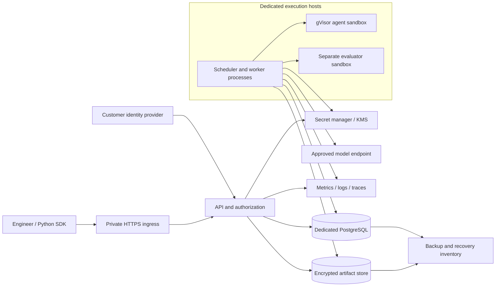
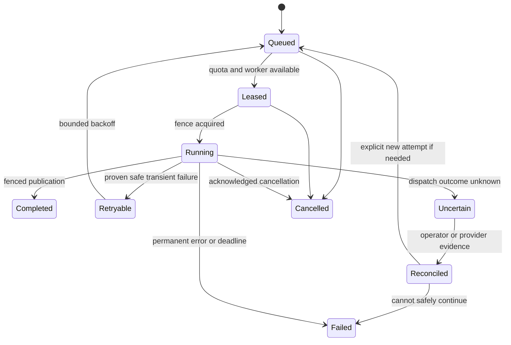
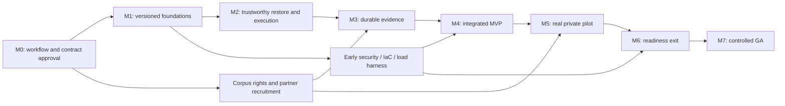

# Agent Rewind — enterprise product and engineering roadmap

**Document owner:** spei04 · **Revision:** 2026-10-19 · **State:** Proposed for approval
**Implementation baseline:** `8f1ae757005c95c50a789e4fa0a10aae9b3c4024` · **Delivery clock:** Week 1 begins after plan approval and staffing confirmation.

This is the single authoritative planning and progress document. It fills the product, architecture, delivery, security, operations, and governance brief in one file. Existing technical documents describe the current release; proposed behavior below is not implemented unless explicitly marked verified. No production deployment, enterprise certification, customer adoption, or capacity benchmark is implied by this plan.

## Contents

1. [Context, assumptions, and progress](#1-context-assumptions-and-progress)
2. [Product requirements and user journeys](#2-product-requirements-and-user-journeys)
3. [Architecture and decision records](#3-architecture-and-decision-records)
4. [Data model, APIs, and execution contracts](#4-data-model-apis-and-execution-contracts)
5. [Capacity, performance, and economics](#5-capacity-performance-and-economics)
6. [Security, privacy, and reliability](#6-security-privacy-and-reliability)
7. [Research and evaluation program](#7-research-and-evaluation-program)
8. [Milestones and delivery schedule](#8-milestones-and-delivery-schedule)
9. [Team ownership and parallel work](#9-team-ownership-and-parallel-work)
10. [Prioritized engineering backlog](#10-prioritized-engineering-backlog)
11. [Testing and release quality](#11-testing-and-release-quality)
12. [Delivery and operations](#12-delivery-and-operations)
13. [Traceability, risks, and governance](#13-traceability-risks-and-governance)
14. [Launch gates and progress log](#14-launch-gates-and-progress-log)

## 1. Context, assumptions, and progress

### 1.1 Product context

Agent Rewind helps engineers find interventions that improve a failed coding-agent run. An engineer opens a recorded run, inspects a decision boundary, changes an action or tool observation, and compares fresh continuations against unchanged controls. Automatic investigation proposes promising intervention points; independent confirmation measures whether the selected intervention helps reliably.

The product's differentiator is **evidence about useful interventions**: location ranking, reproducible execution boundaries, honest uncertainty, and a path from a finding to an agent regression test. It must distinguish a successful example, an effect conditional on one failed run, and a result that generalizes across tasks.

| Context | Confirmed fact or planning assumption |
| --- | --- |
| Objective | Build a production product useful to frontier labs and startups operating coding agents. |
| Repository | Public personal repository [spei04/agent-rewind](https://github.com/spei04/agent-rewind); existing MIT license. |
| Existing implementation | Python/FastAPI service, PostgreSQL jobs, encrypted artifacts, Docker/gVisor runner, Python SDK, browser workbench. |
| Working environment | Authoritative source and private validation evidence are in the existing Google Cloud workspace. Development location does not establish a production deployment. |
| Accepted initial deployment | Self-hosted, one organization per deployment, dedicated metadata database and artifact store, dedicated Linux gVisor workers. No connection to an adopter's production application database. |
| Initial execution scope | Controlled sequential Python coding agent; workspace files and serialized policy state; offline tools and independent evaluator. |
| Model integration | Existing model provider adapter and private worker credential. Provider versions and rates are configuration, not hardcoded product assumptions. |
| Spending authorization | Initial model validation cap: $200. Historical reservations: $36.567974, leaving $163.432026 under that cap before any later expenditure. These are conservative reservations, not an invoice. Reconcile before further paid experiments. |
| Team | Unknown. Planning scenario: six core engineers plus shared product/security support; see Section 9. No hires or availability are assumed confirmed. |
| Launch date | Unknown. Gate-based forecast: limited private pilot in Weeks 28–34; enterprise general availability in Weeks 42–50 under the staffing scenario. |
| Capacity and customers | No verified customer demand or production load. Baseline, forecast, and stress assumptions are defined separately in Section 5. |
| Compliance and data | Assume confidential source code and proprietary traces. Regulated personal/health/payment data and jurisdiction requirements require customer-specific review before ingestion. No compliance claim. |
| Infrastructure budget | Not established. This plan proposes a cost model; it does not authorize recurring cloud spend, staffing, or procurement. |

### 1.2 Current implementation evidence

Source inspected on 2026-10-19 at the baseline above. Historical test results below are from the published validation record, not a fresh execution of those tests during planning.

| Capability | Status | Evidence and material limitation |
| --- | --- | --- |
| Workspace checkpoints, action/result branches, parent immutability | Implemented; historical automated verification | [engine.py](../agent_rewind/engine.py), [workspace.py](../agent_rewind/workspace.py), [engine tests](../tests/test_engine.py). No process-memory or external-system restoration. |
| Bounded execution and hidden evaluator files | Implemented; historical Linux integration verification | [runner.py](../agent_rewind/runner.py), [Docker tests](../tests/test_docker.py). gVisor tested in CI; live model validation used development runc. Adversarial grader integrity remains unproven. |
| Automatic ranking, frozen winner, confirmation and missing outcomes | Implemented; narrow live verification | [experiments.py](../agent_rewind/experiments.py), [statistics.py](../agent_rewind/statistics.py), [VALIDATION.md](VALIDATION.md). A deliberately injected early stop yielded 0/8 control versus 8/8 treatment. No natural-failure benchmark. |
| OIDC/PKCE, roles, scoped API keys, encrypted artifacts | Implemented; fixture verification | [auth.py](../agent_rewind/auth.py), [artifacts.py](../agent_rewind/artifacts.py). No customer IdP exercise, online key rotation, project-level isolation, or production storage validation. |
| PostgreSQL claims, lease fences, budget reservations | Implemented; historical concurrency verification | [database.py](../agent_rewind/database.py), [PostgreSQL tests](../tests/test_postgres.py). Worker loss terminates jobs; studies execute serially; no resumable trial scheduler. |
| Browser debugger, comparison, report export, Python client | Implemented; initial integration verification | [web](../agent_rewind/web/), [sdk.py](../agent_rewind/sdk.py). Limited navigation/search, no full framework integration or fleet administration. |
| CI and packaging | Implemented; historical passing checks | [workflow](../.github/workflows/ci.yml), [validation CI](https://github.com/spei04/agent-rewind/actions/runs/37415445488). 48 core and 3 gVisor tests reported; not a security audit or scale certification. |
| Production operations and enterprise readiness | Not verified | No demonstrated IaC deployment, HA/DR exercise, migration lifecycle, retention/GC, production SLOs, external penetration test, or real customer pilot. |

### 1.3 Progress conventions

Use **Not started**, **In progress**, **Blocked**, **Implemented / verification pending**, and **Verified**. A checked box means its stated acceptance evidence exists. Historical implementation is not retroactively marked enterprise-ready. Milestone completion requires all exit gates, not just merged code. Each implementation change updates its task row, requirement row, and dated evidence log in this file. No fabricated overall percentage.

Current planning work: repository/template inspection, blueprint, challenge review, and document validation complete; publication in progress. M0 approval and every new implementation milestone remain open.

### 1.4 Decisions still requiring confirmation

Planning can proceed with the assumptions above. Before M0 exits, confirm staffing and launch constraints, two target customer workflows, acceptable regions/data classes, and the production operating budget. Before any pilot, confirm who operates the installation, approved model processors, network egress policy, retention contract, and named incident contacts. These are release dependencies, not reasons to stop writing the blueprint.

## 2. Product requirements and user journeys

### 2.1 Vision, users, and measurable outcomes

The primary customer is an engineering or research team shipping a coding agent with an executable success criterion and access to reproducible task environments. The buyer is the agent platform or engineering lead; daily users are agent engineers, researchers, and evaluation engineers. Security administrators and platform operators control deployment, access, and resource limits.

| Journey | User problem and required outcome | Proposed success measure |
| --- | --- | --- |
| Diagnose a failure | Engineer imports or records a compatible run, sees why a checkpoint can be restored, and investigates a ranked decision. | At least 80% of a predeclared supported-workload pilot sample can be captured and restored without core-code changes. Report incompatible runs separately. |
| Test an intervention | Engineer edits one action/result, sees both actual and observed effects, compares branches without altering the source. | All contract tests preserve parent hashes and reproduce the specified boundary; no hidden side-effect replay. |
| Establish evidence | Researcher freezes a candidate and protocol, runs controlled trials, inspects failures and uncertainty. | Every reported effect links to immutable protocol, attempts, evaluator identity, and missing-outcome accounting. |
| Improve the agent | Engineer exports an investigation as a regression case and tests a policy change on held-out tasks. | Three design partners use the workflow weekly for four weeks; at least two adopt a resulting regression or policy fix. Targets, not current customers. |
| Operate safely | Administrator sets projects, access, quotas, retention, and processor policy; operator restores service after failure. | No authorization or budget invariant violation; restore and on-call gates pass before enterprise launch. |

A pilot should measure time from opening a failed run to a reviewed intervention report against the team's prior workflow. Target a 50% reduction in median engineer investigation time on at least 20 investigations, paired where possible; record selection, uncertainty, and incomplete investigations. This is a product target, not an existing result or a promise that every failure has a useful intervention.

### 2.2 Scope

**Production MVP / private pilot:** one organization per isolated installation; project-scoped authorization; controlled Python environments; two supported policy integrations including the native adapter; immutable state/provenance; manual branching; automatic location ranking; resumable paired experiments; bounded parallel trials; complete cost ledger; readable evidence UI; SSO; retention/deletion; managed secrets; install/upgrade/backup/restore; metrics and on-call ownership. This is the minimum deployable product, beyond the existing initial release.

**Enterprise GA:** demonstrated forecast capacity, four-week operating evidence, tested regional recovery, independent security review, policy administration, audited exports, customer integration/support documentation, reproducible releases, compatibility guarantees, and natural-failure evaluation with held-out tasks. SCIM is required if a launch customer needs automated provisioning; otherwise documented IdP group synchronization and rapid deprovisioning must satisfy the access gate.

**Post-GA, demand-gated:** additional languages/frameworks, customer-operated remote execution plane, shared SaaS tenancy, larger workspaces, brokered network tools, experiment portfolios, and learned location ranking. Each needs its own contract and evidence gate.

**Out of scope for the first enterprise release:** arbitrary memory snapshots; automatic rollback of production databases or external writes; unconstrained internet access; arbitrary uploaded worker plugins; transparent branching of any historical trace; model training; a general observability replacement; global active-active scheduling; and automatic deployment of agent fixes to customer systems.

### 2.3 Requirements and acceptance stories

Priority **P0** blocks a private pilot; **P1** blocks enterprise GA; **P2** is conditional post-GA work. Detailed implementation mapping is in Section 13.

| ID / priority | User story and why it matters | Acceptance criteria |
| --- | --- | --- |
| R01 / P0 | As an engineer, capture a real agent run with enough state to resume it. | Versioned adapter contract; all tool effects classified; policy/image/evaluator identities recorded; unsupported state produces a machine-readable reason rather than a branchable claim. |
| R02 / P0 | Inspect and fork the exact decision that interests me. | Stable decision IDs, before/after files, actual/observed results, immutable parent, action/result fork contracts; keyboard-accessible UI. |
| R03 / P0 | Receive useful intervention suggestions without treating a heuristic as proof. | Ranked locations with reasons and proposal provenance; unchanged negative control; no hidden evaluator source in discovery context. |
| R04 / P0 | Measure the effect of a fixed intervention. | Persisted protocol and winner before confirmation; independent trial set; randomized arm order; complete attempts/missingness; interval and scope displayed. |
| R05 / P0 | Continue long studies after worker loss without silently doubling spend. | Durable trial/attempt state, fenced publication, unique logical call IDs, explicit ambiguous outcomes, safe retry policy, cancellation and budget invariants under crash tests. |
| R06 / P0 | Run untrusted agent code without exposing infrastructure. | Dedicated gVisor workers, no sandbox credentials/network/host mounts, resource caps, tested denial of escape paths, evaluator trust boundary. |
| R07 / P0 | Keep each project's confidential traces accessible only to authorized people. | Resource-scoped checks on every API/export/cache path; project roles and service identities; negative authorization tests; single-organization deployment boundary. |
| R08 / P0 | Retain, rotate keys, export, and delete evidence predictably. | Dependency-aware retention, legal-hold handling, deletion tombstones/receipts, live key rotation, tested restore including deletion replay. |
| R09 / P0 | Control cost before an experiment starts and explain it afterward. | Organization/project/study reservations are atomic; every proposal/continuation/evaluation call has ledger entries; observed usage separate from reservations and invoices. |
| R10 / P0 | Integrate an existing coding agent without rewriting the product. | Native adapter plus one partner-selected Python adapter; conformance suite; working SDK capture/branch/study/export; tracing-only imports visibly nonbranchable. |
| R11 / P0 | Install, upgrade, observe, and recover the product. | Repeatable staging install, versioned schema migration, dashboards/runbooks, backup restore, secret/IdP/storage integration tests, no API Docker privilege. |
| R12 / P1 | Trust throughput and service availability at the purchased capacity. | Forecast and stress load reports, SLO dashboard, saturation/backpressure tests, fair project scheduling, regional recovery exercise. |
| R13 / P1 | Decide whether findings generalize to my agent workloads. | Predeclared natural-failure corpus, task-level held-out evaluation, calibrated uncertainty/null tests, cost-matched baselines and error analysis. |
| R14 / P1 | Share defensible evidence and operate enterprise access. | Permission-checked evidence bundles, audited downloads, admin workflows, lifecycle of users/service accounts, signed release identity, customer support and incident process. |
| R15 / P2 | Use more execution boundaries or deployment models. | Separate capability definitions and security review for each extension; no broadened guarantee inferred from basic support. |

## 3. Architecture and decision records

### 3.1 System boundaries and target topology

Keep a modular Python application and independently scalable trusted workers. Separate the customer/browser trust boundary, privileged execution hosts, hostile sandbox processes, external model provider, and data stores. The platform stores its own metadata; customer application databases are outside this architecture.

No edge from a sandbox to the provider, database, cloud metadata endpoint, or secret manager is allowed. Initially workers are trusted for their entire organization; per-project authorization does not isolate one project from a compromised worker. Customers needing internal hard isolation receive separate installations or worker/storage credentials with a separately tested boundary.

**Recommended reference deployment, pending approval:** Google Cloud because development already uses it; Cloud Run for the stateless API, Cloud SQL PostgreSQL with regional HA, native Cloud Storage artifacts, Secret Manager/KMS, and dedicated Compute Engine worker groups running Docker/runsc. Add a native object-store adapter rather than assuming the current S3 implementation supports Cloud Storage. Keep local and S3 adapters for existing adopters; do not claim tested support on another cloud until its release matrix passes.

Private HTTPS ingress must use an explicitly configured internal load-balancer/serverless integration and supported customer connectivity. Direct VPC egress connects API instances to private resources; it does not itself make ingress private. Verify DNS, IdP redirects, startup probes, and denied public ingress in staging. [Cloud Run network documentation](https://docs.cloud.google.com/run/docs/configuring/vpc-direct-vpc).

Development uses disposable fixtures and the existing checkout. Staging and production have separate cloud projects/accounts, databases, buckets, keys, IdP clients, provider budgets, and identities. Production cannot run on the development VM. A zone failure should preserve API/metadata access; interrupted agent work resumes only through the durable attempt protocol. Regional disaster recovery is an explicit restore/failover procedure, not an active-active promise.

### 3.2 Component ownership

| Component | Responsibility and state | Must not do |
| --- | --- | --- |
| API / identity | Validate requests, authenticate/authorize, admit jobs, serve bounded read models, audit access. Stateless sessions except revocation/access metadata. | Execute submitted code, own Docker access, or hold model credentials. |
| Scheduler / study coordinator | Persist protocol, freeze candidates, create trial pairs, admission/fairness and reconcile attempts. Same deployable initially, separate worker role. | Infer success from job completion or regenerate a selected candidate during resume. |
| Policy worker | Restore state, request model decisions, validate outputs, reserve spend, call runner, publish fenced events. | Trust model instructions as platform authority or silently switch models mid-study. |
| Runner / evaluator | Enforce environment contract, bounded execution, snapshots, cleanup, grade in separate environment. | Restore unsupported external state or permit agent access to grading secrets. |
| Metadata store | Transactions, jobs/attempts, authorization, immutable references, searchable bounded summaries. | Store raw prompts, files, credentials, or full traces in general-purpose logs. |
| Artifact store | Immutable encrypted bodies, manifests, integrity verification, retention graph, export material. | Expose unauthenticated object paths or deduplicate across customer deployments. |
| Research library | Versioned estimators, diagnostics, location strategies, benchmark reporting. | Overstate causality or hide missing trials. |
| Workbench / SDK | Explain compatible states, propose changes, display comparisons/evidence, expose cancellation and quota reasons. | Render untrusted HTML or treat a heuristic score as a measured probability. |

### 3.3 Architecture decision records

These inline ADRs are proposed recommendations unless marked retained. Each includes a reconsideration trigger; moving it to another file is unnecessary for this plan.

| ADR | Decision, rationale, alternatives | Trade-off, cost, limit, and replacement trigger |
| --- | --- | --- |
| ADR-01 — Deployment boundary | Retain one organization per installation through GA. Prefer private customer infrastructure with optional operator-managed dedicated installation. Alternative: shared SaaS from day one. | Duplicated control-plane cost per customer buys simpler isolation/residency. Revisit shared SaaS only after at least three customers require it and a dedicated tenant-isolation milestone passes. |
| ADR-02 — Application structure | Retain FastAPI, SQLAlchemy, Python modules and independent workers. Alternative: microservices or a language rewrite. | Low migration cost; Python remains orchestration, not sandbox trust. Split a service only when measured scaling/availability or ownership needs cannot be met with process roles. |
| ADR-03 — Durable execution | Retain PostgreSQL transactional queue, add normalized trials/attempts, outbox, bounded leases, and an explicit state machine. Alternatives: managed queue, Temporal. | One durable authority avoids cross-system commit ambiguity. DB write/lease load is the ceiling. Revisit an orchestration engine for multi-day external workflows or queue p95 claim latency above 100 ms after indexing/batching at forecast load. A migration must preserve paid-call uncertainty. |
| ADR-04 — Schema lifecycle | Introduce Alembic revisions and expand/backfill/contract migration discipline. Keep typed SQLAlchemy models and JSON only for versioned payloads. | Adds migration maintenance but removes dependence on create_all. Replace generic JSON lookups for hot paths when adding queryable fields; avoid an all-at-once rewrite. |
| ADR-05 — Sandbox | Retain dedicated Linux gVisor/runsc hosts and offline sandboxes. Alternatives: plain runc, managed sandbox service, microVMs. | Host operation and compatibility overhead; API stays unprivileged. gVisor narrows host-kernel exposure but does not eliminate host, side-channel, or application risks. Use separate microVM/managed pool only for a demonstrated compatibility or isolation need and rerun conformance/security tests. [Security model](https://gvisor.dev/docs/architecture_guide/intro/). |
| ADR-06 — State | Retain tool-boundary filesystem plus complete serialized policy state. Alternatives: transparent process/VM snapshot, log-only replay. | Lower complexity and portable evidence; excludes long-lived processes and unmanaged services. A new snapshot type requires a versioned capability contract and evaluator for restoration fidelity. |
| ADR-07 — Storage and keys | Retain encrypted content-addressed objects; add backend-neutral adapter and KMS-wrapped data keys with key IDs. Use organization-local deduplication. | KMS requests, object operations and storage are cost drivers. Manifest caching/batched access precedes a storage rewrite. Separate integrity digest from authorization and object locator; do not make plaintext hash a cross-tenant existence oracle. [Envelope encryption](https://docs.cloud.google.com/kms/docs/envelope-encryption). |
| ADR-08 — Experiment protocol | Retain fixed screening, frozen winner, independent confirmation; add task-level generalization evaluation. Alternatives: single replay, naive adaptive stopping. | More executions and latency buy interpretable evidence. Adaptive experiments require an explicit statistically valid protocol/version; no dashboard-driven early declaration. |
| ADR-09 — Reference cloud | Propose Cloud Run API, Cloud SQL, Cloud Storage, dedicated GCE workers, IaC. Alternative: all-VM install or Kubernetes. | Managed control plane reduces operational work; native storage integration is new work. A customer-required cluster install or measured scheduling need justifies a Kubernetes package; not required for initial throughput. |
| ADR-10 — Frontend | Retain the existing browser surface initially; add typed API contracts, bounded timeline views, accessible components and browser tests. Alternative: immediate React rewrite. | Lowest disruption. Adopt a component framework only when branch graph/state complexity or maintenance evidence justifies it; preserve contracts and workflows through the migration. |
| ADR-11 — Observability | Add structured redacted logs and OpenTelemetry instrumentation exported to the deployment's existing backend. Alternative: proprietary telemetry schema or a new analytics database. | Request volume/retention determine cost. No raw trace payloads in telemetry; cardinality bounded. Add analytical storage only when reporting workloads demonstrably harm transactional SLOs. |
| ADR-12 — Network tools | Keep sandbox network disabled through MVP/GA. Future external tools use a broker with operation allowlists, recorded inputs/results and side-effect classification. | Restricts supported tasks but protects reproducibility and credentials. Never replay external writes automatically. Demand for real network-dependent tasks triggers a separate design/security milestone. |

## 4. Data model, APIs, and execution contracts

### 4.1 Schema and ownership

The current schema contains generic `records`, `events`, `jobs`, `api_keys`, and `audit` tables. Introduce typed read/query fields incrementally without rewriting immutable historical payloads. Preserve original IDs, event digests, and schema-version readers. The database is the authority for publication, authorization and scheduling; the object store is the authority for immutable payload bytes.

| Proposed entity | Required fields and invariants | Owner |
| --- | --- | --- |
| Organization / project / membership | Installation organization ID; project ID; subject/service identity; role and policy version. Exactly one organization enabled per installation through GA. | API / identity |
| Run | Project, task/environment/policy/evaluator digests, parent run and fork boundary, state, capability flags, final event head, timestamps. Composite project references prevent cross-project lineage. | Execution |
| Decision / checkpoint | Run, monotonic step, pre-state and post-workspace refs, proposed/executed action, actual/observed result refs, previous event hash, schema version. Unique `(run_id, step)`; committed bodies never overwritten. | Execution |
| Study / candidate / protocol | Source run, candidate and protocol digests, proposal version, planned sample counts, estimator version, frozen-at time, selected candidate, stopping policy. Confirmation cannot mutate these fields. | Research |
| Trial pair / arm / attempt | Study, phase, pair ID, randomized order, arm, logical execution ID, attempt number, lease epoch, status, run ID, failure class. Unique logical arm; all attempts retained. | Execution / scheduler |
| Job / outbox | Project, kind, payload ref, state, available-at, deadline, owner, monotonic fence, retry policy, priority, terminal reason. Transactional outbox only for later external notifications. | Backend |
| Provider call / budget ledger | Logical call and attempt IDs, purpose including discovery, request digest, dispatch state, provider request ID if available, configured price version, reserved/estimated/reconciled micro-USD, usage, uncertainty. | Execution / finance controls |
| Artifact / reference edge | Organization/project scope, opaque locator, encrypted data-key ref, integrity digest, bytes, backend, lifecycle generation, reference owner, deletion state. Dedup only within authorized boundary. | Storage |
| API key / session / audit | Hashed token or session ID, resource scope, expiry/revocation, actor, action, target, result, correlation ID; no secret bodies. | Identity / security |
| Retention / deletion / release | Policy and hold IDs, dependency closure, tombstone/receipt, backup cutoff; release/build/schema IDs and evidence refs. | Platform / security |

Use foreign keys and unique constraints for relationships and logical operations; require project scope in repository methods and database constraints. Row-level security can provide defense in depth for project separation but is not a substitute for endpoint checks or a shared-SaaS security design. Initial indexes: project/time/ID lists, jobs `(state, available_at, priority, id)`, attempts by study/phase/pair/arm, artifact reference owner, and audit project/time. Paginate by stable `(created_at, id)` cursors. Add time partitioning only after measured retention/query pressure.

### 4.2 Publication, consistency, and lifecycle

1. Validate and authorize input; allocate an idempotent operation identity and reserve admission quota.
2. Write encrypted immutable objects; confirm object write and digest before publishing references in a database transaction. A failed transaction may leave unreferenced objects, never a successful visible reference to an unconfirmed upload.
3. Atomically publish metadata, ledger changes, event head, and outbox entries under the current lease fence. Readers observe committed boundaries only.
4. Resume from the last committed boundary; classify any dispatched-but-uncommitted model or tool operation as uncertain. Offline tool execution may be repeated only from an immutable pre-state under a new attempt; preserve uncertainty about model billing.
5. Cache only immutable decoded manifests or bounded pages. Authorization is checked before cache access; cache keys include organization/project and policy version where relevant. No cache is authoritative for budgets, revocation, or job state. Do not introduce Redis initially.

Object store consistency does not provide a transaction with PostgreSQL; retain this publish-before-reference design even when the backend offers strong consistency. [Cloud Storage consistency guarantees](https://docs.cloud.google.com/storage/docs/consistency).

**Provisional retention defaults:** raw traces and workspace bodies 30 days; study summaries/protocols 90 days; security audit events 365 days; encrypted backups 35 days. These require customer approval and storage sizing. Study evidence pins its referenced raw objects until its retention/hold expires; the UI shows this effective retention, which can exceed 30 days. Never expire parent objects independently of live branch references.

Deletion is an authorized asynchronous operation: calculate descendants and references, reject/resolve legal holds, tombstone access immediately, cancel relevant work, remove or retain explicitly selected dependents, then collect unreferenced objects. Mark-and-sweep uses a stable generation, a grace interval of at least 48 hours, and a second reference check before deletion. Race tests cover new forks and unfinished uploads. Backups age out under the disclosed schedule; restored systems replay an independently retained deletion journal before access reopens. A receipt distinguishes active-store deletion from pending backup expiry. Private support bundles receive a review date and separate access policy.

### 4.3 API and adapter contracts

Current routes remain as documented in [api.py](../agent_rewind/api.py). Introduce `/api/v1` with versioned OpenAPI/schema snapshots, SDK compatibility checks, and an announced legacy transition. The following contracts are proposed; they are not available in the current server.

| Contract | Request / result and guarantees |
| --- | --- |
| `POST /api/v1/projects/{id}/runs` | Task/environment refs, adapter config ID, budget in integer micro-USD, client operation ID. Requires project operator and `Idempotency-Key`; returns `202` with operation/job IDs. |
| `POST /api/v1/runs/{id}/branches` | Boundary ID, intervention kind/payload, expected parent digest, budget. Reject missing state, changed identity, unbranchable source, or unauthorized project before enqueue. |
| `POST /api/v1/runs/{id}/investigations` | Candidate policy/version, screening plan, confirmation plan, concurrency cap and total budget. Persist a draft protocol; freeze winner before confirmation. |
| `GET /api/v1/runs/{id}/events` | Cursor, bounded limit (default 50, max 200), summary/body expansion. Returns events, next cursor, immutable head; never loads every payload to list metadata. |
| `GET /api/v1/studies/{id}` | Separate protocol, planned/completed/missing counts, attempt states, effect interval, limits, and ledger totals; links to paginated trial data. |
| `POST /api/v1/jobs/{id}/cancel` | Idempotent cancellation intent; returns current state and outstanding calls. Does not promise to undo provider billing. |
| `POST /api/v1/studies/{id}/resume` | Explicit reconciliation decision for uncertain attempts, expected protocol digest, budget check. No silent duplicate confirmation sampling. |
| `POST /api/v1/exports` and `DELETE /api/v1/runs/{id}` | Authorized asynchronous jobs; export manifest/access expiry/audit; deletion plan/hold/descendant treatment/receipt. No public share links by default. |

Error envelope: `code`, safe `message`, `request_id`, `retryable`, and optional structured `details` without payloads/secrets. Distinguish `checkpoint_unavailable`, `identity_mismatch`, `budget_exhausted`, `provider_uncertain`, `quota_exceeded`, `lease_lost`, and `retention_hold`. Use 401 for absent/invalid credentials, 403 for forbidden operations where disclosure is safe, 404 for inaccessible object IDs, 409 for state/idempotency conflicts, 413 for size, 422 for invalid schema, and 429 with Retry-After for admission throttles.

Idempotency is scoped to principal/project/operation and canonical request digest. Same key and body returns the same operation; changed body returns 409. Retain records for the operation lifetime plus at least 90 days and publish expiry semantics. Clients must not reuse operation IDs. Idempotent API submission does not make a third-party inference request exactly once.

Adapter contract v2 declares state schema, identity, supported tools, checkpoint capability, deterministic-environment assumptions, evaluator compatibility, and external-effect classification. Add adapter conformance fixtures before framework integration. Imported telemetry without full restore state is viewable but nonbranchable. Trusted, reviewed adapters are deployed by operators; the API never imports arbitrary user-specified Python modules into a worker. Model integration exposes capabilities such as seed support and usage reporting; never infer them solely from a model name.

### 4.4 Durable state machine and retry policy

Lease loss revokes publication rights and permission to reserve new calls. A failed lease monitor must stop execution locally. Already-authorized calls may still be dispatched or billed across a pause/network partition; their reservations remain held and their state becomes uncertain. Fencing does not revoke a credential already held by a compromised worker: quarantine the host and revoke its credentials on suspected compromise. Retry reads and idempotent storage operations with bounded exponential backoff and jitter; cap attempts and job deadline. Malformed inputs, authorization failures, evaluator policy violations and exhausted budgets are terminal. Ambiguous provider calls retain their reservations and enter reconciliation, with no automatic paid retry. A successful remote response followed by a database outage is uncertain until recovered from a durable receipt. No promise of exactly-once external billing.

A dead-letter/reconciliation view exposes safe error codes, attempts, partial evidence and authorized requeue controls. Do not hide failed trials by replacing them in an analysis dataset. Distributed study fanout preserves phase barriers, pair IDs, randomized order, independent confirmation, and a global budget. Separate worker permits for inference and active sandboxes; do not hold a database transaction while awaiting a provider or a tool.

## 5. Capacity, performance, and economics

### 5.1 Workload assumptions

All figures below are planning/test targets per installation, not measurements or customer commitments. A continuation means either an original run or one trial arm; experiments consume many continuations. A fleet of ten isolated customers multiplies installation costs and does not make their data share a database.

| Quantity | Pilot baseline | GA forecast | Stress / saturation test |
| --- | ---: | ---: | ---: |
| Organizations per installation | 1 | 1 | 1 |
| Registered / simultaneously active users | 20 / 5 | 200 / 50 | 1,000 / 250 |
| API requests/s, sustained / five-minute burst | 20 / 100 | 200 / 1,000 | 1,000 / 5,000 |
| Continuations/hour, including study arms | 20 | 200 | 1,000 |
| Mean decisions/continuation | 20 | 20 | 20 |
| Mean continuation duration, including inference | 10 min | 10 min | 10 min |
| Admitted live continuation slots | 8 | 64 | 256 |
| Simultaneously executing sandbox tools, cap | 4 | 32 | 128 |
| Average decision events/s | 0.11 | 1.11 | 5.56 |
| Synthetic metadata write operations/s | 20 | 200 | 1,000 |
| New stored bytes/continuation, assumed | 16 MiB | 16 MiB | 16 MiB |
| Daily new artifact data at continuous utilization | 7.5 GiB | 75 GiB | 375 GiB |
| 90-day artifact upper scenario, before backup | 675 GiB | 6.6 TiB | 33 TiB |

The 90-day estimate assumes studies pin all raw evidence for the full interval; 30-day unpinned retention reduces it. The 16 MiB assumption includes 8 MiB initial unique files, 5 MiB total changed-file content, and 3 MiB event/policy/output bodies. Measure it: whole-file dedup is not block dedup, and repeated policy histories can dominate storage. Use a 2x storage safety reserve until representative data exists. Peak metadata tests include ledger, leases, audit and polling beyond average event throughput.

Current limits remain 32 MiB default workspace, 512 MiB sandbox memory, 100 decisions maximum, and bounded task manifests; they are not evidence of suitability for real repositories. Benchmark 32/128/512 MiB workspaces with varying file counts before choosing supported pilot limits. Large dependency trees belong in pinned images, not every snapshot. Any increase must fit runner/host memory, upload, snapshot and security budgets. Incompatible customer repositories are a product risk, not silently truncated workloads.

Use Little's law for planning: live slots ≈ arrival rate × mean duration. At 200 continuations/hour and 10 minutes, mean concurrency is 33.3; 64 slots leave headroom. If inference time doubles, throttle admissions or add capacity rather than claiming the same throughput. The tool permit cap bounds instantaneous CPU/memory even when many continuations are waiting for inference. At forecast load, 200 continuations/hour × 20 decisions requires about 66.7 model decisions/minute. Provision requests/tokens quotas using measured context/output distributions; concurrency alone is insufficient. A full 32 MiB restore per decision implies approximately 35.6 MiB/s artifact reads before cache, while 16 MiB new data per continuation implies 0.89 MiB/s average artifact writes. Benchmark file-object operation amplification and burst behavior separately from these byte rates.

### 5.2 Latency, availability, and recovery objectives

| SLI | Proposed pilot gate | Proposed GA gate / measurement |
| --- | --- | --- |
| Control-plane availability | 99.9% over pilot window | 99.95% over rolling 30 days; valid eligible requests without 5xx/timeouts. Expected policy denials excluded, unexpected denials investigated separately. No contracted SLA before observation. |
| Metadata read / enqueue latency | p95 < 300 / 500 ms | Same at forecast load; p99 < 1 s / 2 s. Excludes asynchronous completion, not DB/object lookup performed within the endpoint. |
| Workbench responsiveness | Initial usable timeline < 2 s p95 | Same for paginated 100-step run on specified test network/device; no full-history blocking fetch. |
| Queue admission to execution | p95 < 30 s when quota/capacity available | Same at forecast load; quota-blocked time separately visible, never omitted from user-visible total wait. |
| Snapshot restore and capture | p95 < 3 s each for 32 MiB/2,000-file fixture | Measure each supported size; publish maximum latency/size matrix. Images pre-pulled. |
| Platform completion reliability | > 99% of eligible jobs | > 99.5%, excluding user task failure/cancellation but reporting those counts and external provider errors separately. |
| Cancellation | New work stops within 5 s of observed intent | Local commands stopped within 10 s p95; dispatched provider call may run to configured timeout. |
| Zone failure | Documented restart and no stale-owner publish | Control-plane recovery target < 5 min; no loss of committed metadata/object references; prove with fault exercise. |
| Regional disaster | RPO ≤ 24 h, RTO ≤ 8 h before private pilot | RPO ≤ 15 min, RTO ≤ 4 h before GA; includes key availability, reference integrity and deletion journal. |

Observe both request-based and time-based outages; a quiet installation can otherwise hide downtime. Provider outage does not prevent viewing existing evidence, but blocks new model work and is reported in an end-to-end execution SLI. A statistically inconclusive study is a valid product outcome, not an availability failure. Cloud SQL HA does not replace application reconnection/recovery or cross-region disaster recovery. [HA documentation](https://docs.cloud.google.com/sql/docs/postgres/high-availability).

### 5.3 Scaling and degradation

Scale API processes independently within a database connection budget; start with bounded pools, timeouts and query plans. Admission control combines project quotas, study concurrency, sandbox permits, provider requests/tokens limits, and organization spend. Weighted fair scheduling prevents one large study from starving interactive debugging. Users see queue reasons and expected work, not a fake precise completion time.

Scale workers on eligible queue age and permit demand, with a fixed maximum and budget guard. Drain workers before updates; preserve active leases or let recovery reconcile them. Pre-pull images on new nodes before marking ready. Keep online/interactive and bulk study queues independently capped. Under saturation: serve metadata, reject new excessive admissions with 429, delay expensive comparisons/exports, and stop new inference when the ledger cannot be reached.

| Measured trigger | First response | Escalation condition |
| --- | --- | --- |
| DB pool utilization > 70% for 15 min or wait p95 > 50 ms | Lower per-process pools/concurrency; inspect transactions and indexes. | Add pooling or enlarge DB after a benchmark; read replicas only for explicitly stale-tolerant reads. |
| Queue claim p95 > 100 ms at forecast target | Index, reduce lease write frequency safely, batch metadata; measure lock contention. | Evaluate separate orchestration/queue only if SLO still fails; retain transactional ledger/fencing authority. |
| Artifact request rate/latency dominates restore | Cache immutable manifests, bulk/prefetch file bodies, optimize per-file requests. | Add chunk/pack format with compatibility/GC tests if large-file fixtures still miss targets. |
| Worker utilization > 70% and queue-age SLO breached | Add warm slots within approved limits; verify provider capacity first. | Different worker pools by resource class if large tasks cause starvation. |
| Transactional reporting > 20% DB CPU or p95 read target missed | Precompute bounded summaries and pagination. | Add analytical replica/store with explicit freshness; never move budget authority there. |

### 5.4 AI and operating cost model

Separate model, compute, storage, network, telemetry and human operations. There is no confirmed monthly production budget. A provisional **$1,000–$3,000/month base-infrastructure planning envelope per small dedicated installation** excludes inference, burst workers, large evidence storage, staffing and external security work. This is an internal allowance to validate, not a cloud quote; region, HA sizing and private networking may exceed it. M0 must attach a region-specific estimate before provisioning. Use the [cloud calculator](https://cloud.google.com/products/calculator) and current [API hosting](https://cloud.google.com/run/pricing) and [VM pricing](https://cloud.google.com/products/compute/pricing); record date, region, instance sizes and rates.

Cost worksheet, with rates supplied from that estimate:

- Base/month = API minimum capacity + HA metadata database + minimum worker hosts + ingress/private networking + secrets/KMS + baseline monitoring/support.
- Execution/month = sum(worker vCPU-hours × rate + worker GiB-hours × rate), including idle inference wait if a host remains allocated.
- Evidence/month = stored GiB × storage rate + object operations + backup/replication + retrieval/egress + KMS operations. No dedup savings assumed until measured.
- Inference/study = sum over **discovery, control, treatment, evaluator-model calls if ever enabled** of input, output, reasoning/cache charges at the pinned price configuration. Track model latency p50/p95, concurrent requests, tokens/minute and provider throttle rate separately.
- Customer cost = dedicated fixed cost + attributable usage + support allocation; research efficiency = confirmed useful interventions / dollar and / engineer-hour. No invented gross-margin claim.

Example work count: four screened candidates × eight pairs × two arms = 64 continuations; 30 confirmation pairs × two arms = 60 more. Total 124 continuations plus discovery calls. At 20 decisions per continuation this can approach 2,480 model decisions; it is much larger than one replay. Preflight estimates must account for continuation length at each fork, reserved maximum tokens and provider caps. At forecast arrival rate this study consumes over half an hour of aggregate throughput even before queueing; wall time depends on phase barriers and permits.

Keep the existing $200 experiment ceiling until explicitly revised. Enterprise policy may later support larger administrator-approved ceilings; never remove the guard just because the product targets enterprise. Add per-call, study, project, organization/day and billing-period limits, atomic reservations, alerts at 50/80/100%, and a fail-closed kill switch. Accounting distinguishes held reservation, observed usage estimate, uncertain charge and reconciled invoice. Never refund an ambiguous call without evidence or silently select a cheaper model during confirmation. Forecast experiments run with mocked providers first; paid samples require a current ledger and bounded study plan.

## 6. Security, privacy, and reliability

### 6.1 Threat model

Assets: proprietary source, prompts/traces, provider credentials, evaluator integrity, identity sessions, experiment evidence, billing limits and host/cloud privileges. Adversaries include malicious submitted code, prompt-injected repository content, compromised user/API keys, dependency/image compromise and an attacker exploiting the public edge. Administrators and workers are powerful trusted actors in the initial deployment; hash chains alone cannot prove history against a privileged rewrite.

| Threat / relevant risk family | Required pilot control and test | GA addition / owner |
| --- | --- | --- |
| Object/property/function authorization failures; API BOLA/BFLA | Scope every run/checkpoint/file/study/key/export to project and role; disallow mass-assigned privilege fields. Exercise every route with inaccessible IDs and viewer/operator/admin identities. | Independent authorization review; identity lifecycle/SCIM when required. Backend + security. |
| Authentication/session compromise | OIDC issuer/audience/nonce/PKCE, secure cookies/CSRF, short sessions, API key expiry/revocation, no bootstrap in production. Test replay, bad JWT/JWKS, revoked principal and logout. | Revocation enforcement within 5 minutes, break-glass audit, customer IdP tests. Identity owner. |
| Injection/XSS/unsafe output | Strict model/tool schemas, normalized paths, bounded archives, text-only UI, parameterized DB, restrictive CSP. No model-produced code runs in API/worker interpreter. | Fuzz parsing/archive/display boundaries; browser security regression. Execution + frontend. |
| SSRF/data exfiltration | Offline sandboxes; configured HTTPS model/identity endpoints only; block metadata/private service access from sandbox and validate redirect/DNS policy for configurable outbound destinations. | Network attack tests and egress policy review; broker design before any network tool. Platform. |
| Resource abuse/unrestricted consumption | CPU/RAM/PID/disk/output/time limits, input size and rate quotas, spend reservation before calls, safe cleanup. Test fork/output/archive bombs and concurrent budget exhaustion. | Fairness and abuse-load exercise; organization kill switch. Platform + execution. |
| Supply-chain/integrity compromise | Locked Python dependencies, pinned task images, scanned release artifacts, reviewed trusted adapters, no untrusted PR access to secrets. | Actions/runtime pinned to immutable identities, SBOM, signed provenance, patch SLA and independent review. Platform + security. |
| Cryptographic/storage failure | TLS, DB/storage encryption, application encryption, KMS-backed key IDs, least-privilege roles, redacted telemetry. Test wrong keys, tampering and denied storage access. | Online rotation, backup/key restore, audited key access and cross-project cache checks. Platform. |
| Grader manipulation | Separate read-only evaluator inputs; no grading source in discovery; out-of-process outcome checks where possible. Test malicious candidate code attacking imports, exit codes and filesystem assumptions. | Independent adversarial grading review and corpus of cheating attempts. Research + security. |
| Prompt injection/excessive authority | Repository text and tool output remain untrusted model input; policy cannot change network, permissions, cost limits or evaluator identity. | Attack corpus measures proposed versus blocked unsafe actions; no unsupported claim of prompt-injection elimination. Research + execution. |
| Logging/exception handling gaps | Safe error taxonomy, correlation IDs, audit failures alert; avoid swallowing lease/storage errors; no secrets in generic exceptions. | Incident exercises prove detection and evidence integrity. QE + platform. |

This mapping uses [OWASP Top 10:2025](https://top10.owasp.org/2025/) and [OWASP API Security Top 10:2023](https://api-security.owasp.org/editions/2023/en/0x11-t10/) as review taxonomies, not certifications. Coverage includes access control, configuration, supply chain, cryptography, injection, authentication, integrity, logging, exceptional conditions, resource use, SSRF and unsafe external API consumption. Inventory/version APIs and remove unsupported routes deliberately. Reassess against the applicable editions at release.

### 6.2 Data and identity controls

Production credentials move from development environment files into managed secrets/workload identities. Separate API, worker, migrator, backup and export roles; only workers access provider keys, only migrators alter schema, and sandboxes receive none. Scope object permissions to the installation and operation. KMS wrapping-key rotation must preserve readers of historical key IDs; data-key re-encryption is a separate audited migration. Keys and data must have tested recoverability without publishing either in the repository.

Classify raw workspace/prompt data as confidential by default. Model requests are a documented egress boundary: show exactly which source/context is sent and require an approved provider/region/retention configuration. Literal redaction currently makes checkpoints unbranchable; do not advertise automatic secret discovery. Add upload scanning and configurable deny rules, then clearly distinguish sanitized nonbranchable exports from complete restricted checkpoints. Never send private evidence to public issue trackers or telemetry.

Proposed authorization: organization administrator; project maintainer/operator/viewer; deployment service identities with explicit resource/action scopes. An organization administrator can grant project access; a project operator cannot change provider credentials, role mapping, or environment allowlists. An IdP group is mapped by administrator policy, not trusted merely because a user supplies its name.

Potential procurement requirements include DPA/subprocessor disclosure, data residency, deletion/access requests, vulnerability disclosure, audit evidence, and SOC 2 or ISO 27001 programs. Their legal applicability, audit scope, counsel review and customer requirements are unresolved. No HIPAA/regulated-data acceptance or compliance badge before the relevant agreements, controls and independent evidence exist. Keep compliance evidence private; publish only accurate product capabilities.

### 6.3 Failure scenarios and required behavior

| Failure | Required behavior / release evidence |
| --- | --- |
| Worker killed before/after provider dispatch | Fence old worker; preserve reservation; recover only confirmed boundaries; record uncertain call; no unapproved duplicate dispatch. Crash-point tests before and after each durable transition. |
| Database failover/partition | Stop new spending/publication when authority is unavailable; serve only safe existing reads if possible; reconnect with bounded backoff. Stale owners remain fenced. |
| Object upload/read fails or is corrupted | No complete run references an unverified upload; integrity failure is visible; quarantine; restore from approved backup if available. |
| Model 429/5xx/timeout or identity drift | Enforce limits, distinguish known rejection from uncertain charge, preserve protocol; pause confirmation on incompatible model identity rather than mixing evidence. |
| KMS/secret manager or IdP outage | Fail closed for new access requiring validation/key use; short-lived existing authorized sessions follow policy; no bootstrap bypass. |
| Disk/memory exhaustion or host reboot | Kill bounded workloads; retain committed state; clean orphaned resources without touching active jobs; capacity alert. |
| GC races a branch or restore | Referenced objects survive; deletion journal remains authoritative; interrupted GC is safely resumable. |
| Evaluator flake/tampering | Mark invalid/uncertain outcome, retain evidence, quarantine evaluator version; never silently count as treatment improvement. |
| Deployment/schema incompatibility | Readiness fails; roll back compatible application version or perform forward repair; no destructive automatic downgrade. |

## 7. Research and evaluation program

### 7.1 Claim hierarchy and experimental design

The primary per-run estimand is the change in success probability from replacing one action or observation, conditional on the saved prefix, task, policy, environment and evaluator. It does not identify the unique root cause. A changed observation must preserve the original tool's actual filesystem effects; a changed action restores the pre-action checkpoint. Unchanged controls use that same boundary. Earlier unchanged continuations may avoid a later mistake naturally.

Keep fixed screening and independent confirmation. Record proposal policy/context digest and usage; discovery calls currently lack a separate detailed usage record and must join the new ledger. Freeze candidate, sample size, eligibility, estimator and model identity before confirmation. Pair arms by task/checkpoint and randomized execution order; advisory provider seeds do not establish identical randomness. Record routing/fingerprint changes and stratify or restart the protocol under a new study identity when they invalidate comparability.

The current paired wins-minus-harms estimator and conservative interval remain a baseline. Add simulation tests of null false-positive behavior, confidence coverage, missingness and heterogeneous effects. No optional stopping, hidden trial replacement, reuse of screening observations for confirmation, or aggregate claims from one task. Preregister a multiple-comparison procedure for any portfolio claim across many studies; otherwise label each report exploratory beyond its own fixed confirmation protocol.

### 7.2 Useful-location evaluation

The ranking system must answer whether it finds beneficial intervention points **under a fixed investigation budget**. Compare against random eligible boundaries, latest visible error, earliest divergence/repetition heuristic, and a human-selected boundary on a measured subset. Use the same candidate-generation policy, evaluator and continuation budget to isolate location quality. On a small diagnostic subset, exhaustive boundary screening can provide a reference frontier; it is not an affordable production requirement.

Metrics: confirmed improvement per allocated dollar; fraction of tasks with a useful intervention among top-k suggestions; rank of a verified useful boundary when a reference exists; harmful/no-effect proposal rate; time to report; restored-checkpoint coverage; missing outcome rate; and calibrated interval coverage in controlled simulations. A learned ranker is P2 until the heuristic baseline has enough diverse training/evaluation data and demonstrable benefit.

### 7.3 Corpus and release gates

1. **M0–M2:** select permitted repositories and deterministic test environments with no hidden evaluator leakage. Obtain at least 10 naturally failing runs across at least three repositories to validate restoration and grading, alongside existing injected-fault cases. Retain the full attempted capture denominator and reasons for incompatibility.
2. **M3–M4:** construct a versioned corpus of at least 100 eligible natural failures across at least 10 repositories and two agent configurations, subject to rights and available budget. Split by repository/task family before ranker tuning: 60 discovery/development and 40 untouched holdout is a provisional allocation. Do not repeatedly inspect holdout to tune proposals.
3. **Before funded confirmation:** estimate discordance/variance from development data; specify minimum useful effect, power target and exact/simulated required trials. Thirty pairs is a default protocol setting, not a power guarantee. If available budget cannot support the design, narrow the claim and mark research gate incomplete.
4. **M5–M6:** evaluate on pilot workloads and holdout under a frozen protocol; report task-level effects with clustering at task/repository where appropriate, uncertainty, heterogeneity, nulls, failures and spend. Compare cost-matched baselines. A positive effect is not guaranteed and cannot be a prerequisite for honest publication.
5. **GA product gate:** publish a reproducible methodology and scoped results with a useful-location result that exceeds the predeclared practical threshold on the chosen customer workload, or revise the product claim/scope before launch. The precise threshold is set in M0 with design partners; a provisional target is a ≥20% relative increase in confirmed-useful investigations per equal budget over the strongest simple location baseline. Report uncertainty; a small point estimate alone does not pass.

Paid research remains constrained by approved funds. Corpus collection, model drift, grader quality and sample size can move the schedule. The earlier 8-pair injected-stop result is integration evidence only. [AgentReplay's repository](https://github.com/gadda00/agentreplay) describes recording, replay and counterfactual mutation; this roadmap's proposed differentiation is automatic intervention selection and separately verified effects, not a claim that replay or counterfactual debugging is new.

## 8. Milestones and delivery schedule

### 8.1 High-level roadmap

All milestones below are **Not started**, except preparation of this planning document. Effort is incremental engineering work beyond the current release, not elapsed calendar time. Estimates are provisional and include implementation plus ordinary verification; add a separate 25% program contingency for integration/rework. External audit lead time, hiring and customer/procurement delays can exceed that reserve.

| Milestone | Objective and deliverable | Base effort | Forecast window | Exit gate |
| --- | --- | ---: | --- | --- |
| M0 | Approved product, contracts, corpus rights, staffing and cost plan | 10 engineer-days | W1–3 | G0: decisions and feasible pilot workload approved |
| M1 | Versioned foundations and secure data contracts | 40 days | W3–10 | G1: schema/API/budget/authorization contracts tested |
| M2 | Recoverable, isolated execution on production-shaped infrastructure | 70 days | W8–20 | G2: restore, isolation and failure invariants verified |
| M3 | Durable distributed studies and evidence accounting | 70 days | W14–26 | G3: resumable experiment protocol and ledger verified |
| M4 | Complete deployable MVP and customer integration | 80 days | W12–28 | G4: independent end-to-end staging acceptance |
| M5 | Limited private pilot with real workloads | 50 days | W28–40 | G5: four-week pilot and product/research evidence reviewed |
| M6 | Enterprise security, scale and operational readiness | 80 days | W20–42 | G6: forecast capacity, DR, security and support gates pass |
| M7 | Controlled GA rollout and launch review | 30 days | W42–50 | G7: release acceptance and 30-day review complete |

Total base: **430 engineer-days / 86 engineer-weeks**. With 25% contingency: approximately **538 engineer-days**. Six engineers at 70% planned delivery availability yield 21 engineer-days/week, approximately 26 ideal capacity weeks before dependency/external lead-time effects. The dependency audit also finds 133 serialized work-package days on the longest path before milestone waiting periods: approximately 38 weeks at 70% availability, or 48 weeks with the 25% contingency. The 42–50 week GA forecast requires partial interface handoffs and careful staffing; retain the upper end until Week 8 evidence supports compression. This is a forecast, not a commitment; delays in staffing, paid research, audit access or the four-week pilot extend it. With two engineers, the same scope requires roughly 77 capacity weeks before external delays; re-scope the product rather than keeping the six-person dates. Product/security specialists are additional shared support, not six more full-time roles.

### 8.2 Milestone execution cards

**M0 — Discovery and approval.** Owner: technical lead with product/security. Entry: inspected baseline and this draft. Tasks AR-001–004: confirm workflow/personas, obtain permissible natural-failure inputs, freeze architecture/contracts, quote capacity and define success thresholds. Deliverables: completed assumptions/decision log, permitted corpus manifest specification, versioned interface fixtures and approved roadmap. Tests: reproducibility feasibility on sample metadata and review of current evidence; no claim of new live trials. Risk: no compatible customer workload or funded team. Done/G0: named owners, confirmed scope and minimum useful effect, region/data policy, budget plan, launch assumptions and explicit plan approval. If users cannot supply a restorable workload, narrow integrations before building infrastructure.

**M1 — Contracts and data foundation.** Owner: backend lead; QE/security review. Entry: G0. Tasks AR-005–012: migrations, queryable metadata, project authorization, idempotency, object format, budget ledger, safe errors/telemetry and contract CI. Deliverables: migration from the existing database, `/api/v1` schemas, compatibility reader, immutable object/ref lifecycle and ledger primitives. Tests: historical fixture upgrade, cross-project denial, concurrent idempotency/reservation, schema compatibility. Risks: changed event digests, ambiguous legacy ownership, backward-incompatible API. Done/G1: existing evidence still verifies; new contracts pass automated tests; duplicate submissions/insufficient budgets cannot enqueue extra paid work. No new UI or worker relies on an unversioned field.

**M2 — Execution reliability.** Owner: execution engineer plus platform. Entry: stable M1 schema/identity/ledger interfaces; G1 required before exit. Tasks AR-013–019: Linux worker image, runner conformance, bounded object IO, keys/secrets, fail-closed leases, adversarial evaluators, crash matrix. Deliverables: real gVisor execution in staging, complete checkpoints, resource lifecycle, runtime identity inventory. Tests: kill worker/container at each boundary, verify hashes/restores, timeout/fork/output bombs, credential/network denial, evaluator evasion attempts. Risks: gVisor compatibility, large snapshots, lost-heartbeat races, compromised grader. Done/G2: admitted workloads satisfy replay contract, all mandatory isolation tests pass, stale owner cannot acquire new call permits or publish, every created runtime resource is accounted for. A paid model smoke test is separately budgeted and records runtime/model identity.

**M3 — Durable experiments.** Owner: backend execution and research. Entry: M1 contracts plus M2 checkpoint/runner interfaces; G2 before exit. Tasks AR-020–026: trial/attempt schema, resumable coordinator, fair bounded fanout, provider reconciliation, statistical simulation, proposal provenance and frozen evaluation. Deliverables: phase barriers, deterministic plan identities, immutable candidate, complete call ledger, missingness and invalidation states. Tests: crash/resume during discovery, freeze, arm dispatch and confirmation publication; concurrent cancellation/budget depletion; null/coverage simulations. Risks: duplicate paid calls, selection bias, provider drift. Done/G3: a multi-worker study survives failures with no silently duplicated logical outcomes, no unauthorized spend and no changed confirmation protocol; the report can be independently recomputed from evidence.

**M4 — Integrated production MVP.** Owner: technical lead coordinating frontend, SDK, platform and research. Entry: stable `/api/v1`, runner and study contracts; G1–G3 before final acceptance. Tasks AR-027–034: useful workbench, SDK/adapter integration, retention/GC, reference IaC, real IdP/admin workflows. Deliverables: native plus partner adapter, accessible full workflow, install/upgrade guide, deletion/export controls and staging deployment. Tests: SDK/browser end-to-end on PostgreSQL + real object store + IdP + gVisor, client compatibility, GC races, permission matrix. Risks: adapter state gaps, overly large UI scope, real repository incompatibility. Done/G4: an engineer outside the implementing workstream installs and performs capture → investigate → confirm → compare → export/delete using documented interfaces, including cancellation and insufficient-evidence cases. No production customer secrets required for this gate.

**M5 — Private pilot.** Owner: product/technical lead and platform; named customer operator. Entry: G4, baseline backup/restore/security/load gates, approved data/processor terms and pilot spend. Tasks AR-035–039: isolated customer install, two partner onboarding paths, natural-failure evaluation and four-week measurement. Deliverables: workload compatibility report, investigation outcomes, cost/SLO dashboard, incidents and usability findings, customer feedback. Tests: customer IdP/deprovisioning, production-shaped restore, supported real workload journeys; monitor all attempted investigations. Risks: no partners, weak useful-location results, unrepresentative tasks, budget shortfall. Done/G5: actual pilot evidence supports or narrows the product claim; blocker defects fixed; agreed usefulness/operability thresholds met. Lack of positive research evidence is recorded honestly and triggers scope/strategy review.

**M6 — Enterprise readiness.** Owner: platform lead with QE/security; research signs off claims. Entry: early hardening starts after G1 with stable deployment contracts; completion depends on G5. Tasks AR-040–047: forecast load, HA/region recovery, supply-chain release, independent security review, customer evidence pack, on-call drills, upgrade compatibility. Deliverables: benchmark/cost report, restore evidence, security findings/remediation, signed release package, runbooks and support responsibility matrix. Tests: 24-hour forecast soak, five-minute burst and saturation, backup/key loss, failover, red-team scenarios, N/N-1 rolling upgrades. Risks: capacity differs from assumptions, late security findings, unfunded operations. Done/G6: all GA launch blockers pass, no unresolved critical/high exploitable issue, no untested recovery dependency, named support owners and approved capacity/cost envelope. A third-party review is not a certification.

**M7 — Launch and post-launch review.** Owner: product/technical lead; platform release owner. Entry: G6 and customer launch agreement. Tasks AR-048–050: release/docs/support package, staged rollout, 30-day operating review. Deliverables: versioned supported matrix and limitations, release notes, customer rollback plan, documented adoption and reliability results, prioritized next-quarter backlog. Tests: canary journeys and rollback, alert routing, regression studies under approved spend. Risks: hidden workload mix, operator fatigue, model/version changes. Done/G7: rollout stable, remaining risks explicitly accepted within policy, 30-day review complete, success metrics measured, next expansion justified by demand and evidence.

### 8.3 Critical path and integration gates

Arrows describe **exit dependencies**, not a requirement to keep everyone idle until the prior milestone closes. UI can use frozen mocks while workers are built; research can develop on fixed fixtures; platform can build staging after contracts stabilize. Full acceptance cannot bypass the predecessor gate. The critical path is approved workload/state contract → migrations/identity → trustworthy execution → durable trials → integrated workflow → four-week pilot → enterprise evidence → rollout. Corpus access, budget, IdP setup and independent audit booking are external critical dependencies.

### 8.4 First eight weeks

| Week | Committed planning focus after approval | Integration evidence / dependency |
| --- | --- | --- |
| W1 | M0 workflow interviews, baseline audit, staffing constraints and supported-state feasibility. | Confirm customer problem and reject unsupported workload assumptions. |
| W2 | Corpus rights/taxonomy, cloud cost worksheet, threat review and contract fixtures. | Product, research, security and consumer review of G0 decisions. |
| W3 | Close G0; migration baseline and shared schema/error/adapter mocks. | Historical fixture inventory and agreed interface versions before parallel implementation. |
| W4 | Typed run/query fields, project membership model, object/ref contract and observability primitives. | Query plan and foreign-project denial fixtures; no migration of production data. |
| W5 | Idempotent submission, authorization propagation and object publication semantics. | Duplicate submissions/conflicting bodies and orphan-upload tests. |
| W6 | Logical call ledger, hierarchical budgets, secrets/key interface and contract harness. | Concurrent budget cap tests; consumer compatibility feedback. |
| W7 | Historical reader compatibility, paging integration, worker image/security preparation from stable interfaces. | Draft G1 evidence; preflight Linux runtime checks without customer data. |
| W8 | Integrate foundation slices; start runner/lease and UI work only against reviewed interfaces. | Re-estimate G1–G4 and critical path from delivery, compatible workloads and measured costs; G1 final exit remains W9–10. |

This is a capacity-limited sequence, not 50 tickets scheduled simultaneously. Assign at most one primary implementation ticket per engineer; move overflow rather than reducing acceptance criteria. Reserve 30% availability for reviews, maintenance, coordination and investigation. Specialized review/audit lead time is tracked separately.

### 8.5 Quarterly outlook relative to approval

- **Quarter 1:** M0–M1 and early M2; versioned contracts and trustworthy execution foundations. No enterprise launch claim.
- **Quarter 2:** M2–M3, integrated workbench/adapter slices and production-shaped staging; measure natural-failure compatibility.
- **Quarter 3:** Complete MVP, begin private pilots, collect research evidence and harden operations/capacity.
- **Quarter 4:** Complete pilot/readiness gates; controlled GA and 30-day review if evidence and external dependencies permit.
- **Following quarters:** Reassess shared SaaS, more execution types and learned ranking using adoption, cost and security evidence. Do not schedule all automatically.

## 9. Team ownership and parallel work

### 9.1 Staffing scenario and code ownership

| Role / allocation | Ownership and deliverables | Interfaces, dependencies, testing and required review |
| --- | --- | --- |
| Technical lead / backend engineer, 1 FTE | Architecture, API/data model, migration decisions; accountable delivery owner. | Own API/OpenAPI/DB contract. Review from consumers and security on auth/data changes; integration/upgrade tests. |
| Execution/backend engineer, 1 FTE | Engine, runners, queue/attempt state, budgets and cancellation. | Own policy/runner/lease/ledger contracts. QE crash tests; platform review for host privilege; research review for trial semantics. |
| Platform/SRE engineer, 1 FTE | IaC, worker images, deployment, storage/keys, telemetry and DR. | Own deployment/storage interfaces. Security approval for trust boundary changes; restore/load/failover tests. |
| Frontend/product engineer, 1 FTE | Debugger, branch comparison, evidence/admin workflows and accessibility. | Consumes versioned API fixtures; owns browser tests. Research reviews claim presentation; backend reviews permissions. |
| Research/ML engineer, 1 FTE | Protocols, ranking, evaluator design, corpus, partner adapter and evidence reports. | Own evaluator/proposal/statistics contracts. Independent statistical and adversarial grading review; golden/simulation/held-out tests. |
| Quality/automation engineer, 1 FTE | Cross-system contract/E2E/failure/load harness and release evidence. | Own quality gates; does not replace developer-owned tests. Reviews migration, failure matrix and supported configuration coverage. |
| Product/founder, shared ~0.3 FTE | Customer research, scope, adoption, launch criteria and budget decisions. | Accepts user journeys and scope changes; provides partner/data permissions. |
| Security specialist, shared ~0.3 FTE plus external assessment | Threat model, authorization/isolation review, incident/privacy controls. | Signs off security gates; independently reviews changes crossing trust boundaries. Not assumed to provide round-the-clock on-call. |

These are role allocations, not named hires. If one person covers several roles, reduce parallel commitments. Infrastructure owners cannot simultaneously implement the entire worker platform, run an audit and provide continuous support without capacity adjustment. Establish primary/secondary on-call coverage and contract hours before offering enterprise support.

### 9.2 Parallel development rules

Freeze shared schemas and representative success/error/uncertain fixtures at G0/G1 before parallel consumers implement them. Backend and research agree trial identities and failure taxonomy; platform and execution agree artifact/key/runtime boundaries; frontend and SDK consume the same generated schema. Mocks must represent errors and missing data, not only successful runs.

Use short-lived branches and pull requests in the personal repository. Independent writers use separate owned checkouts; reuse free worktrees and preserve private evidence outside them. Each contract change includes migration/compatibility notes and consumer review. Daily integration on shared staging with synthetic fixtures; twice-weekly cross-workstream integration review during M1–M4; weekly product/research/operations gate review. No long-lived frontend/backend branches or private, undocumented schema changes.

## 10. Prioritized engineering backlog

This is issue-ready Markdown within the single roadmap file; no GitHub issues or milestones have been created by drafting it. After approval, use milestones M0–M7 and labels `priority:P0`, `priority:P1`, `priority:P2`, `area:api`, `area:execution`, `area:research`, `area:ui`, `area:platform`, `area:security`, `area:quality`, `type:feature`, `type:verification`, `blocked:external`.

Each row provides an issue title/scope, dependencies to start, responsible role, effort and acceptance evidence. Milestone exit gates additionally join all required work; a readiness review is not an extra serial ten-day implementation package. Pilot measurements start after deployment and continue at least four calendar weeks; they cannot close the pilot without all customer/research results. **All new backlog work is Not started (NS)**. Existing code is the starting point, not a completed enterprise ticket. For a 10-day work package, create two independently reviewable child issues: **a = first five days / first deliverable; b = second five days / second deliverable and end-to-end verification**, with b depending on a. Subdivide further if a child cannot deliver a testable slice within five days. Estimates match milestone totals; contingency is outside the table. In every issue, Definition of Done also includes relevant Section 11 tests, documentation, migration/rollback impact and an evidence/progress update here.

Role abbreviations: TL technical lead, BE execution/backend, PL platform, FE frontend, RS research, QE quality, SEC security, PM product. Priority is the delivery gate, not permission to bypass dependencies.

| ID | Milestone / priority | Issue scope and concrete acceptance evidence | Depends on | Owner / days | Status |
| --- | --- | --- | --- | --- | --- |
| AR-001 | M0 / P0 | Confirm two customer workflows and requirements; agreed supported workload and practical usefulness threshold recorded. | — | TL+PM / 3 | NS |
| AR-002 | M0 / P0 | Corpus permissions, failure taxonomy and task split; reproducible input/evaluator specification with no private source in public Git. | AR-001 | RS / 3 | NS |
| AR-003 | M0 / P0 | Threat/deployment/cost review; selected region, staffing and funding assumptions explicitly accepted or blocked. | AR-001 | PL+SEC / 2 | NS |
| AR-004 | M0 / P0 | Freeze schemas/fixtures and approve roadmap; consumer review and decision log complete. | AR-002,003 | TL / 2 | NS |
| AR-005 | M1 / P0 | Alembic baseline and migration guard; old fixture upgrades with original event/artifact identities intact. | AR-004 | TL / 5 | NS |
| AR-006 | M1 / P0 | Typed run/query fields and cursor paging; historical and new rows coexist with indexed query plans. | AR-005 | TL / 5 | NS |
| AR-007 | M1 / P0 | Project memberships and scoped repositories; every read/write route has deny tests for foreign project IDs. | AR-005 | TL+SEC / 5 | NS |
| AR-008 | M1 / P0 | Idempotent job submission and safe errors; concurrent same-key requests create one operation, changed body returns conflict. | AR-005,007 | BE / 5 | NS |
| AR-009 | M1 / P0 | Versioned object/ref interface; failed publication leaves collectable orphan, never a completed broken reference. | AR-005 | PL / 5 | NS |
| AR-010 | M1 / P0 | Logical call ledger and hierarchical reservations; concurrent reservations cannot exceed study/project/org caps. | AR-005,008 | BE / 5 | NS |
| AR-011 | M1 / P0 | Redacted error taxonomy and tracing IDs; fault fixtures give useful diagnostics without credential/payload leakage. | AR-004 | PL / 5 | NS |
| AR-012 | M1 / P0 | Schema/contract CI and historical fixtures; incompatible contract changes fail required checks. | AR-006,008,009,010 | QE / 5 | NS |
| AR-013 | M2 / P0 | a: pinned Linux worker/runtime image; b: resource lifecycle and denied-access integration matrix on gVisor. | AR-009,011 | PL / 10 | NS |
| AR-014 | M2 / P0 | a: adapter capability/preflight; b: restoration conformance across binary files, rejected state and policy identities. | AR-006,012 | BE / 10 | NS |
| AR-015 | M2 / P0 | a: bounded artifact IO/caching; b: snapshot size/file-count benchmarks and corrupt/partial-object tests. | AR-009,013 | PL / 10 | NS |
| AR-016 | M2 / P0 | a: KMS key IDs/workload secrets; b: rotation/old-key-read and real object-store verification. | AR-009,013 | PL+SEC / 10 | NS |
| AR-017 | M2 / P0 | a: fail-closed lease/call dispatch; b: crash-point matrix proves no new stale-owner reservation or publication. | AR-010,013,014 | BE / 10 | NS |
| AR-018 | M2 / P0 | a: grader trust boundary fixtures; b: malicious candidate/evaluator-flake tests and quarantine behavior. | AR-002,013 | RS+SEC / 10 | NS |
| AR-019 | M2 / P0 | a: runtime cleanup/recovery fault harness; b: G2 evidence including bounded real-provider smoke if funded. | AR-015,016,017,018 | QE / 10 | NS |
| AR-020 | M3 / P0 | a: study/pair/attempt schema; b: uniqueness and frozen protocol mutation tests. | AR-005,010,012 | BE / 10 | NS |
| AR-021 | M3 / P0 | a: coordinator phase state machine; b: resume from each phase boundary without rerunning completed arms. | AR-014,020 | BE / 10 | NS |
| AR-022 | M3 / P0 | a: per-project fair fanout/permits; b: multi-worker cancellation/saturation and phase-barrier tests. | AR-017,020,021 | BE+PL / 10 | NS |
| AR-023 | M3 / P0 | a: discovery/continuation call receipts; b: uncertain-call reconciliation and no silent refunds/retries. | AR-010,017,020 | BE / 10 | NS |
| AR-024 | M3 / P0 | a: estimator version/golden results; b: null, coverage, missingness and heterogeneous-task simulations. | AR-002,020 | RS / 10 | NS |
| AR-025 | M3 / P0 | a: proposal provenance/negative controls; b: cost-matched simple ranking baselines and independent recomputation. | AR-018,023,024 | RS / 10 | NS |
| AR-026 | M3 / P0 | a: frozen holdout protocol and power plan; b: G3 crash/resume study with auditable outcomes and ledger. | AR-019,022,023,024,025 | RS+QE / 10 | NS |
| AR-027 | M4 / P0 | a: paginated typed timeline/files; b: keyboard/accessibility and large-history browser acceptance. | AR-006,007,012 | FE / 10 | NS |
| AR-028 | M4 / P0 | a: action/result branch and comparison UI; b: parent/actual/observed semantics and permission E2E. | AR-014,027 | FE / 10 | NS |
| AR-029 | M4 / P0 | a: study/budget/queue interface; b: missing, uncertain, no-effect and cancelled result journeys. | AR-022,023,024,027 | FE / 10 | NS |
| AR-030 | M4 / P0 | a: versioned Python SDK; b: capture/branch/study/export compatibility examples and contract CI. | AR-008,012,020 | TL / 10 | NS |
| AR-031 | M4 / P0 | a: partner-selected adapter; b: real restoration conformance and unsupported-state diagnostics. | AR-002,014,030 | RS / 10 | NS |
| AR-032 | M4 / P0 | a: retention graph/tombstones/export; b: GC, legal-hold, concurrent-fork and deletion-after-restore tests. | AR-007,009,016,020 | TL+PL / 10 | NS |
| AR-033 | M4 / P0 | a: reference-cloud IaC/staging; b: private ingress, real storage/secrets/IdP and repeatable install tests. | AR-013,016 | PL / 10 | NS |
| AR-034 | M4 / P0 | a: admin/identity lifecycle; b: real IdP deprovisioning/browser checks; full workflow acceptance remains the G4 milestone gate. | AR-007,033 | FE+QE / 10 | NS |
| AR-035 | M5 / P0 | a: isolated pilot installation and agreements; b: baseline load/backup restore/key recovery before real data. | AR-019,026,027,028,029,030,031,032,033,034 | PL+SEC / 10 | NS |
| AR-036 | M5 / P0 | a: first partner capture integration; b: supported-workload denominator and operator onboarding evidence. | AR-031,035 | TL+PM / 10 | NS |
| AR-037 | M5 / P0 | a: second partner integration; b: distinct workflow acceptance and permissions/support handoff. | AR-031,035 | TL+PM / 10 | NS |
| AR-038 | M5 / P0 | a: permitted natural-failure corpus; b: preregistered useful-location evaluation and documented nulls/limits. | AR-026,036,037 | RS / 10 | NS |
| AR-039 | M5 / P0 | a: four-week pilot measurements; b: usefulness/cost/incident measurement report; G5 also requires completed AR-036–038 and at least four elapsed pilot weeks. | AR-035 | QE+PM / 10 | NS |
| AR-040 | M6 / P1 | a: reproducible forecast/burst harness; b: 24-hour soak, saturation/fairness and capacity/cost report. | AR-022,033 | QE+PL / 10 | NS |
| AR-041 | M6 / P1 | a: zonal failover/reconnect tests; b: DB/object/provider failure drills and error-budget evidence. | AR-019,021,033 | PL / 10 | NS |
| AR-042 | M6 / P1 | a: regional backup/deletion-journal plan; b: timed restore meeting RPO/RTO with evidence/key verification. | AR-016,032,035 | PL+QE / 10 | NS |
| AR-043 | M6 / P1 | a: pinned/scanned signed releases and SBOM; b: artifact provenance and compromised-dependency response drill. | AR-012,013,033 | PL+SEC / 10 | NS |
| AR-044 | M6 / P1 | a: independent security assessment; b: remediation and retest of release-blocking findings. | AR-034,043 | SEC+BE / 10 | NS |
| AR-045 | M6 / P1 | a: audit/export/identity evidence pack; b: customer data/processor/support review, SCIM decision if required. | AR-032,034,035 | TL+SEC / 10 | NS |
| AR-046 | M6 / P1 | a: dashboards/alerts/runbooks and support roster; b: primary/secondary operator incident exercises. | AR-011,033,041,042 | PL+QE / 10 | NS |
| AR-047 | M6 / P1 | a: N/N-1 upgrade/rollback matrix; b: compatibility/readiness evidence assembly; G6 additionally requires every M5/M6 package and sign-off. | AR-005,033,043 | TL+QE / 10 | NS |
| AR-048 | M7 / P1 | a: supported release/limits/docs package; b: independent onboarding and support acceptance. | AR-034,043,047 | TL+PM / 10 | NS |
| AR-049 | M7 / P1 | a: canary/progressive rollout; b: rollback verification and customer launch acceptance. | AR-036,037,038,039,040,041,042,043,044,045,046,047,048 | PL+QE / 10 | NS |
| AR-050 | M7 / P1 | a: 30-day reliability/adoption review; b: G7 closure and evidence-driven next-quarter priorities. | AR-049 | TL+PM / 10 | NS |

Post-GA candidate backlog, **uncommitted P2**: customer-operated remote worker protocol with scoped credentials; additional languages/frameworks selected by demand; brokered read-only network tools before any external writes; learned intervention ranking after held-out improvement; shared SaaS with tenant threat model/RLS/key/worker isolation; Kubernetes packaging for committed customers; analytical store for demonstrated reporting bottlenecks. Each needs an approved design, estimate, budget, migration/security tests and explicit exit gate before scheduling.

## 11. Testing and release quality

### 11.1 Layered strategy

| Layer | Product-specific protections | Execution and release consequence |
| --- | --- | --- |
| Unit/property | Path/archive validation, state transitions, hashes, permission predicates, estimator arithmetic, budget integer bounds. Include malformed/oversized inputs. | Local and every PR. Failure blocks merge; use behavioral properties rather than implementation-mirroring assertions. |
| Integration | Real PostgreSQL claim/reservation races, object store/key envelope, gVisor execution, IdP token/session flows. | Every PR for deterministic DB/runtime paths; dedicated staging for actual cloud/IdP integrations. Mandatory platform matrix before release. |
| Contract | Versioned OpenAPI, SDK, policy/runner capability, event/checkpoint readers, error envelopes and old-fixture compatibility. | Every PR and published SDK build. Consumer-breaking change requires version/migration review. |
| End-to-end | Browser and SDK capture → branch → investigate → confirm → export/delete; viewer denials; cancel/budget/missing-state paths. | PR smoke with test-only policy; full staging matrix before pilot/release. Distinguish fixtures from live-agent evidence. |
| Regression | Known action/result fork bugs, premature finish discovery, resource cleanup, init preserving credentials, existing historical evidence. | Every relevant change; never rewrite a failed fixture merely to obtain a passing check. |
| Load/stress | Sections 5 targets; realistic pagination, artifact sizes, concurrent studies, fair queues, token throttles and GC. | Reproducible baseline on scaling changes; full 24-hour forecast soak and saturation before GA. Mock provider latency/rate profiles for volume; bounded live sample separately. |
| Security | Project/role/object matrix, JWT/session/CSRF, archive fuzzing, SSRF/metadata denial, sandbox escape attempts, evaluator attacks, XSS and secret leakage. | PR tests plus pre-release independent assessment. Critical/high exploitable findings block release. |
| Failure injection | Kill before/after reservation, dispatch, upload, commit and freeze; network partition; expired lease; provider ambiguity; KMS outage; cleanup failure. | Nightly/staging and every state-machine change. Validate invariants and visible uncertainty, not a fixed number of automatic retries. |
| Migration/rollback | Existing v0.1 data, interrupted backfill, mixed N/N-1 readers, app rollback against expanded schema, recovery of failed migration. | Required on schema/storage/version changes and before release. No data-destroying downgrade in rollout automation. |
| Data correctness | Independent hash/lineage verifier, report recomputation, GC reference closure, spend/usage reconciliation, audit completeness and deletion replay. | PR fixtures, staging integration, periodic production integrity samples without exporting customer bodies. |
| AI evaluation | Real natural failures, cost-matched ranking baselines, grader attacks/flakiness, drift, null/coverage simulations and held-out generalization. | Deterministic checks in CI; funded, versioned real-model studies at research gates. No secret provider key on untrusted CI. |

### 11.2 Definition of done and evidence standard

A task is verified only when its acceptance criteria pass at an identified commit/environment; relevant docs and compatibility notes are updated; security/data effects are reviewed; required CI is green; rollback/recovery behavior is known; and this document links a public-safe report or a private evidence identifier. Record command or pipeline, date, configuration, result, limitations and owner. Keep raw traces/customer evidence private with an indexed source commit and retention date. A screenshot, unit suite, or successful replay alone cannot close a scale, security or research gate.

No arbitrary line-coverage percentage. Require coverage of every authorization boundary, paid-call state transition, branch semantic, checkpoint compatibility failure and recovery invariant. Quarantined/flaky tests have an owner, reason and repair deadline; a release-blocking invariant cannot be quarantined to pass CI. Read-only availability may degrade under fault, but no accepted risk may permit cross-project disclosure, unbounded spend, unauthorized code execution or corrupted evidence presented as valid.

## 12. Delivery and operations

### 12.1 CI/CD implementation plan

1. Preserve existing ruff, format, mypy, pytest, JS syntax, packaging and gVisor CI. Add schema compatibility/migration checks, SDK/browser smoke, fixture replay and secret scanning in M1. Run from locked dependencies in owned Linux environments.
2. In M2–M4, add container/dependency vulnerability scans, IaC validation, real staging storage/IdP/runtime matrix and failure harness. CI identities use scoped workload federation where available; untrusted pull requests never receive deployment or model credentials.
3. In M6, pin GitHub Actions/runtime/image versions to reviewed immutable identities, generate SBOM and signed build provenance, publish a versioned release manifest with schema/adapter/runtime matrix. Scan findings are triaged by exploitability and affected path; define patch owner and deadline.
4. Use protected main and short-lived PRs. Required reviewers: component owner plus security for trust boundaries, research for protocol/statistics, platform for migrations/operations. Retain existing commit identity conventions; no generated authorship trailers. Automated tests and public logs contain no secrets/private workloads.
5. Build once and promote the same artifact to staging/canary/production. Migrations run as a restricted one-off role with preflight backup/schema check. Expand schema, backfill with bounded batches, verify, switch readers, and only later contract after the support window. Avoid coupling destructive schema change to application deploy.
6. Roll out API to a small canary, validate synthetic journeys/latency/error budget, then broaden. Drain worker groups and verify capability/identity before admitting new work. Snapshot/protocol semantics remain pinned for existing studies. Feature flags may gate UI/new algorithms but cannot disable authorization, encryption, fencing or spend limits.
7. Roll back compatible application revisions on regression. If data format has changed irreversibly, stop admissions and perform forward repair/restore; never claim a binary rollback repairs data automatically. Record all releases and decisions in the evidence ledger.

Book an independent security assessment by Weeks 10–12 for the later readiness window; engagement lead time and remediation may move launch. A region-specific infrastructure estimate and production approval are required before provisioning. Initial plan drafting creates no cloud resources or paid model calls.

### 12.2 Observability and alerting

Use structured logs with safe error code, request/job/run/study/attempt ID, component and release version. Do not log prompts, source, provider tokens, task contents or raw exception bodies. High-cardinality run IDs belong in logs/traces, not unconstrained metric labels. Use bounded sampling and policy-controlled retention.

Dashboards cover API eligible request/error/latency, auth denial anomalies, queue age by reason, admitted/active permits, lease expiry, attempt uncertainty, provider latency/rate/usage, budget reservation/reconciliation gap, sandbox CPU/memory/cleanup, snapshot bytes/latency, DB pool/locks, object/KMS errors, GC lag, backup age/restore integrity and study outcomes/missingness. Keep model/task failure distinct from infrastructure failure. An improving completion rate caused by missing failed trials must be detectable.

Alerts have owners and runbooks: rapid/slow SLO error-budget burn, oldest eligible queued job above target, orphan count above zero beyond grace, any cross-scope authorization anomaly, spend admission inconsistency, backup age beyond RPO policy, repeated key failures and repeated provider uncertainty. Warning thresholds are tuned against staging baselines; security/data/budget invariant breaches page immediately. Readiness verifies database and necessary storage/key dependencies without leaking configuration; liveness only establishes process health. Synthetic probes use dedicated non-customer fixtures and scoped credentials.

### 12.3 Incident response and support

| Severity | Example | Proposed response expectation |
| --- | --- | --- |
| SEV0 | Suspected data exfiltration, uncontrolled paid dispatch, sandbox host compromise | Immediate page and containment; acknowledge within 15 min during contracted coverage; pause new execution/revoke affected access, preserve private evidence, notify designated customer contacts under agreed process. |
| SEV1 | Sustained control-plane outage or corrupted evidence references | Page primary/secondary; acknowledge within 30 min during contracted coverage; fail over or restore, communicate impact and data uncertainty. |
| SEV2 | Partial degradation, isolated failing adapter, delayed study | Ticket/alert to owner; same business-day triage; disclose affected scope and workaround. |
| SEV3 | Nonblocking UI/documentation issue | Prioritized backlog with normal support response. |

These are proposed operating commitments, not an existing 24/7 service. Customer-operated deployments require a responsibility matrix: customer owns cloud/IdP/network/on-call access; product team owns software support, security releases and agreed escalation. Operator-managed deployments need staffed primary/secondary coverage and access before accepting workloads. Do not sell a stronger SLA than the staffed service can deliver.

Runbooks: provider outage/ambiguous charge; stuck/expired job; sandbox cleanup or compromise; database failover and exhausted connections; artifact corruption; key/IdP outage; budget stop; retention/deletion failure; bad release/migration; and regional restore. Each identifies detection, safe containment, evidence location, customer impact, recovery, validation, escalation and rollback limits. Hold a blameless review for SEV0/1 within five business days with root conditions, corrective tasks, owners and verification; do not substitute a model-generated root-cause claim for an investigation.

### 12.4 Backup and disaster recovery

Back up database, immutable artifact versions/manifests, encryption-key recoverability, configuration, deployment inventory and deletion journal as a coherent set. For GA, maintain a separately recoverable region within permitted residency and a reference-consistent recovery watermark no older than 15 minutes. Asynchronous replication alone does not establish that watermark. If data and keys cannot be restored together within the objective, the gate fails.

Restore procedure: stop admissions; choose a complete recovery watermark; restore database and object inventory; validate keys and critical digests; replay deletion/hold policies; reconcile leases/uncertain provider calls without automatic redispatch; rotate exposed credentials if relevant; run representative read/branch/evaluator checks; reopen access gradually. Record actual RPO/RTO from fault start to usable validated service, not just database startup. Exercise isolated restore monthly during pilot and full regional recovery quarterly after GA, with a drill after material storage/key changes. A stored archive is not a tested off-region recovery plan.

## 13. Traceability, risks, and governance

### 13.1 Requirements traceability

Status **Partial** means some initial-release code exists but the stated enterprise acceptance requirement is not yet verified. **Planned** means the new requirement lacks end-to-end evidence. No enterprise requirement below is marked complete.

| Requirement | Design component / ADR | Implementation packages | Verification | Accountable role | Status |
| --- | --- | --- | --- | --- | --- |
| R01 Capture/restoration | Adapter, engine, ADR-06 | AR-006,014,031 | Historical fixture + adapter conformance + natural workload restore | BE | Partial |
| R02 Debug/branch | Engine, workbench, ADR-10 | AR-027,028 | Parent hashes, before/after semantics, browser E2E | FE | Partial |
| R03 Suggest locations | Discovery, ADR-08 | AR-023,025 | Proposal ledger, negative controls, cost-matched baselines | RS | Partial |
| R04 Confirm effects | Protocol/statistics, ADR-08 | AR-020,024,026 | Freeze/resume invariants, independent recomputation, calibration | RS | Partial |
| R05 Recover work | Scheduler/attempts, ADR-03 | AR-017,019,021,022,023 | Dispatch/crash/fencing/cancel matrix | BE | Planned |
| R06 Isolate execution | Runner/host, ADR-05,12 | AR-013,018,019,044 | Linux isolation/egress/grader attack tests | PL | Partial |
| R07 Access control | API/identity, ADR-01 | AR-007,034,044 | Full object/role/project matrix and real IdP lifecycle | TL | Partial |
| R08 Data lifecycle | Artifacts/KMS, ADR-07 | AR-009,016,032,042 | Rotation, reference/GC races, deletion-aware restore | PL | Planned |
| R09 Cost control | Admission/ledger, ADR-03 | AR-008,010,023 | Atomic hierarchical caps, call completeness/reconciliation | BE | Partial |
| R10 Integrate agents | SDK/adapters, ADR-06 | AR-030,031,036,037 | Version compatibility and partner-run conformance | TL | Partial |
| R11 Operate product | Deployment/data, ADR-04,09,11 | AR-005,011,033,035,046,047 | Install/migrate/observe/restore and operator handoff | PL | Planned |
| R12 Scale/reliability | Capacity/HA | AR-040,041,042 | Forecast soak, burst, zone/region fault evidence | PL | Planned |
| R13 Generalize results | Research corpus/protocol | AR-002,024,026,038,039 | Preregistered held-out study and error analysis | RS | Planned |
| R14 Enterprise evidence | Audit/export/release | AR-032,034,043,045,048 | Authorized evidence bundle, lifecycle and customer acceptance | TL | Planned |
| R15 Extensions | New capability contracts | P2 backlog | Separate conformance/security/effect gates | TL | Planned |

### 13.2 Risk register

Severity is impact if realized; likelihood is a planning judgment, not measured probability. Review date for all initial risks: **2026-10-26 or the first approval review, whichever occurs first**. Later reviews replace this date and retain outcome in the progress log; no automatic monitoring task is implied.

| ID | Risk | Severity / likelihood | Mitigation and trigger | Owner |
| --- | --- | --- | --- | --- |
| K01 | No compatible, high-value customer workload | High / medium | M0 partner workflow and restore feasibility; stop scope expansion if compatibility < 80% on agreed supported sample. | PM+TL |
| K02 | Heuristic ranking adds no value over simple baselines | High / high | Fixed-budget natural-failure comparison; revise research/product claims if holdout misses threshold. | RS |
| K03 | Hidden process/network state invalidates branches | High / high | Capability/preflight contract; reject unsupported checkpoints; require adapter conformance. | BE |
| K04 | Worker escape, hostile plugin or evaluator cheating | Critical / medium | Dedicated hosts, gVisor, no network/secrets, trusted adapters, adversarial evaluator tests and external review. | SEC+PL |
| K05 | Crash creates duplicate spend or biased missing trials | High / high | Durable logical call/attempt ledger, no automatic ambiguous retry, phase barriers, missingness analysis. | BE |
| K06 | Key loss, bad GC or inconsistent backup destroys evidence | Critical / medium | Reference graph, rotation and deletion-aware regional restore drills; no independent lifecycle expiry of live blobs. | PL |
| K07 | Cross-project disclosure through API/cache/export | Critical / medium | Complete resource authorization matrix, scoped keys/objects, no shared SaaS claims, security review. | TL+SEC |
| K08 | Proposed staffing or schedule unavailable | High / high until confirmed | Capacity-based forecast; M0 named commitments; reduce scope/parallelism instead of compressing gates. | PM |
| K09 | Provider changes/rate caps invalidate confirmation or throughput | High / medium | Record identities, explicit protocol invalidation, quota simulations, provider-aware admission; no silent fallback. | RS+PL |
| K10 | Research/production cost exceeds approved funds | High / high until funded | Reconcile initial cap; preflight costs and samples, separate production estimate; no paid benchmark without budget. | PM+BE |
| K11 | Large repositories overwhelm snapshots/metadata | High / medium | Representative size/file-count benchmarks; bounded IO and images with dependencies; reject incompatible sizes visibly. | PL |
| K12 | Compliance/procurement or region constraints arrive late | High / medium | M0 customer/data/processor review, private evidence pack, legal/security scope before pilot. | PM+SEC |
| K13 | Six-person team cannot sustain promised enterprise support | High / medium | Coverage/responsibility matrix, limited pilot support hours, gate 24/7 promises on staffing. | PL+PM |
| K14 | Audit/remediation or customer access extends critical path | Medium / high | Book early, reserve 25% contingency, explicit release gate independent of calendar date. | TL |

### 13.3 Skeptical design review and revisions

The blueprint was reviewed against the current source and its limits, rather than assuming a green test suite means enterprise readiness. The resulting decisions are:

- **Overengineering:** defer shared tenancy, Kubernetes, a separate message broker, analytical database and learned ranker. Keep explicit triggers in ADRs; use the existing modular application and transactional database first.
- **Missing workload evidence:** make restoration compatibility, natural failures, independent graders and cost-matched ranking baselines pilot gates. The injected-stop test cannot satisfy them.
- **Recovery overclaim:** do not promise exactly-once third-party calls or cancellation of a billed request. Fence new reservations/publication; treat already-authorized dispatches as potentially billed when ownership is lost.
- **Security gap:** organization-dedicated workers remain powerful trusted components. Project roles protect application access, not a hostile shared host. Keep hostile multi-tenant SaaS out of GA scope.
- **Single points of failure:** the current development VM, single data key and initial schema creator are not a production deployment. Add managed HA, versioned migrations, rotation and coherent region recovery; gate them with failures, not diagrams.
- **Potential bottleneck:** per-file downloads, full-history API reads and sequential studies can dominate. Benchmark/paginate first, then add bounded fanout and cache immutable manifests; do not assume aggregate API RPS measures execution scale.
- **Schedule realism:** six engineers are an assumption; 430 base days, a dependency-bound path and a four-week pilot cannot fit into a short prototype schedule. Remove unnecessary serialization of admin UI, measurement and compatibility work; retain explicit milestone exit gates. The audited forecast is 42–50 weeks, to be revisited after Week 8.
- **Cost realism:** one confirmatory study can require 124 continuations under default counts. The existing $200 authorization is not a production or broad benchmark budget; require a funded research design before making evidence promises.
- **Operational omissions:** add customer responsibility matrix, on-call coverage, independent assessment, deletion-aware restore and upgrade compatibility before GA. Avoid compliance claims without scoped evidence.

### 13.4 Governance and progress maintenance

Weekly engineering review: inspect milestone exits, active work/blocked dependencies, evidence freshness, budget/capacity, research validity and risks. Technical lead owns schedule/dependencies; product owns scope; security/research/platform own their release gates. Architecture reviews occur at G0, before schema/execution contract changes, and before any P2 trust-boundary expansion. Release readiness review requires sign-off from technical lead, QE, platform, security, research and the launch customer/operator where applicable.

Scope changes record need, alternatives, effect on requirements/contracts, security/cost, effort and displaced work. Do not quietly add a new platform or broaden replay guarantees. Technical debt gets an issue, operational impact, owner and removal trigger; no permanent undocumented workaround. Update this file in the same change as implementation whenever feasible. A task marked Blocked names its dependency and next action; a task marked Verified links evidence and notes its applicable runtime/configuration.

Progress update format: `date | task/milestone | old → new status | commit/environment | checks/evidence | remaining limitation | next action/owner`. Keep planning completion separate from implementation completion. New progress entries preserve earlier results and explain superseded evidence. Public log entries contain only aggregates and safe identifiers; private evidence is retained in the existing separate evidence location with source commit, owner, purpose and retention review date.

### 13.5 Required artifact mapping — one file

The supplied brief lists separate repository artifacts. This document contains their substance in the locations below to honor the single-Markdown-file requirement. Split only when ownership or size makes it useful, preserving this file as the status/index authority. Do not generate empty duplicates.

| Requested artifact | Location in this file / disposition |
| --- | --- |
| `docs/product/PRD.md` | Sections 1–2: context, scope, requirements and measurable outcomes |
| `docs/product/USER_STORIES.md` | Section 2.3: user stories and acceptance criteria |
| `docs/architecture/SYSTEM_OVERVIEW.md` | Section 3: boundaries, components and topology |
| `docs/architecture/SCALABILITY.md` | Section 5: workload, budgets, bottlenecks and evolution |
| `docs/architecture/DATA_MODEL.md` | Sections 4.1–4.2: entities, ownership and lifecycle |
| `docs/architecture/API_CONTRACTS.md` | Sections 4.3–4.4: APIs, adapters and job transitions |
| `docs/architecture/adr/` | Section 3.3: ADR-01–12 with costs, alternatives and triggers |
| `docs/security/THREAT_MODEL.md` | Section 6.1: assets, trust, threats and tests |
| `docs/security/SECURITY_REQUIREMENTS.md` | Sections 6.1–6.3: controls, privacy and failure behavior |
| `docs/quality/TEST_STRATEGY.md` | Section 11: layered local/CI/staging/release verification |
| `docs/operations/OBSERVABILITY.md` | Section 12.2 and Section 5.2 SLIs/SLOs |
| `docs/operations/INCIDENT_RESPONSE.md` | Section 12.3: ownership, severity and runbooks |
| `docs/operations/DISASTER_RECOVERY.md` | Section 12.4: coherent backups and measured recovery |
| `docs/roadmap/ROADMAP.md` | Section 8.1–8.2: milestones and gates |
| `docs/roadmap/DELIVERY_SCHEDULE.md` | Sections 8.4–8.5: first eight weeks and quarters |
| `docs/roadmap/DEPENDENCY_GRAPH.md` | Section 8.3 and Section 10 issue dependencies |
| `docs/team/OWNERSHIP.md` | Section 9: roles, boundaries, reviews and parallel work |
| `docs/REQUIREMENTS_TRACEABILITY.md` | Section 13.1: requirement → design → task → evidence |
| `docs/RISKS_AND_ASSUMPTIONS.md` | Sections 1.1/1.4 and 13.2 |
| `docs/DEFINITION_OF_DONE.md` | Sections 11.2 and 14, plus milestone-specific gates |
| Backlog, GitHub issues, labels and milestones | Section 10: ready for conversion after plan approval; none created yet |
| CI/CD plan, launch checklist and progress report | Sections 12.1 and 14 |

## 14. Launch gates and progress log

### 14.1 Enterprise launch checklist

- [ ] G0: product/workload, staffing, regions, data classes, infrastructure/research budget and scope approved.
- [ ] G1: versioned contracts/migrations/project authorization/idempotency/budget tests pass against historical and new data.
- [ ] G2: production-shaped Linux sandbox, checkpoint, credential/network isolation, grader and failure matrix verified.
- [ ] G3: distributed studies preserve frozen protocol, logical outcomes, missingness and complete provider-call accounting under faults.
- [ ] G4: independently executed browser/SDK customer workflow passes on staging with real IdP, storage and supported adapter.
- [ ] G5: four-week private pilot, compatible-workload denominator, usefulness and natural-failure evidence accepted; limitations public-safe and explicit.
- [ ] G6 capacity: forecast/soak/burst/overload results meet Section 5 objectives with measured per-installation cost.
- [ ] G6 security: independent review/remediation complete; no unresolved critical/high exploitable issue, unauthorized access/spend path or corrupted-evidence claim.
- [ ] G6 operations: region/key/data recovery, deletion replay, upgrade/rollback and incident drills meet objectives; named support coverage in place.
- [ ] G6 procurement: customer data/processor/retention/residency/support agreements and required identity controls reviewed; no unearned compliance claim.
- [ ] G7: signed release and supported configuration matrix published, rollout/rollback accepted, 30-day review complete.

### 14.2 Planning and historical evidence checklist

- [x] Supplied planning brief read and mapped into one document.
- [x] Cloud repository, current source, tests, dependency manifests, deployment files and existing documentation inspected at `8f1ae75`.
- [x] Existing capabilities separated from unverified enterprise controls and proposed architecture.
- [x] PRD, ADRs, contracts, capacity/cost model, threat model, evaluation program, roadmap, ownership, backlog, operations and traceability drafted.
- [x] Principal-engineering challenge review recorded and incorporated in Section 13.3.
- [x] Cross-references, task dependencies, effort totals and document integrity validated.
- [ ] Roadmap committed and published to the personal repository.
- [ ] Product owner approves broad implementation under the stated scope and assumptions.

### 14.3 Dated progress ledger

| Date | Item / state change | Evidence / scope | Next action |
| --- | --- | --- | --- |
| 2026-10-06 | Historical initial release and live integration recorded | [VALIDATION.md](VALIDATION.md): published 48 core + 3 gVisor tests; live model injected-stop confirmation 0/8 versus 8/8. Historical evidence only; no natural-failure/general scale claim. | Preserve evidence and use as regression baseline. |
| 2026-10-19 | Planning: Not started → In progress | Supplied brief and baseline inspected; original short plan expanded into this single authoritative roadmap. No runtime implementation or infrastructure changes in this planning pass. | Validate plan consistency and publish. |
| 2026-10-19 | Design challenge: draft → reviewed | Section 13.3 records revisions to isolation, recovery, staffing, costs, scope and research claims. This is an internal design review, not independent security/statistical certification. | Product owner reviews proposed decisions and provisional assumptions. |
| 2026-10-19 | Document consistency: pending → verified | Local repository links/anchors, 50 unique work packages, acyclic dependency graph, 430-day effort reconciliation, 133-day serialized task path and clean diff checks. Schedule revised to match dependency/capacity assumptions. No application tests or paid inference rerun for this documentation-only change. | Commit and publish the single roadmap. |

### 14.4 Immediate next action

Finish document validation and publication, then request approval of this plan. The supplied brief explicitly requires: “Do not begin broad implementation until I approve the plan.” After approval, start **AR-001–004 / M0**, resolve the named assumptions and create only the first ready implementation issues. Subsequent work updates this file's task states, traceability and evidence ledger as it proceeds; no scheduled automation is implied.
